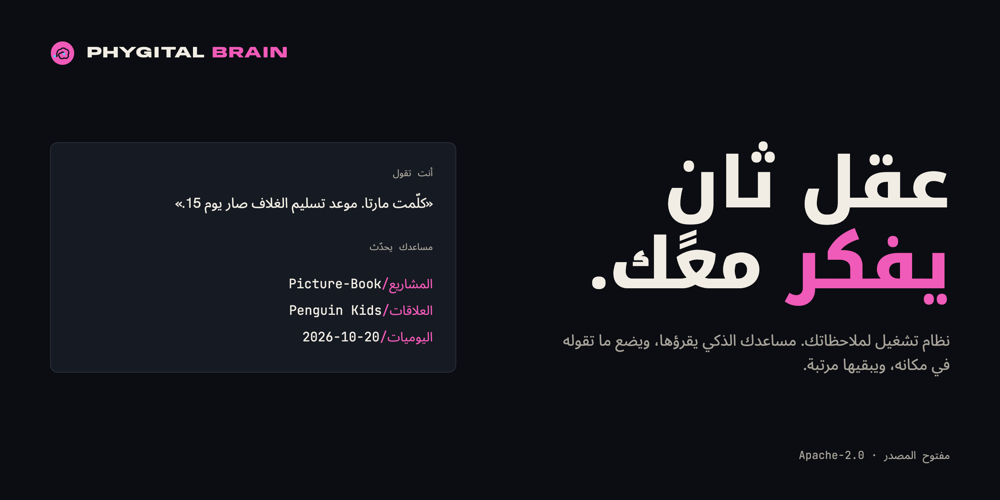
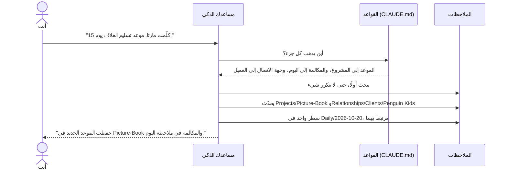
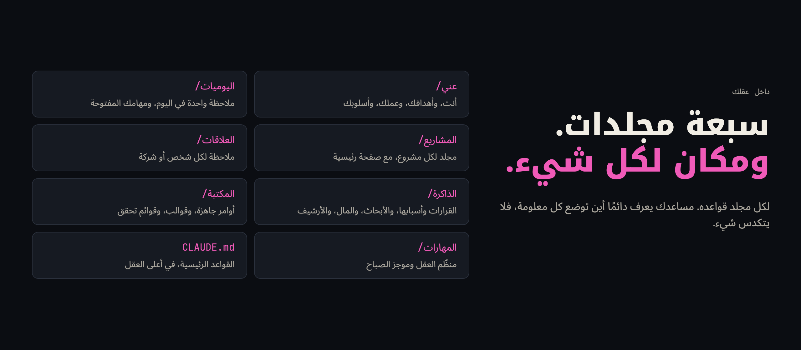
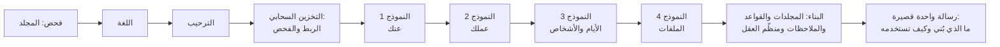
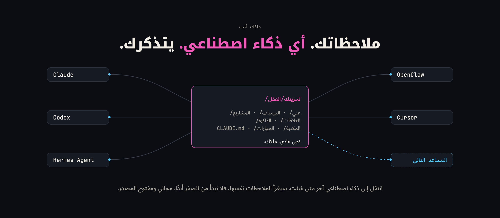

<p align="center"><a href="README.md">English</a> · <a href="README.zh-CN.md">简体中文</a> · <a href="README.pt-BR.md">Português (Brasil)</a> · <a href="README.es.md">Español</a> · <a href="README.fr.md">Français</a> · <a href="README.ja.md">日本語</a> · <b>العربية</b></p>

<p align="center" dir="rtl"><sub>هذه الصفحة مترجمة من الإنجليزية. إذا اختلف أي شيء، فالنسخة الإنجليزية هي المرجع. الأدلة المرتبطة هنا باللغة الإنجليزية.</sub></p>

<p align="center" dir="rtl"></p>

<h1 align="center">Phygital Brain</h1>

<p align="center" dir="rtl"><b>عقل ثانٍ يفكر معك.</b><br>نظام تشغيل (OS) لملاحظاتك: مجلد واحد في تخزينك السحابي، يقرؤه مساعدك الذكي ويكتب فيه ويبقيه مرتبًا. أربعة نماذج قصيرة تبنيه في حوالي عشر دقائق. بعدها تتكلم أنت، ومساعدك يضع ما تقوله في مكانه الصحيح.</p>

<p align="center">
<a href="#المصدر-المفتوح-ونسبة-العمل"></a>
<a href="LICENSE"></a>
<a href="https://www.npmjs.com/package/phygital-brain"></a>
<a href="#البدء-السريع"></a>
<a href="docs/install.md"></a>
<a href="CONTRIBUTING.md"></a>
</p>
<p align="center">
<a href="docs/other-agents.md"></a>
<a href="docs/getting-started.md#2-a-cloud-drive-folder"></a>
<a href="docs/how-it-works.md"></a>
<a href="SECURITY.md#what-you-share-with-your-ai"></a>
</p>
<p align="center">
<a href="https://github.com/Phygital-Brain/phygital-brain/stargazers"></a>
<a href="https://github.com/Phygital-Brain/phygital-brain/commits/main"></a>
<a href="https://www.npmjs.com/package/phygital-brain"></a>
<a href="#اللغات"></a>
</p>

<p align="center" dir="rtl">
<a href="#ما-هو">ما هو</a> ·
<a href="#ملكك-أنت">ملكك أنت</a> ·
<a href="#كيف-يعمل">كيف يعمل</a> ·
<a href="#البدء-السريع">البدء السريع</a> ·
<a href="#أسبوع-مع-عقلك">أسبوع معه</a> ·
<a href="#على-هاتفك">الهاتف</a> ·
<a href="#اللغات">اللغات</a> ·
<a href="#الخصوصية">الخصوصية</a> ·
<a href="docs/faq.md">الأسئلة الشائعة</a> ·
<a href="#كل-الأدلة">الأدلة</a>
</p>

## ما هو

Phygital Brain نظام تشغيل (OS) لملاحظاتك ولمساعدك الذكي. يبني مجلدًا واحدًا في تخزينك السحابي (Google Drive أو Nextcloud أو Dropbox أو أي تخزين يستطيع مساعدك الاتصال به)، وفيه ثلاثة أنواع من الأشياء:

- **القواعد:** ملف `CLAUDE.md` في كل مجلد. يخبر مساعدك أين يضع كل نوع من المعلومات، وكيف تبدأ كل ملاحظة، وما الذي يسألك عنه قبل أن يغيّر أي شيء.
- **الملاحظات:** ملفات Markdown بسيطة (ملفات نصية عادية بتنسيق خفيف) عنك وعن مشاريعك والأشخاص في حياتك وقراراتك وأيامك. يكتبها مساعدك وأنت تتكلم، ويربطها ببعضها.
- **منظّم العقل:** مهمة مجدولة ترتب العقل في كل يوم عمل، مع فحص شامل متى طلبته.

كل محادثة في هذا المجلد تبدأ بأن يقرأ مساعدك القواعد وآخر الملاحظات. لذلك يعرف مسبقًا اسمك وعملاءك وأهدافك وما فعلته أمس. يمكنك قراءة الملاحظات نفسها وتصفحها في [Baalda](https://github.com/naveedharri/baalda)، أو من هاتفك عبر تخزينك السحابي.

يأتي على شكل مهارتين (مجموعتا تعليمات يتبعها مساعدك): واحدة تبني العقل، والأخرى تبقيه مرتبًا. وتأتيان معًا في إضافة (plugin) لـ Claude، لأن Claude هو ما نستخدمه وننصح به، لكن أي مساعد يستطيع العمل داخل مجلد يمكنه اتباعهما. راجع [المساعدات الأخرى](docs/other-agents.md).

## ملكك أنت

- **أنت تملكه.** عقلك مجلد من ملفات نصية عادية في تخزينك السحابي. لا تحتاج إلى حساب لدينا، ولا إلى تصدير أي شيء.
- **خذه إلى أي ذكاء اصطناعي.** انتقل إلى مساعد آخر وافتح المجلد نفسه. المساعد الجديد يقرأ الملاحظات نفسها.
- **يتذكرك.** ما تقوله لمساعدك يُحفظ كملاحظات، لذلك تبدأ المحادثة التالية، أو الذكاء الاصطناعي التالي، من حيث توقفت.
- **مجاني ومفتوح المصدر.** يستطيع أي شخص أن يرى كيف يعمل. ملاحظاتك تبقى خاصة في تخزينك السحابي: Phygital Brain لا يجمع أي شيء، وملاحظاتك لا تذهب إلا إلى الذكاء الاصطناعي الذي تختاره.

## لماذا صنعناه

المحادثة مع الذكاء الاصطناعي تنتهي، ويذهب معها كل ما قلته. في المرة التالية تشرح من جديد عملك وعملاءك ومشروعك. والملاحظات التي تحتفظ بها موزعة على خمسة تطبيقات، ولا يتصل أي منها بمساعدك.

Phygital Brain يعطي المساعد مكانًا واحدًا يقرأ منه ويكتب فيه، مع قواعد يتبعها في كل مرة:

| بدونه | مع Phygital Brain |
|---|---|
| تشرح من أنت في كل محادثة جديدة | مساعدك يقرأ `About/me.md` قبل أن يجيب |
| ملاحظات المكالمات تضيع في محادثة لن تجدها مرة أخرى | المكالمة تُحفظ في المشروع وملاحظة العميل وملاحظة اليوم، وكلها مترابطة |
| تنسى لماذا اتخذت قرارًا ما | `Memory/decisions/` يحفظ القرار وسببه، وينبّهك لمراجعته بعد 30 يومًا |
| الملاحظات تتراكم وتصبح قديمة | منظّم العقل يغلق الملاحظات القديمة، وينبّهك إلى المشاريع المتوقفة، ويذكر ما يحتاج إلى تدخلك |
| مساعدك يغيّر الملفات بدون أن يسأل | يسأل قبل أن ينشئ أي شيء أو ينقله أو يغيّر اسمه أو يحذفه |

## كيف يعمل

<p align="center" dir="rtl"></p>

لكل جزء من نظام تشغيل الكمبيوتر جزء يقابله في عقلك:

| في الكمبيوتر | في Phygital Brain |
|---|---|
| المستخدم | أنت، تتكلم بكلمات عادية |
| المعالج الذي يقوم بالعمل | مساعدك الذكي |
| قواعد النظام | ملفات `CLAUDE.md`: ملف رئيسي واحد، وملف لكل مجلد |
| نظام الملفات | سبعة مجلدات من ملاحظات Markdown في تخزينك السحابي |
| الإعدادات | `About/me.md`: كيف تريد أن يعمل مساعدك، ولغتك، ومنطقتك الزمنية، وأيام عملك |
| خدمة تعمل في الخلفية | منظّم العقل، يعمل في كل يوم عمل |
| التطبيقات | المهارات: موجز الصباح، والفحص الشامل، وأي مهارة تضيفها |

هذا ما يحدث عندما تقول شيئًا لمساعدك:



التحديثات الصغيرة على ملاحظات موجودة تحدث فورًا، ويخبرك مساعدك بها في سطر واحد. أما الملاحظات الجديدة والنقل وتغيير الأسماء والحذف فتنتظر دائمًا موافقتك. المزيد في [كيف يعمل](docs/how-it-works.md).

## ماذا تحصل عليه

- **عقل مبني من إجاباتك.** من يبيع شيئًا يحصل على صفحات لنشاطه التجاري وخدماته وزبائنه. ومن لا يبيع لا يحصل على أي منها. موجز الصباح لا يظهر إلا إذا طلبته.
- **أسئلة مكتوبة لعملك.** النموذج الثاني يبدأ بثلاثة أسئلة يكتبها مساعدك لمهنتك. الرسام يُسأل عن دور النشر وكيف يحدد أسعاره، والمبرمج يُسأل عن مشاريعه وأدواته.
- **المشاريع والأشخاص والأيام، مترابطة.** كل شخص وشركة ومشروع هو رابط `[[link]]`، لذلك تنقلك نقرة واحدة في Baalda من المشروع إلى العميل إلى اليوم الذي تكلمتما فيه.
- **قرارات مع أسبابها.** كل ملاحظة قرار تقول ماذا اخترت، ولماذا، وما الذي تخليت عنه، وما المخاطرة. القرارات المفتوحة تظهر في ملاحظتك اليومية حتى تغلقها.
- **منظّم العقل.** في كل يوم عمل يجهّز ملاحظة الغد، ويغلق القديمة، ويجمع القرارات المفتوحة، ويصلح حتى 5 أشياء صغيرة، ويكتب تقريرًا. وفحص شامل يعمل متى قلت "افحص عقلي".
- **موجز الصباح،** إذا أردته: أهم ثلاثة أشياء لديك، وما تنتظره، وقرار واحد عليك اتخاذه.
- **التحضير للاجتماعات.** قل "حضّرني للقاء مارتا" لتحصل على موجز قصير من ملاحظاتك: متى تكلمتما آخر مرة، وما الذي يجري، وما الذي اتفقتما عليه، وما الذي تطرحه.
- **أدوات التفكير.** "ناقش فكرتي" يقارن فكرتك بملاحظاتك أنت. "ما الأنماط التي تراها؟" يجد ما يتكرر. "ابحث عن التناقضات" يجد الملاحظات التي لا تتفق.
- **تطبيقاتك، للقراءة فقط.** اربط Gmail وGoogle Calendar (أو Outlook وNextcloud وغيرها)، فيسجّل منظّم العقل رسائل الأمس مع الأشخاص في حياتك واجتماعات الغد. لا يرسل أي شيء ولا يغيّر أي شيء أبدًا.
- **يعمل بالكامل عبر الإنترنت، إذا أردت.** يمكن أن يعمل منظّم العقل كمهمة سحابية، يقرأ ملاحظاتك ويكتبها عبر تخزينك السحابي، وكمبيوترك مطفأ.
- **النسخ الاحتياطية والتراجع.** قبل أي تغيير كبير، ينسخ مساعدك الملفات إلى مجلد مخفي `.backups/` لمدة 10 أيام. وعبارة "تراجع عن آخر تغيير" تعيدها كما كانت.
- **ملاحظاتك القديمة، في أي وقت.** "انقل ملاحظاتي القديمة" يستورد من Notion وGoogle Docs وApple Notes وغيرها، بخطة توافق عليها أولًا.
- **الفرق.** شارك عقلًا واحدًا عبر سحابة Baalda، مع قسم للفريق في القواعد يحدد دور كل شخص.
- **هاتفك.** اسأل عقلك من تطبيق مساعدك على الهاتف عبر تخزينك السحابي، أو أرسل مهام إلى كمبيوترك (في Claude، عبر Dispatch).
- **لغتك.** النماذج والرسائل والملاحظات باللغة التي تختارها. وكذلك أسماء المجلدات والملاحظات. فقط بعض ملفات النظام، مثل `CLAUDE.md`، تبقى أسماؤها بالإنجليزية.
- **كتابة تشبهك.** كل عقل يأتي مع مهارة [no-ai-slop](https://github.com/petergyang/no-ai-slop). مساعدك يكتب بأسلوبك، ثم يبحث عن الأنماط التي تبدو مكتوبة بالذكاء الاصطناعي قبل أن يقرأ النص أي شخص آخر.
- **عادات عمل حذرة.** القواعد الرئيسية تتضمن إرشادات Andrej Karpathy للمساعدات الذكية: اسأل عندما لا تكون متأكدًا، واختر أبسط طريقة، وغيّر فقط ما يلزم، وراجع عملك.
- **قواعدك الخاصة.** عندما تصحح مساعدك، يحفظ التصحيح كقاعدة جديدة بكلماتك أنت. والتحديثات لا تغيّر هذه القواعد أبدًا.

## كيف يعمل مساعدك الذكي

<p align="center" dir="rtl"></p>

عادات العمل هي إرشادات Andrej Karpathy للمساعدات الذكية ([andrej-karpathy-skills](https://github.com/multica-ai/andrej-karpathy-skills))، مكتوبة بكلماتنا داخل القواعد الرئيسية لكل عقل. ومراجعة الكتابة تستخدم مهارة [no-ai-slop](https://github.com/petergyang/no-ai-slop)، التي يحصل عليها كل عقل في `Skills/no-ai-slop/`. المزيد في [القواعد الرئيسية](docs/folders/main-rules.md).

## داخل عقلك

<p align="center" dir="rtl"></p>

```
My Brain/
├── CLAUDE.md          القواعد الرئيسية
├── .claudeignore      ما لا يقرؤه مساعدك أبدًا إلا إذا طلبت
├── About/             me.md, goals.md, business.md, services.md, brand.md ...
├── Daily/             2026-10-20.md, 2026-10-21.md ... و tasks.md
├── Projects/          Picture-Book/README.md, Portfolio-Website/README.md ...
├── Relationships/     Clients/, Collaborators/, Team/, Partners/
├── Memory/            decisions/, research/, finances/ (خاص), archive/
├── Library/           الأوامر الجاهزة، القوالب، قوائم التحقق
└── Skills/            brain-keeper/, morning-brief/
```

لكل مجلد دليله الخاص: ما الذي يوضع فيه، وما الذي يمكنك قوله، وأمثلة، وقواعده. ابدأ من [المجلدات في عقلك](docs/folders/README.md).

## البدء السريع

<p align="center" dir="rtl"></p>

تحتاج إلى مساعد ذكي يستطيع العمل داخل مجلد، وتخزين سحابي يستطيع مساعدك الاتصال به، وكمبيوتر. بدون أي برمجة. ننصح بـ Claude مع Google Drive، فهذا هو الثنائي الذي جربناه أكثر، لذلك الخطوات أدناه تستخدمهما. الخطوات الكاملة، مع أنواع أخرى من التخزين والمساعدات، موجودة في [البداية](docs/getting-started.md).

| الخطوة | ماذا تفعل | الوقت |
|---|---|---|
| 1 | احصل على مساعدك: ننصح بـ [تطبيق Claude على الكمبيوتر](https://claude.ai/download) مع خطة مدفوعة | 3 دقائق |
| 2 | ثبّت تطبيق التخزين السحابي على الكمبيوتر (مثلًا Google Drive)، وأنشئ داخله مجلدًا لعقلك | 3 دقائق |
| 3 | في مساعدك، ابدأ مهمة واختر ذلك المجلد | دقيقة واحدة |
| 4 | اربط التخزين السحابي بمساعدك (في Claude: الإعدادات، ثم الموصلات)، حتى يصل هاتفك إلى العقل | دقيقة واحدة |
| 5 | نزّل [Baalda](https://github.com/naveedharri/baalda) وافتح المجلد نفسه | دقيقتان |
| 6 | ثبّت Phygital Brain (بنقرة واحدة، في الأسفل) وقل **"جهّز عقلي الثاني."** | 10 دقائق |

**التثبيت:** اضغط الزر الخاص بمساعدك.

<p align="center" dir="rtl">
<a href="https://github.com/Phygital-Brain/phygital-brain/releases/latest/download/phygital-brain.mcpb"></a>
<a href="docs/install.md#claude-code"></a>
<a href="https://cursor.com/en/install-mcp?name=phygital-brain&config=eyJjb21tYW5kIjoibnB4IiwiYXJncyI6WyIteSIsInBoeWdpdGFsLWJyYWluIl19"></a>
<br>
<a href="https://insiders.vscode.dev/redirect?url=vscode%3Amcp%2Finstall%3F%257B%2522name%2522%253A%2522phygital-brain%2522%252C%2522command%2522%253A%2522npx%2522%252C%2522args%2522%253A%255B%2522-y%2522%252C%2522phygital-brain%2522%255D%257D"></a>
<a href="docs/install.md#codex"></a>
<a href="docs/install.md#hermes-agent-and-openclaw"></a>
</p>

**أو من الطرفية (terminal)، لأي مساعد يستخدم المهارات** (Claude Code وCodex وCursor وGemini CLI وغيرها):

```bash
npx skills add Phygital-Brain/phygital-brain
```

يسألك إلى أي من مساعداتك تريد إضافته. Claude على الكمبيوتر وClaude Code لا يحتاجان إلى أي شيء آخر. الطرق الأخرى تحتاج إلى [Node.js](https://nodejs.org)، وتثبيته مجاني ومرة واحدة فقط.

كل الطرق، خطوة بخطوة: [التثبيت](docs/install.md).



في النهاية، يرحب بك مساعدك ويقدّم نفسه كمساعد شخصي لك، ويقترح عليك Baalda لتتصفح ملاحظاتك كأنها تطبيق.

## أسبوع مع عقلك

آنا رسامة تعيش في لشبونة. تبيع رسوم كتب الأطفال المصورة لدور النشر، وجهّزت عقلها يوم الاثنين.

- **الاثنين، 10:00.** تجيب عن النماذج الأربعة وتضيف سيرتها الذاتية وقائمة أسعارها. يبني مساعدها `About/me.md` و`goals.md` و`services.md` وثلاثة مشاريع وملاحظة لدار النشر التي تعمل فيها محررتها.
- **الثلاثاء، 08:00.** موجز الصباح يذكر ثلاثة أشياء: إرسال الرسومات الأولية، والرد على مخبز يريد شعارًا، وتحديد سعر الغلاف.
- **الثلاثاء، 15:00.** بعد مكالمة تقول: "مارتا تريد الغلاف قبل يوم 15." يُحدَّث المشروع وملاحظة العميل وملاحظة اليوم، وتترابط كلها.
- **الأربعاء، في الحافلة.** تسأل في تطبيق مساعدها على الهاتف: "على ماذا اتفقت أنا ومارتا يوم الثلاثاء؟" فيجد الملاحظة في تخزينها السحابي.
- **الخميس.** "قررت أن أرفع سعر الغلاف إلى 400 بدءًا من يناير." يسألها مساعدها قليلًا عن السبب، ثم يكتب `Memory/decisions/2026-10-23-raise-cover-price.md`.
- **كل يوم عمل، 07:00.** منظّم العقل يجهّز ملاحظة اليوم التالي، ويغلق القديمة، ويصلح الأشياء الصغيرة. وكل صباح يذكر قرار سعر الغلاف على أنه ما زال مفتوحًا، حتى تغلقه.

أشخاص آخرون، من صاحبة مخبز إلى طالب، تجدهم في [أمثلة الاستخدام](docs/use-cases.md).

## على هاتفك

| الطريقة | ماذا تفعل | كمبيوترك |
|---|---|---|
| **اسأل:** تطبيق مساعدك على الهاتف، مع ربط تخزينك السحابي | يجد ما في عقلك ويقرؤه | يمكن أن يكون مطفأً |
| **نفّذ:** أرسل مهمة إلى مساعدك على كمبيوترك (في Claude، عبر Dispatch) | يضيف الأشياء ويضعها في مكانها مع كل القواعد | يجب أن يكون مُشغَّلًا، وتطبيق مساعدك مفتوحًا |

الإعداد، وما الذي تقوله، وحلول المشاكل الشائعة: [عقلك على هاتفك](docs/phone.md).

## اللغات

Phygital Brain جاهز بـ **41 لغة**. اختر لغتك في بداية الإعداد، وسيُبنى العقل كله بها: النماذج، والقواعد، وأسماء المجلدات والملاحظات، ومنظّم العقل، وكل رسالة.

راجع [القائمة الكاملة للغات](languages/README.md#ready-languages).

**لغتك ليست هنا؟** اختر "أخرى" (Other) واكتب اسمها. سيترجم مساعدك العقل كله أثناء الإعداد، بما في ذلك أسماء المجلدات، بدون أن يسألك أي شيء. ولتصنع مجموعة لغة مُراجعة يستطيع كل من يتكلم لغتك استخدامها، قل:

> ترجم Phygital Brain إلى لغتي.

مهارة `add-language` تسألك ثلاثة أشياء (هل تريد مخاطبة رسمية أم غير رسمية، وأسماء المجلدات الرئيسية، والاسمين اللذين تريدهما لمنظّم العقل ولموجز الصباح)، ثم تترجم كل شيء، وتراجعه، وتريك كيف تستخدمه وتشاركه. كيف يعمل ذلك خطوة بخطوة: [اللغات](languages/README.md).

**التغيير لاحقًا:** قل "غيّر لغة عقلي إلى الإسبانية". يغيّر مساعدك أسماء المجلدات ويبدّل القواعد، بعد نسخة احتياطية وموافقتك.

## يعمل مع مساعدك الذكي

| | تطبيق Claude على الكمبيوتر | المساعدات التي تعمل داخل مجلد (Claude Code وCodex وHermes Agent وOpenClaw) | تطبيقات الدردشة التي لا تستطيع حفظ الملفات |
|---|---|---|---|
| بناء العقل | نعم | نعم | لا |
| نوافذ النماذج الأربعة | نعم | الأسئلة نفسها، في الدردشة | لا |
| الاستخدام اليومي | نعم | نعم | للقراءة فقط |
| منظّم العقل وموجز الصباح | نعم، بمواعيد مجدولة | إذا كان التطبيق يستطيع جدولة المهام | لا |

ملفات القواعد اسمها `CLAUDE.md`. المساعدات التي تبحث عن اسم آخر، مثل `AGENTS.md` في Codex، تحصل على ملف من سطر واحد يشير إلى `CLAUDE.md`، لذلك توجد مجموعة قواعد واحدة فقط. المزيد في [المساعدات الأخرى](docs/other-agents.md).

## الخصوصية

ملاحظاتك يقرؤها مساعدك الذكي، وتُحفظ في تخزينك السحابي. Phygital Brain نفسه ليس له خادم ولا يجمع أي شيء. المزيد في [ما تشاركه مع الذكاء الاصطناعي](SECURITY.md#what-you-share-with-your-ai).

- **البيانات الخاصة تبقى في مكان واحد.** الأرقام الضريبية، وبيانات البنك، وأرقام البطاقات، واسمك القانوني الكامل، وتاريخ ميلادك تبقى فقط في الملاحظة التي تحتاجها. مساعدك لا ينسخها أبدًا إلى ملاحظات أخرى، ولا يكررها أبدًا في رد.
- **قائمة "لا تقرأ أبدًا".** `.claudeignore` يشمل ملفات كلمات المرور والمفاتيح و`Memory/finances/`. لا يفتح مساعدك هذه إلا عندما تطلب ملفًا محددًا بالضبط. مساعدك يتبع هذا كقاعدة، لكن لا شيء مقفل.
- **لا أسرار في الملاحظات.** كلمات المرور والمفاتيح والرموز (tokens) مكانها مدير كلمات المرور.

## ما لا يقدمه

القائمة الكاملة في [الحدود](docs/limits.md).

- **ليس تطبيقًا.** لا يوجد شيء تشغّله. مساعدك الذكي يقوم بالعمل، متبعًا الملفات الموجودة في هذا المستودع.
- **لا قفل بعد.** القواعد تعمل فقط لأن مساعدك يتبعها. احتفظ بالأشياء السرية فعلًا خارج مجلد العقل. المجلدات المقفلة موجودة في [خطة التطوير](#خطة-التطوير).
- **لا يعمل طوال الوقت، إلا إذا نقلته إلى السحابة.** على كمبيوترك، يعمل منظّم العقل وموجز الصباح فقط عندما يكون تطبيق مساعدك مفتوحًا. وكمهمة سحابية، يعملان والكمبيوتر مطفأ.
- **إصدار مبكر.** هذا هو الإصدار 0.1.10، ولم يُجرَّب الإعداد مع كثير من الناس بعد.

## خطة التطوير

مخطط له، ولم يُبنَ بعد:

- **المجلدات المقفلة.** تختار المجلدات التي تريد قفلها، مثل `Memory/finances/`. تُشفَّر ملاحظاتها في تخزينك السحابي، فلا يستطيع أي تطبيق أو مساعد قراءتها بدونك. تفتحها بكلمة المرور أو ببصمة إصبعك، من المساعد الذي تستخدمه أصلًا، وفقط لما توافق عليه.

نرحب بالأفكار: افتح بلاغًا (issue) على GitHub.

## التحديث والمغادرة

**للتحديث:** حدّث الإضافة (في Claude Code: `/plugin marketplace update phygital-brain`)، ثم قل **"حدّث عقلي الثاني."** يعرض لك مساعدك ما الجديد ويسألك أولًا. ملاحظاتك وقواعدك الخاصة تبقى كما هي.

**لتغيير إجاباتك:** قل **"غيّر إجاباتي."** تُفتح النماذج من جديد، وتُحدَّث صفحات About الخاصة بك.

**للمغادرة:** أزل الإضافة. عقلك مجلد من ملفات نصية عادية في تخزينك السحابي. أي تطبيق يقرأ Markdown يستطيع فتحه.

## الأسئلة الشائعة

أكثر الأسئلة شيوعًا موجودة أدناه. القائمة الكاملة، مع 92 إجابة مقسمة حسب الموضوع، موجودة في [الأسئلة الشائعة](docs/faq.md).

<details dir="rtl">
<summary><b>هل أحتاج إلى معرفة البرمجة؟</b></summary>

لا. تثبّت بعض التطبيقات، وتجيب عن أربعة نماذج، وتتكلم بكلمات عادية. الأسطر الوحيدة التي تشبه البرمجة هي سطرا التثبيت الخاصان بـ Claude Code، ويمكنك لصقهما كما هما.
</details>

<details dir="rtl">
<summary><b>مع أي مساعدات ذكية يعمل؟</b></summary>

مع أي مساعد يستطيع قراءة الملفات وتعديلها وإنشاءها داخل مجلد على كمبيوترك. Claude هو ما نستخدمه وننصح به: هو الوحيد الذي يعرض الإعداد في نوافذ نماذج، ويستطيع جدولة منظّم العقل. Codex وHermes Agent وOpenClaw والمساعدات المشابهة تطرح الأسئلة نفسها في الدردشة. راجع [المساعدات الأخرى](docs/other-agents.md).
</details>

<details dir="rtl">
<summary><b>ما أنواع التخزين السحابي التي تعمل معه؟</b></summary>

أي تخزين يحتفظ بنسخة من المجلد على كمبيوترك ويستطيع مساعدك الاتصال به، حتى يقرأ الملفات ويعدّلها وينشئها هناك: Google Drive وNextcloud وDropbox وOneDrive وغيرها. لدى Claude موصل مدمج لـ Google Drive، أما أنواع التخزين الأخرى فتتصل عادة عبر خادم MCP. راجع [التخزين السحابي](docs/faq.md#cloud-drives).
</details>

<details dir="rtl">
<summary><b>هل سيغيّر ملاحظاتي بدون أن يسأل؟</b></summary>

يحفظ التحديثات الصغيرة على الملاحظات الموجودة ويخبرك بها في سطر واحد. ويسأل قبل أن ينشئ ملاحظة جديدة، أو يعيد كتابة ملاحظة، أو ينقل أي شيء أو يغيّر اسمه أو يحذفه. منظّم العقل لا يحذف ملاحظاتك أبدًا.
</details>

<details dir="rtl">
<summary><b>كم يكلف؟</b></summary>

Phygital Brain مجاني ومفتوح المصدر. تدفع مقابل مساعدك الذكي، ومقابل التخزين السحابي إذا احتجت إلى مساحة أكبر من المساحة المجانية.
</details>

## كل الأدلة

| الدليل | ماذا فيه |
|---|---|
| [أمثلة الاستخدام](docs/use-cases.md) | خمسة أشخاص، وكيف يبدو عقل كل منهم، وماذا يقولون في يوم عادي |
| [الأسئلة الشائعة](docs/faq.md) | 92 سؤالًا وجوابًا، مقسمة حسب الموضوع |
| [التثبيت](docs/install.md) | نقرة واحدة لـ Claude على الكمبيوتر وCursor وVS Code، وخطوات لـ Claude Code وCodex وHermes Agent وOpenClaw وغيرها |
| [البداية](docs/getting-started.md) | كل خطوة من الصفر حتى عقل يعمل، مع الفحوصات والحلول |
| [اربط تطبيقاتك](docs/connect-your-apps.md) | Gmail والتقويم وDrive وخدمات أخرى، للقراءة فقط، والعمل بالكامل عبر الإنترنت |
| [أضف مهارات أخرى](docs/add-skills.md) | إضافة أي مهارة إلى عقلك، وصنع الفيديوهات بـ [HyperFrames](https://github.com/heygen-com/hyperframes)، وصنع التصاميم بـ [Canva](https://www.canva.com) |
| [الفرق](docs/teams.md) | مشاركة عقل واحد عبر سحابة Baalda |
| [نقل ملاحظاتك القديمة](docs/importing.md) | التصدير من Notion وGoogle Docs وApple Notes وغيرها، ثم ترتيب كل شيء في مكانه |
| [مثال على عقل](docs/example-brain/README.md) | بعض الملاحظات المختلَقة، حتى ترى الملفات قبل أن تبني عقلك |
| [كيف يعمل](docs/how-it-works.md) | ماذا يفعل مساعدك في كل خطوة، ومتى يحفظ ومتى يسأل |
| [المجلدات في عقلك](docs/folders/README.md) | صفحة لكل مجلد ومجلد فرعي، مع أمثلة وقواعد |
| [القواعد الرئيسية](docs/folders/main-rules.md) | ملف `CLAUDE.md` الرئيسي، بكلمات بسيطة |
| [عقلك على هاتفك](docs/phone.md) | اسأل من تطبيق مساعدك على الهاتف، وأرسل مهام إلى كمبيوترك |
| [المساعدات الأخرى](docs/other-agents.md) | استخدام Codex أو Hermes Agent أو OpenClaw أو مساعد آخر، وأسماء ملفات القواعد، ومساعدان على عقل واحد |
| [اللغات](languages/README.md) | كيف تعمل اللغات الأخرى |
| [الحدود](docs/limits.md) | ما لا يجيده، أو ما لا يفعله بعد |
| [المصطلحات](docs/glossary.md) | كل مصطلح، بكلمات بسيطة |
| [الأمان والخصوصية](SECURITY.md) | ما تشاركه مع الذكاء الاصطناعي، وكيف تبلغ عن مشكلة |

## هذا المستودع

| المجلد | ماذا فيه |
|---|---|
| `skills/brain-setup/` | الإعداد: تعليمات المساعد، والنماذج الأربعة، وكل ملف يحصل عليه العقل الجديد |
| `skills/brain-keeper/` | منظّم العقل: الترتيب اليومي والفحص الشامل |
| `skills/add-language/` | صنع مجموعة كاملة بلغة جديدة، أو تغيير لغة عقل |
| `skills/brain-setup/i18n/` | مجموعات اللغات الجاهزة التي ينسخها الإعداد |
| `docs/` | الأدلة المذكورة أعلاه، والصور |
| `languages/` | الترجمات (ملف ومجلد لكل لغة) وطريقة إضافة لغة |
| `scripts/` | الفحوصات التي تشغّلها قبل أي تغيير (`python3 scripts/check.py`) |
| `.claude-plugin/` | ملفات الإضافة، لتثبيتها في Claude |
| `mcp/` | الموصل (خادم MCP بلا اعتماديات) للمساعدات التي تقبل خوادم MCP |
| `package.json` | حزمة npm، حتى يشغّل `npx -y phygital-brain` الموصل |
| `.github/workflows/` | ينشر كل إصدار جديد: على npm، وإصدار GitHub مع ملف Claude للكمبيوتر |

<p align="center" dir="rtl"></p>

## المساعدة والمساهمة

للأسئلة والأخطاء والأفكار: افتح بلاغًا (issue) على GitHub. لتغيير شيء ما، اقرأ [CONTRIBUTING.md](CONTRIBUTING.md) و[AGENTS.md](AGENTS.md). أبلغ عن مشاكل الأمان أو الخصوصية بشكل خاص، كما يشرح [SECURITY.md](SECURITY.md). وللإشارة إلى المشروع في المراجع، استخدم [CITATION.cff](CITATION.cff).

## المصدر المفتوح ونسبة العمل

مجاني ومفتوح المصدر بموجب [Apache License 2.0](LICENSE). احتفظ بملف [NOTICE](NOTICE): فيه السطر "Created by Phygital-Brain".

الترخيص لا يشمل الاسم والشعار (راجع [TRADEMARKS.md](TRADEMARKS.md)). يمكنك أن تقول إن عملك "مبني على Phygital Brain"، لكن لا يمكنك بيعه بهذا الاسم.

## بلا ضمان

يُقدَّم Phygital Brain كما هو، بدون أي نوع من الضمان (راجع البندين 7 و8 من [الترخيص](LICENSE)). أنت المسؤول عما تضعه في عقلك وما تشاركه مع مزوّد الذكاء الاصطناعي.
