<p align="center"><a href="README.md">English</a> · <a href="README.zh-CN.md">简体中文</a> · <a href="README.pt-BR.md">Português (Brasil)</a> · <b>Español</b> · <a href="README.fr.md">Français</a> · <a href="README.ja.md">日本語</a> · <a href="README.ar.md">العربية</a></p>
<p align="center"><sub>Traducido del inglés. Si algo no coincide, vale lo que dice el README en inglés. Las guías enlazadas aquí están en inglés.</sub></p>

<p align="center">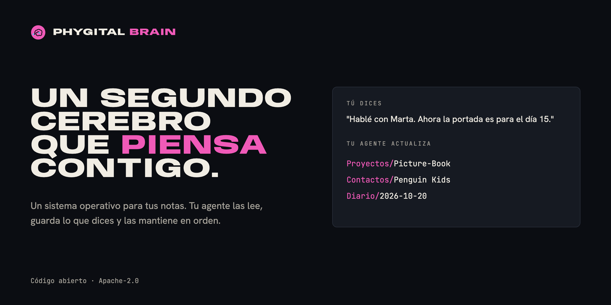</p>

<h1 align="center">Phygital Brain</h1>

<p align="center"><b>Un segundo cerebro que piensa contigo.</b><br>Un SO (sistema operativo) para tus notas: una carpeta en tu nube que tu agente de IA lee, escribe y mantiene en orden. Cuatro formularios cortos lo crean en unos diez minutos. Después, tú hablas y tu agente guarda lo que dices en el lugar correcto.</p>

<p align="center">
<a href="#código-abierto-y-créditos"></a>
<a href="LICENSE"></a>
<a href="https://www.npmjs.com/package/phygital-brain"></a>
<a href="#inicio-rápido"></a>
<a href="docs/install.md"></a>
<a href="CONTRIBUTING.md"></a>
</p>
<p align="center">
<a href="docs/other-agents.md"></a>
<a href="docs/getting-started.md#2-a-cloud-drive-folder"></a>
<a href="docs/how-it-works.md"></a>
<a href="SECURITY.md#what-you-share-with-your-ai"></a>
</p>
<p align="center">
<a href="https://github.com/Phygital-Brain/phygital-brain/stargazers"></a>
<a href="https://github.com/Phygital-Brain/phygital-brain/commits/main"></a>
<a href="https://www.npmjs.com/package/phygital-brain"></a>
<a href="#idiomas"></a>
</p>

<p align="center">
<a href="#qué-es">Qué es</a> ·
<a href="#tuyo-para-siempre">Tuyo para siempre</a> ·
<a href="#cómo-funciona">Cómo funciona</a> ·
<a href="#inicio-rápido">Inicio rápido</a> ·
<a href="#una-semana-con-tu-cerebro">Una semana con él</a> ·
<a href="#en-tu-móvil">Móvil</a> ·
<a href="#idiomas">Idiomas</a> ·
<a href="#privacidad">Privacidad</a> ·
<a href="docs/faq.md">Preguntas frecuentes</a> ·
<a href="#todas-las-guías">Guías</a>
</p>

## Qué es

Phygital Brain es un SO (sistema operativo) para tus notas y tu agente de IA. Crea una carpeta en tu nube (Google Drive, Nextcloud, Dropbox o cualquier nube a la que se pueda conectar tu agente) con tres tipos de cosas dentro:

- **Reglas:** un archivo `CLAUDE.md` en cada carpeta. Le dice a tu agente dónde va cada tipo de información, cómo empieza cada nota y qué tiene que preguntarte antes de cambiar algo.
- **Notas:** archivos Markdown simples (archivos de texto con un poco de formato) sobre ti, tus proyectos, tu gente, tus decisiones y tus días. Tu agente los escribe mientras hablas y los enlaza entre sí.
- **El Guardián del Cerebro:** una tarea programada que ordena el cerebro cada día laborable, más una revisión completa cuando la pidas.

Cada chat en esa carpeta empieza con tu agente leyendo las reglas y las notas más recientes. Así ya sabe tu nombre, tus clientes, tus objetivos y lo que hiciste ayer. Puedes leer y recorrer esas mismas notas en [Baalda](https://github.com/naveedharri/baalda), o desde el móvil a través de tu nube.

Viene como dos habilidades (conjuntos de instrucciones que sigue tu agente): una crea el cerebro y la otra lo mantiene en orden. Vienen empaquetadas como un plugin de Claude, porque Claude es lo que usamos y recomendamos, pero cualquier agente que pueda trabajar en una carpeta puede seguirlas. Mira [Otros agentes](docs/other-agents.md).

## Tuyo para siempre

- **Es tuyo.** Tu cerebro es una carpeta de archivos de texto simple en tu propia nube. No necesitas una cuenta con nosotros y no hay nada que exportar.
- **Llévalo a cualquier IA.** Cambia de agente y abre la misma carpeta. El nuevo lee las mismas notas.
- **Se acuerda de ti.** Lo que le cuentas a tu agente se guarda como notas, así que el próximo chat, o la próxima IA, sigue donde lo dejaste.
- **Gratis y de código abierto.** Cualquiera puede ver cómo funciona. Tus notas siguen siendo privadas, en tu nube: Phygital Brain no recopila nada, y tus notas solo van a la IA que tú elijas.

## Por qué existe

Un chat con una IA se termina, y lo que le contaste se va con él. La próxima vez vuelves a explicar tu negocio, tus clientes y tu proyecto. Las notas que sí guardas están repartidas en cinco apps, y ninguna habla con tu agente.

Phygital Brain le da al agente un solo lugar donde leer y escribir, con reglas que sigue siempre:

| Sin él | Con Phygital Brain |
|---|---|
| Explicas quién eres en cada chat nuevo | Tu agente lee `About/me.md` antes de responder |
| Las notas de una llamada se quedan en un chat que nunca volverás a encontrar | La llamada va al proyecto, a la nota del cliente y a la nota del día, enlazadas |
| Olvidas por qué tomaste una decisión | `Memory/decisions/` guarda la decisión y el motivo, y la marca para revisarla a los 30 días |
| Las notas se acumulan y se quedan viejas | El Guardián del Cerebro cierra notas antiguas, marca proyectos parados y te dice qué necesita tu atención |
| Tu agente cambia archivos sin preguntar | Pregunta antes de crear, mover, renombrar o borrar cualquier cosa |

## Cómo funciona

<p align="center">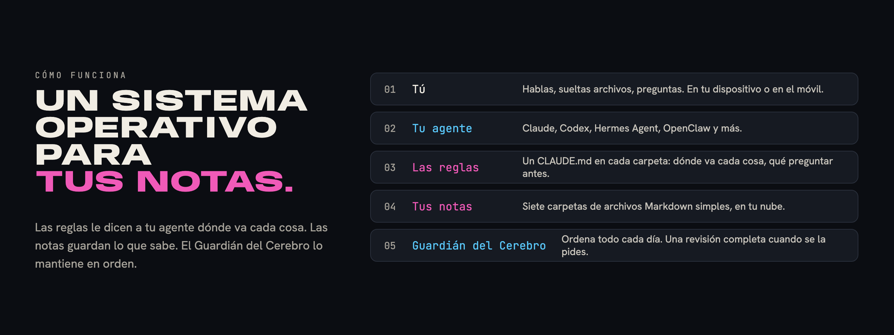</p>

Cada parte del sistema operativo de una computadora tiene su equivalente en tu cerebro:

| En una computadora | En Phygital Brain |
|---|---|
| El usuario | Tú, hablando con palabras normales |
| El procesador que hace el trabajo | Tu agente de IA |
| Las reglas del sistema | Archivos `CLAUDE.md`: uno principal y uno por carpeta |
| El sistema de archivos | Siete carpetas de notas Markdown en tu nube |
| La configuración | `About/me.md`: cómo quieres que trabaje tu agente, tu idioma, tu zona horaria y tus días laborables |
| Un servicio en segundo plano | El Guardián del Cerebro, que funciona cada día laborable |
| Las apps | Habilidades: el resumen de la mañana, la revisión completa y cualquier habilidad que añadas |

Esto es lo que pasa cuando le cuentas algo a tu agente:

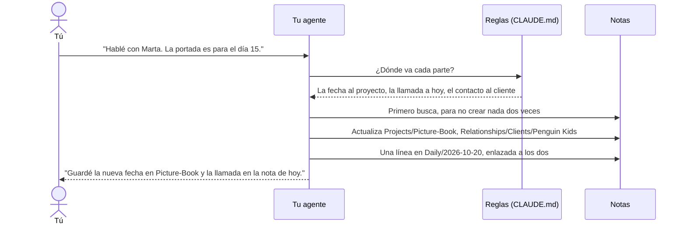

Los cambios pequeños en notas que ya existen se hacen al momento, y tu agente te lo cuenta en una línea. Crear notas nuevas, moverlas, renombrarlas o borrarlas siempre espera tu sí. Más en [Cómo funciona](docs/how-it-works.md).

## Qué incluye

- **Un cerebro hecho con tus respuestas.** Si vendes algo, tienes páginas para tu negocio, tus servicios y tu clientela. Si no vendes, no tienes ninguna de esas. El resumen de la mañana solo aparece si lo pides.
- **Preguntas pensadas para tu trabajo.** El segundo formulario empieza con tres preguntas que tu agente escribe para tu trabajo. A una ilustradora le pregunta por las editoriales y cómo cobra; a un desarrollador, por sus proyectos y herramientas.
- **Proyectos, personas y días, enlazados.** Cada persona, empresa y proyecto es un `[[enlace]]`, así que con un clic en Baalda pasas de un proyecto al cliente y al día en que hablaron.
- **Decisiones con su motivo.** Cada nota de decisión dice qué elegiste, por qué, a qué renunciaste y el riesgo. Las decisiones abiertas aparecen en tu nota del día hasta que las cierras.
- **El Guardián del Cerebro.** Cada día laborable crea la nota de mañana, cierra las antiguas, lista las decisiones abiertas, arregla hasta 5 cosas pequeñas y escribe un informe. Hace una revisión completa cuando dices "revisa mi cerebro".
- **Un resumen de la mañana,** si lo quieres: tus tres cosas más importantes, lo que estás esperando y una decisión por tomar.
- **Preparar reuniones.** Di "prepárame la reunión con Marta" y recibe un resumen corto sacado de tus notas: cuándo hablaron por última vez, qué está pasando, qué acordaron y qué sacar en la reunión.
- **Herramientas para pensar.** "Cuestiona mi idea" la compara con tus propias notas. "¿Qué patrones ves?" encuentra lo que se repite. "Busca contradicciones" encuentra notas que se contradicen.
- **Tus apps, solo lectura.** Conecta Gmail y Google Calendar (u Outlook, Nextcloud y otras) y el Guardián del Cerebro anota los correos de ayer con tu gente y las reuniones de mañana. Nunca envía ni cambia nada.
- **Todo en línea, si quieres.** El Guardián del Cerebro puede funcionar como una rutina en la nube, leyendo y escribiendo tus notas a través de tu nube, con tu computadora apagada.
- **Copias de seguridad y deshacer.** Antes de un cambio grande, tu agente copia los archivos en una carpeta oculta, `.backups/`, y los guarda 10 días. "Deshaz el último cambio" los devuelve.
- **Notas antiguas, cuando quieras.** "Trae mis notas antiguas" importa desde Notion, Google Docs, Apple Notes y otras, con un plan que apruebas antes.
- **Equipos.** Comparte un cerebro a través de la nube de Baalda, con una sección Equipo en las reglas para el rol de cada persona.
- **Tu móvil.** Pregúntale cosas a tu cerebro desde la app de tu agente en el móvil, a través de tu nube, o envía tareas a tu computadora (en Claude, con Dispatch).
- **Tu idioma.** Los formularios, los mensajes y las notas están en el idioma que elijas. Los nombres de las carpetas y de las notas, también. Solo algunos archivos del sistema, como `CLAUDE.md`, mantienen su nombre en inglés.
- **Textos que suenan a ti.** Cada cerebro viene con la habilidad [no-ai-slop](https://github.com/petergyang/no-ai-slop). Tu agente escribe con tu voz y luego busca lo que suena a IA antes de que nadie más lo lea.
- **Buenos hábitos de trabajo.** Las reglas principales incluyen las pautas de Andrej Karpathy para asistentes de IA: preguntar si hay dudas, elegir la forma más simple, cambiar solo lo necesario y revisar el trabajo.
- **Tus propias reglas.** Cuando corriges a tu agente, guarda la corrección como una regla nueva, con tus palabras. Las actualizaciones nunca cambian esas reglas.

## Cómo trabaja tu agente

<p align="center"></p>

Los hábitos de trabajo son las pautas de Andrej Karpathy para asistentes de IA ([andrej-karpathy-skills](https://github.com/multica-ai/andrej-karpathy-skills)), incluidas con nuestras propias palabras en las reglas principales de cada cerebro. El Control de Escritura usa la habilidad [no-ai-slop](https://github.com/petergyang/no-ai-slop), que cada cerebro recibe en `Skills/no-ai-slop/`. Más en [Reglas principales](docs/folders/main-rules.md).

## Dentro de tu cerebro

<p align="center"></p>

```
My Brain/
├── CLAUDE.md          las reglas principales
├── .claudeignore      lo que tu agente nunca lee a menos que se lo pidas
├── About/             me.md, goals.md, business.md, services.md, brand.md ...
├── Daily/             2026-10-20.md, 2026-10-21.md ... y tasks.md
├── Projects/          Picture-Book/README.md, Portfolio-Website/README.md ...
├── Relationships/     Clients/, Collaborators/, Team/, Partners/
├── Memory/            decisions/, research/, finances/ (privada), archive/
├── Library/           prompts, plantillas, listas de control
└── Skills/            brain-keeper/, morning-brief/
```

Cada carpeta tiene su propia guía: qué va dentro, qué puedes decir, ejemplos y sus reglas. Empieza en [Las carpetas de tu cerebro](docs/folders/README.md).

## Inicio rápido

<p align="center"></p>

Necesitas un agente de IA que pueda trabajar en una carpeta, una nube a la que se pueda conectar tu agente y una computadora. Sin código. Recomendamos Claude con Google Drive, la combinación que más probamos, así que los pasos de abajo usan esos dos. Los pasos completos, con otras nubes y agentes, están en [Primeros pasos](docs/getting-started.md).

| Paso | Qué haces | Tiempo |
|---|---|---|
| 1 | Consigue tu agente: recomendamos la [app de escritorio de Claude](https://claude.ai/download) con un plan de pago | 3 min |
| 2 | Instala la app de escritorio de tu nube (por ejemplo Google Drive) y crea dentro una carpeta para tu cerebro | 3 min |
| 3 | En tu agente, empieza una tarea y elige esa carpeta | 1 min |
| 4 | Conecta la nube a tu agente (en Claude: Configuración, Conectores), para que puedas usar el cerebro desde el móvil | 1 min |
| 5 | Descarga [Baalda](https://github.com/naveedharri/baalda) y abre la misma carpeta | 2 min |
| 6 | Instala Phygital Brain (con un clic, abajo) y di **"Configura mi segundo cerebro."** | 10 min |

**Instalar:** haz clic en el botón de tu agente.

<p align="center">
<a href="https://github.com/Phygital-Brain/phygital-brain/releases/latest/download/phygital-brain.mcpb">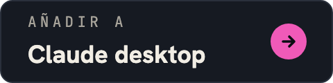</a>
<a href="docs/install.md#claude-code">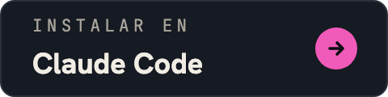</a>
<a href="https://cursor.com/en/install-mcp?name=phygital-brain&config=eyJjb21tYW5kIjoibnB4IiwiYXJncyI6WyIteSIsInBoeWdpdGFsLWJyYWluIl19">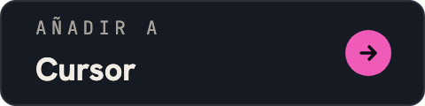</a>
<br>
<a href="https://insiders.vscode.dev/redirect?url=vscode%3Amcp%2Finstall%3F%257B%2522name%2522%253A%2522phygital-brain%2522%252C%2522command%2522%253A%2522npx%2522%252C%2522args%2522%253A%255B%2522-y%2522%252C%2522phygital-brain%2522%255D%257D">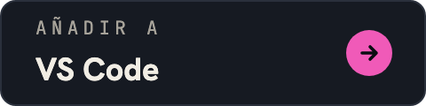</a>
<a href="docs/install.md#codex">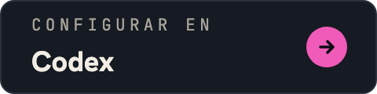</a>
<a href="docs/install.md#hermes-agent-and-openclaw">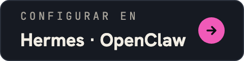</a>
</p>

**O en una terminal, para cualquier agente que use habilidades** (Claude Code, Codex, Cursor, Gemini CLI y otros):

```bash
npx skills add Phygital-Brain/phygital-brain
```

Te pregunta a cuáles de tus agentes añadirlo. Claude desktop y Claude Code no necesitan nada más. Las otras formas necesitan [Node.js](https://nodejs.org), que se instala una sola vez y es gratis.

Todas las formas, paso a paso: [Instalación](docs/install.md).

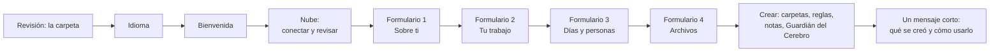

Al final, tu agente te da la bienvenida como tu asistente personal y te ofrece Baalda para ver tus notas como en una app.

## Una semana con tu cerebro

Ana es ilustradora en Lisboa. Vende ilustraciones de libros infantiles a editoriales y configuró su cerebro el lunes.

- **Lunes, 10:00.** Responde los cuatro formularios y sube su CV y su lista de precios. Su agente crea `About/me.md`, `goals.md`, `services.md`, tres proyectos y una nota para la editorial de su editora.
- **Martes, 08:00.** Su resumen de la mañana trae tres cosas: enviar los bocetos, responder a una panadería sobre un logo y decidir el precio de sus portadas.
- **Martes, 15:00.** Después de una llamada dice: "Marta quiere la portada para el día 15." El proyecto, la nota del cliente y el día se actualizan y quedan enlazados.
- **Miércoles, en el autobús.** En la app de su agente en el móvil pregunta: "¿Qué acordamos Marta y yo el martes?" Encuentra la nota en su nube.
- **Jueves.** "Decidí subir el precio de mis portadas a 400 a partir de enero." Su agente le pregunta un poco por qué y luego escribe `Memory/decisions/2026-10-23-raise-cover-price.md`.
- **Cada día laborable, 07:00.** El Guardián del Cerebro crea la nota del día siguiente, cierra las antiguas y arregla cosas pequeñas. Cada mañana muestra la decisión del precio de las portadas como abierta, hasta que ella la cierra.

Más personas, desde la dueña de una panadería hasta un estudiante, en [Casos de uso](docs/use-cases.md).

## En tu móvil

| Forma | Qué hace | Tu computadora |
|---|---|---|
| **Preguntar:** la app de tu agente en el móvil, con tu nube conectada | Busca y lee lo que hay en tu cerebro | Puede estar apagada |
| **Hacer:** enviar una tarea a tu agente en tu computadora (en Claude, Dispatch) | Añade y guarda cosas siguiendo todas las reglas | Tiene que estar encendida, con la app de tu agente abierta |

Configuración, qué decir y cómo arreglar los problemas más comunes: [Tu cerebro en el móvil](docs/phone.md).

## Idiomas

Phygital Brain está listo en **41 idiomas**. Elige el tuyo al empezar la configuración y todo el cerebro se crea en ese idioma: los formularios, las reglas, los nombres de carpetas y notas, el Guardián del Cerebro y cada mensaje.

Mira [la lista completa de idiomas](languages/README.md#ready-languages).

**¿No está tu idioma?** Elige Otro y escríbelo. Tu agente traduce todo el cerebro durante la configuración, nombres de carpetas incluidos, sin preguntarte nada. Para crear una versión revisada que pueda usar cualquiera que hable tu idioma, di:

> Traduce Phygital Brain a mi idioma.

La habilidad `add-language` te pregunta tres cosas (si tratar de "tú" o de "usted", los nombres de las carpetas principales y los nombres del Guardián del Cerebro y del resumen de la mañana), lo traduce todo, lo revisa y te muestra cómo usarlo y compartirlo. Cómo funciona, paso a paso: [Idiomas](languages/README.md).

**Para cambiar más adelante:** di "Pasa mi cerebro a portugués". Tu agente renombra las carpetas y cambia las reglas, haciendo antes una copia de seguridad y con tu sí.

## Funciona con tu agente

| | App de escritorio de Claude | Agentes que trabajan en una carpeta (Claude Code, Codex, Hermes Agent, OpenClaw) | Apps de chat que no pueden guardar archivos |
|---|---|---|---|
| Crear el cerebro | Sí | Sí | No |
| Las cuatro ventanas de formularios | Sí | Las mismas preguntas, en el chat | No |
| Uso diario | Sí | Sí | Solo lectura |
| Guardián del Cerebro y resumen de la mañana | Sí, programados | Si la app puede programar tareas | No |

Los archivos de reglas se llaman `CLAUDE.md`. Los agentes que buscan otro nombre, como `AGENTS.md` en Codex, reciben un archivo de una línea que apunta a `CLAUDE.md`, así que solo hay un conjunto de reglas. Más en [Otros agentes](docs/other-agents.md).

## Privacidad

Tus notas las lee tu agente de IA y se guardan en tu nube. Phygital Brain no tiene servidor y no recopila nada. Más en [Lo que compartes con tu IA](SECURITY.md#what-you-share-with-your-ai).

- **Los datos privados se quedan en un solo lugar.** Números fiscales, datos bancarios, números de tarjeta, tu nombre legal completo y tu fecha de nacimiento están solo en la nota que los necesita. Tu agente nunca los copia a otras notas y nunca los repite en una respuesta.
- **Una lista de "no leer nunca".** `.claudeignore` incluye los archivos de contraseñas y claves y `Memory/finances/`. Tu agente solo los abre cuando le pides un archivo concreto. Tu agente lo sigue como una regla, pero nada está bloqueado.
- **Nada de secretos en las notas.** Las contraseñas, claves y tokens van en un gestor de contraseñas.

## Lo que no es

La lista completa está en [Límites](docs/limits.md).

- **No es una app.** No hay nada que ejecutar. Tu agente de IA hace el trabajo, siguiendo los archivos de este repositorio.
- **Todavía sin bloqueo.** Las reglas funcionan solo porque tu agente las sigue. Guarda lo que sea realmente secreto fuera de la carpeta del cerebro. Las carpetas bloqueadas están en la [hoja de ruta](#hoja-de-ruta).
- **No siempre está activo, a menos que lo pases a la nube.** En tu computadora, el Guardián del Cerebro y el resumen de la mañana solo funcionan mientras la app de tu agente está abierta. Como rutina en la nube, funcionan con la computadora apagada.
- **Una versión temprana.** Esta es la versión 0.1.11, y la configuración todavía no se ha probado con mucha gente.

## Hoja de ruta

Planeado, todavía sin hacer:

- **Carpetas bloqueadas.** Tú eliges qué carpetas bloquear, como `Memory/finances/`. Sus notas se cifran en tu nube, así que ninguna app ni agente puede leerlas sin ti. Las desbloqueas con tu contraseña o tu huella, desde el agente que ya usas, y solo para lo que apruebes.

Las ideas son bienvenidas: abre un issue en GitHub.

## Actualizar y salir

**Para actualizar:** actualiza el plugin (en Claude Code, `/plugin marketplace update phygital-brain`) y luego di **"Actualiza mi segundo cerebro."** Tu agente te muestra las novedades y te pregunta antes. Tus notas y tus propias reglas se quedan como están.

**Para cambiar tus respuestas:** di **"Cambia mis respuestas."** Los formularios se abren otra vez y se actualizan tus páginas de `About/`.

**Para irte:** desinstala el plugin. Tu cerebro es una carpeta de archivos de texto simple en tu propia nube. Cualquier app que lea Markdown puede abrirla.

## Preguntas frecuentes

Abajo están las preguntas más comunes. La lista completa, con 92 respuestas agrupadas por tema, está en las [Preguntas frecuentes](docs/faq.md).

<details>
<summary><b>¿Necesito saber programar?</b></summary>

No. Instalas unas cuantas apps, respondes cuatro formularios y hablas con palabras normales. Lo único que parece código son las dos líneas de instalación para Claude Code, y puedes pegarlas.
</details>

<details>
<summary><b>¿Con qué agentes de IA funciona?</b></summary>

Con cualquier agente que pueda leer, editar y crear archivos en una carpeta de tu computadora. Claude es lo que usamos y recomendamos: es el único que muestra la configuración en ventanas de formularios y puede programar el Guardián del Cerebro. Codex, Hermes Agent, OpenClaw y agentes parecidos hacen las mismas preguntas en el chat. Mira [Otros agentes](docs/other-agents.md).
</details>

<details>
<summary><b>¿Qué nubes funcionan?</b></summary>

Cualquier nube que guarde una copia de la carpeta en tu computadora y a la que se pueda conectar tu agente, para que pueda leer, editar y crear archivos ahí: Google Drive, Nextcloud, Dropbox, OneDrive y otras. Claude tiene un conector de Google Drive integrado; las demás nubes suelen conectarse a través de un servidor MCP. Mira [Nubes](docs/faq.md#cloud-drives).
</details>

<details>
<summary><b>¿Va a cambiar mis notas sin preguntar?</b></summary>

Guarda los cambios pequeños en notas que ya existen y te lo cuenta en una línea. Pregunta antes de crear una nota nueva, reescribir una, o mover, renombrar o borrar cualquier cosa. El Guardián del Cerebro nunca borra tus notas.
</details>

<details>
<summary><b>¿Cuánto cuesta?</b></summary>

Phygital Brain es gratis y de código abierto. Pagas tu agente de IA y, si necesitas más espacio del gratuito, tu nube.
</details>

## Todas las guías

| Guía | Qué tiene |
|---|---|
| [Casos de uso](docs/use-cases.md) | Cinco personas, cómo es su cerebro y qué dicen en un día normal |
| [Preguntas frecuentes](docs/faq.md) | 92 preguntas y respuestas, agrupadas por tema |
| [Instalación](docs/install.md) | Un clic para Claude desktop, Cursor y VS Code, y pasos para Claude Code, Codex, Hermes Agent, OpenClaw y otros |
| [Primeros pasos](docs/getting-started.md) | Cada paso, de cero a un cerebro que funciona, con comprobaciones y arreglos |
| [Conecta tus apps](docs/connect-your-apps.md) | Gmail, Calendar, Drive y otros servicios, solo lectura, y funcionando todo en línea |
| [Añade más habilidades](docs/add-skills.md) | Cómo añadir cualquier habilidad a tu cerebro, hacer vídeos con [HyperFrames](https://github.com/heygen-com/hyperframes) y crear diseños con [Canva](https://www.canva.com) |
| [Equipos](docs/teams.md) | Compartir un cerebro a través de la nube de Baalda |
| [Trae tus notas antiguas](docs/importing.md) | Exportar desde Notion, Google Docs, Apple Notes y otras, y ordenarlo todo |
| [Cerebro de ejemplo](docs/example-brain/README.md) | Unas cuantas notas inventadas, para que veas los archivos antes de crear el tuyo |
| [Cómo funciona](docs/how-it-works.md) | Qué hace tu agente en cada paso, cuándo guarda y cuándo pregunta |
| [Las carpetas de tu cerebro](docs/folders/README.md) | Una página por carpeta y subcarpeta, con ejemplos y reglas |
| [Reglas principales](docs/folders/main-rules.md) | El `CLAUDE.md` principal, con palabras sencillas |
| [Tu cerebro en el móvil](docs/phone.md) | Pregunta desde la app de tu agente en el móvil, envía tareas a tu computadora |
| [Otros agentes](docs/other-agents.md) | Usar Codex, Hermes Agent, OpenClaw u otro agente, nombres de los archivos de reglas, dos agentes en un cerebro |
| [Idiomas](languages/README.md) | Cómo funcionan los demás idiomas |
| [Límites](docs/limits.md) | Lo que hace mal, o todavía no hace |
| [Glosario](docs/glossary.md) | Cada término, con palabras sencillas |
| [Seguridad y privacidad](SECURITY.md) | Lo que compartes con tu IA y cómo avisar de un problema |

## Este repositorio

| Carpeta | Qué hay |
|---|---|
| `skills/brain-setup/` | La configuración: las instrucciones del agente, los cuatro formularios y cada archivo que recibe un cerebro nuevo |
| `skills/brain-keeper/` | El Guardián del Cerebro: el orden diario y la revisión completa |
| `skills/add-language/` | Crear una versión completa en un idioma nuevo, o cambiar el idioma de un cerebro |
| `skills/brain-setup/i18n/` | Las versiones de idioma ya hechas que copia la configuración |
| `docs/` | Las guías de arriba y las imágenes |
| `languages/` | Las traducciones (un archivo y una carpeta por idioma) y cómo añadir una |
| `scripts/` | Las comprobaciones que hay que ejecutar antes de un cambio (`python3 scripts/check.py`) |
| `.claude-plugin/` | Los archivos del plugin, para instalarlo en Claude |
| `mcp/` | El conector (un servidor MCP, sin dependencias) para agentes que aceptan servidores MCP |
| `package.json` | El paquete de npm, para que `npx -y phygital-brain` ejecute el conector |
| `.github/workflows/` | Publica cada versión nueva: en npm, y en GitHub con el archivo para Claude desktop |

<p align="center">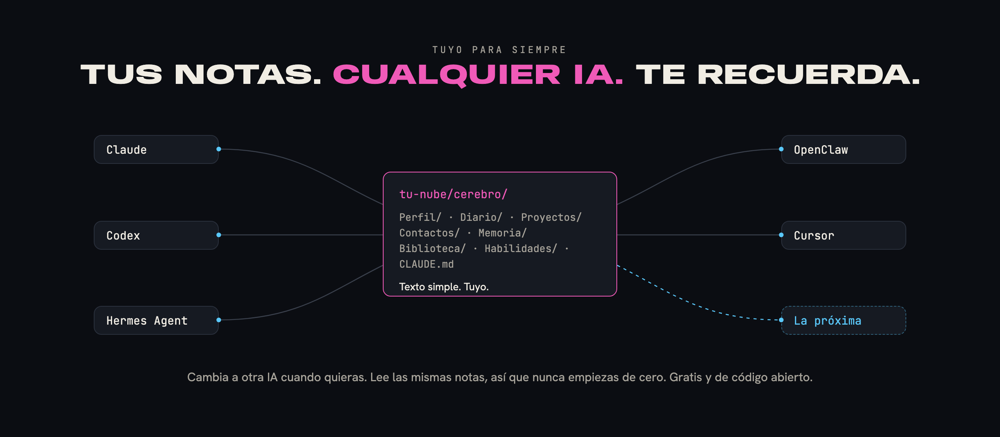</p>

## Ayuda y contribuciones

Preguntas, errores e ideas: abre un issue en GitHub. Para cambiar algo, lee [CONTRIBUTING.md](CONTRIBUTING.md) y [AGENTS.md](AGENTS.md). Avisa de los problemas de seguridad o privacidad en privado, como explica [SECURITY.md](SECURITY.md). Para citar el proyecto, usa [CITATION.cff](CITATION.cff).

## Código abierto y créditos

Gratis y de código abierto bajo la [Apache License 2.0](LICENSE). Conserva el archivo [NOTICE](NOTICE): lleva la línea "Created by Phygital-Brain".

La licencia no cubre el nombre ni el logo (mira [TRADEMARKS.md](TRADEMARKS.md)). Puedes decir que tu trabajo está "basado en Phygital Brain", pero no puedes venderlo con ese nombre.

## Sin garantía

Phygital Brain se ofrece tal cual, sin garantía de ningún tipo (mira las secciones 7 y 8 de la [licencia](LICENSE)). Tú eres responsable de lo que pones en tu cerebro y de lo que compartes con tu proveedor de IA.
