<p align="center"><a href="README.md">English</a> · <a href="README.zh-CN.md">简体中文</a> · <a href="README.pt-BR.md">Português (Brasil)</a> · <a href="README.es.md">Español</a> · <b>Français</b> · <a href="README.ja.md">日本語</a> · <a href="README.ar.md">العربية</a></p>

<p align="center"><sub>Traduit de l'anglais. En cas de différence, c'est le README anglais qui fait foi. Les guides cités ici sont en anglais.</sub></p>

<p align="center">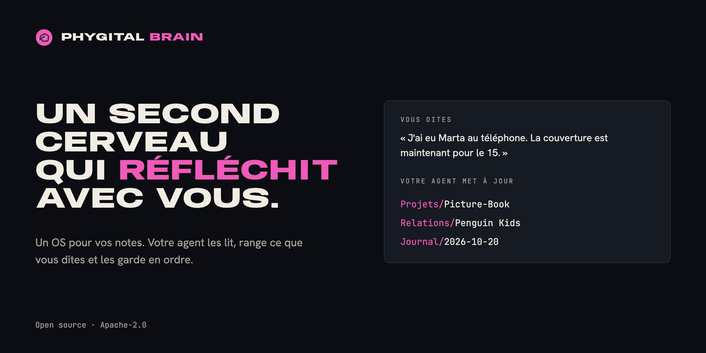</p>

<h1 align="center">Phygital Brain</h1>

<p align="center"><b>Un second cerveau qui réfléchit avec vous.</b><br>Un OS (système d'exploitation) pour vos notes : un seul dossier dans votre cloud, que votre agent IA lit, écrit et garde en ordre. Quatre petits formulaires le créent en dix minutes environ. Ensuite, vous parlez, et votre agent range ce que vous dites au bon endroit.</p>

<p align="center">
<a href="#open-source-et-crédits"></a>
<a href="LICENSE"></a>
<a href="https://www.npmjs.com/package/phygital-brain"></a>
<a href="#démarrage-rapide"></a>
<a href="docs/install.md"></a>
<a href="CONTRIBUTING.md"></a>
</p>
<p align="center">
<a href="docs/other-agents.md"></a>
<a href="docs/getting-started.md#2-a-cloud-drive-folder"></a>
<a href="docs/how-it-works.md"></a>
<a href="SECURITY.md#what-you-share-with-your-ai"></a>
</p>
<p align="center">
<a href="https://github.com/Phygital-Brain/phygital-brain/stargazers"></a>
<a href="https://github.com/Phygital-Brain/phygital-brain/commits/main"></a>
<a href="https://www.npmjs.com/package/phygital-brain"></a>
<a href="#langues"></a>
</p>

<p align="center">
<a href="#de-quoi-il-sagit">De quoi il s'agit</a> ·
<a href="#il-est-à-vous">Il est à vous</a> ·
<a href="#comment-ça-marche">Comment ça marche</a> ·
<a href="#démarrage-rapide">Démarrage rapide</a> ·
<a href="#une-semaine-avec-votre-cerveau">Une semaine avec</a> ·
<a href="#sur-votre-téléphone">Téléphone</a> ·
<a href="#langues">Langues</a> ·
<a href="#confidentialité">Confidentialité</a> ·
<a href="docs/faq.md">FAQ</a> ·
<a href="#tous-les-guides">Guides</a>
</p>

## De quoi il s'agit

Phygital Brain est un OS (système d'exploitation) pour vos notes et votre agent IA. Il crée un seul dossier dans votre cloud (Google Drive, Nextcloud, Dropbox ou tout autre cloud auquel votre agent peut se connecter), avec trois sortes de choses dedans :

- **Des règles :** un fichier `CLAUDE.md` dans chaque dossier. Il dit à votre agent où va chaque type d'info, comment commence chaque note, et ce qu'il doit vous demander avant de changer quoi que ce soit.
- **Des notes :** de simples fichiers Markdown (des fichiers texte avec un peu de mise en forme) sur vous, vos projets, les personnes avec qui vous travaillez, vos décisions et vos journées. Votre agent les écrit pendant que vous parlez, et les relie entre elles.
- **Le Gardien du cerveau :** une tâche programmée qui range le cerveau chaque jour travaillé, plus un bilan complet quand vous le demandez.

Dans chaque discussion sur ce dossier, votre agent commence par lire les règles et les dernières notes. Il connaît donc déjà votre nom, vos clients, vos objectifs et ce que vous avez fait hier. Vous pouvez lire et parcourir les mêmes notes dans [Baalda](https://github.com/naveedharri/baalda), ou depuis votre téléphone via votre cloud.

Il se compose de deux skills (des ensembles d'instructions que votre agent suit) : l'une crée le cerveau, l'autre le garde en ordre. Elles sont livrées sous forme de plugin Claude, parce que c'est Claude que nous utilisons et recommandons, mais tout agent capable de travailler dans un dossier peut les suivre. Voir [Autres agents](docs/other-agents.md).

## Il est à vous

- **Il vous appartient.** Votre cerveau est un dossier de fichiers texte simples, dans votre propre cloud. Pas de compte chez nous, rien à exporter.
- **Emportez-le vers n'importe quelle IA.** Passez à un autre agent et ouvrez le même dossier. Le nouveau lit les mêmes notes.
- **Il se souvient de vous.** Ce que vous dites à votre agent est enregistré sous forme de notes. La discussion suivante, ou la prochaine IA, reprend là où vous en étiez.
- **Gratuit et open source.** Tout le monde peut vérifier comment il marche. Vos notes restent privées, dans votre cloud : Phygital Brain ne collecte rien, et vos notes ne vont qu'à l'IA que vous choisissez.

## Pourquoi ce projet

Une discussion avec une IA se termine, et ce que vous lui avez dit disparaît avec elle. La fois suivante, vous réexpliquez votre activité, vos clients et votre projet. Les notes que vous gardez sont éparpillées dans cinq apps, et aucune ne parle à votre agent.

Phygital Brain donne à l'agent un seul endroit où lire et écrire, avec des règles qu'il suit à chaque fois :

| Sans lui | Avec Phygital Brain |
|---|---|
| Vous expliquez qui vous êtes à chaque nouvelle discussion | Votre agent lit `About/me.md` avant de répondre |
| Vos notes d'appel dorment dans une discussion que vous ne retrouverez jamais | L'appel va dans le projet, dans la note du client et dans la note du jour, avec des liens |
| Vous oubliez pourquoi vous avez pris une décision | `Memory/decisions/` garde la décision et la raison, et la signale pour une relecture au bout de 30 jours |
| Les notes s'entassent et deviennent obsolètes | Le Gardien du cerveau ferme les vieilles notes, signale les projets à l'arrêt et liste ce qui vous attend |
| Votre agent modifie des fichiers sans demander | Il demande avant de créer, déplacer, renommer ou supprimer quoi que ce soit |

## Comment ça marche

<p align="center"></p>

Chaque partie du système d'exploitation d'un ordinateur a son équivalent dans votre cerveau :

| Dans un ordinateur | Dans Phygital Brain |
|---|---|
| L'utilisateur | Vous, qui parlez avec des mots simples |
| Le processeur qui fait le travail | Votre agent IA |
| Les règles du système | Les fichiers `CLAUDE.md` : un fichier principal, plus un par dossier |
| Le système de fichiers | Sept dossiers de notes Markdown dans votre cloud |
| Les réglages | `About/me.md` : comment vous voulez que votre agent travaille, votre langue, votre fuseau horaire et vos jours travaillés |
| Un service en arrière-plan | Le Gardien du cerveau, qui tourne chaque jour travaillé |
| Les apps | Les skills : le point du matin, le bilan, et toutes les skills que vous ajoutez |

Voici ce qui se passe quand vous dites quelque chose à votre agent :

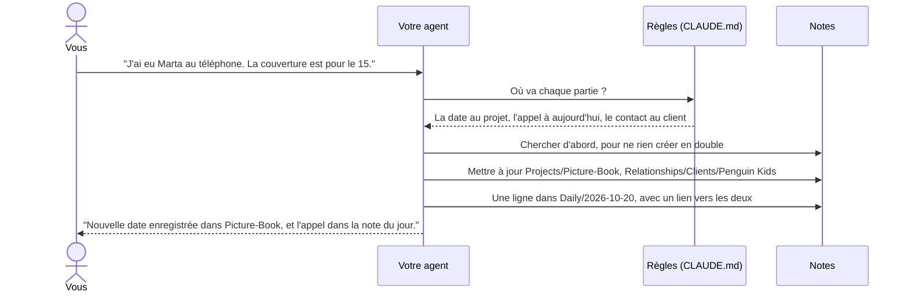

Les petites mises à jour de notes qui existent déjà se font tout de suite, et votre agent vous le dit en une ligne. Les nouvelles notes, les déplacements, les changements de nom et les suppressions attendent toujours votre accord. Plus de détails dans [Comment ça marche](docs/how-it-works.md).

## Ce que vous obtenez

- **Un cerveau construit à partir de vos réponses.** Si vous vendez quelque chose, vous avez des pages pour votre activité, vos offres et votre clientèle. Sinon, vous n'en avez pas. Le point du matin n'apparaît que si vous en voulez un.
- **Des questions écrites pour votre métier.** Le deuxième formulaire commence par trois questions que votre agent écrit pour votre métier. Une illustratrice est interrogée sur les éditeurs et ses tarifs ; un développeur, sur ses projets et ses outils.
- **Projets, personnes et journées, reliés.** Chaque personne, entreprise et projet est un `[[lien]]` : un clic dans Baalda vous emmène d'un projet au client, puis au jour où vous vous êtes parlé.
- **Des décisions avec leur raison.** Chaque note de décision dit ce que vous avez choisi, pourquoi, ce à quoi vous avez renoncé, et le risque. Les décisions en cours s'affichent dans votre note du jour jusqu'à ce que vous les fermiez.
- **Le Gardien du cerveau.** Chaque jour travaillé, il crée la note du lendemain, ferme les anciennes, liste les décisions en cours, corrige jusqu'à 5 petites choses et écrit un rapport. Un bilan complet se lance dès que vous dites « fais le bilan de mon cerveau ».
- **Un point du matin,** si vous en voulez un : vos trois choses les plus importantes, ce que vous attendez, et une décision à prendre.
- **La préparation de réunion.** Dites « prépare-moi pour Marta » et recevez un court résumé tiré de vos notes : la dernière fois que vous vous êtes parlé, ce qui se passe, ce qui a été convenu, ce qu'il faut aborder.
- **Des outils de réflexion.** « Mets mon idée à l'épreuve » la confronte à vos propres notes. « Qu'est-ce qui revient souvent ? » trouve ce qui se répète. « Trouve les contradictions » repère les notes qui ne disent pas la même chose.
- **Vos apps, en lecture seule.** Connectez Gmail et Google Agenda (ou Outlook, Nextcloud et d'autres), et le Gardien du cerveau note les e-mails d'hier avec vos contacts et les réunions de demain. Il n'envoie et ne modifie jamais rien.
- **Entièrement en ligne, si vous voulez.** Le Gardien du cerveau peut tourner comme une routine dans le cloud, en lisant et en écrivant vos notes via votre cloud, même ordinateur éteint.
- **Sauvegardes et annulation.** Avant un gros changement, votre agent copie les fichiers dans un dossier caché `.backups/`, où ils restent 10 jours. « Annule la dernière modification » les remet en place.
- **Vos anciennes notes, quand vous voulez.** « Importe mes anciennes notes » récupère vos notes depuis Notion, Google Docs, Notes d'Apple et d'autres, avec un plan que vous validez d'abord.
- **Les équipes.** Partagez un cerveau via le cloud de Baalda, avec une section Équipe dans les règles pour le rôle de chacun.
- **Votre téléphone.** Posez des questions à votre cerveau depuis l'app mobile de votre agent via votre cloud, ou envoyez des tâches à votre ordinateur (dans Claude, avec Dispatch).
- **Votre langue.** Les formulaires, les messages et les notes sont dans la langue que vous choisissez. Les noms des dossiers et des notes aussi. Seuls quelques fichiers système, comme `CLAUDE.md`, gardent leur nom anglais.
- **Des textes qui vous ressemblent.** Chaque cerveau inclut la skill [no-ai-slop](https://github.com/petergyang/no-ai-slop). Votre agent écrit dans votre style, puis cherche les tournures qui sentent l'IA avant que quelqu'un d'autre ne le lise.
- **De bonnes habitudes de travail.** Les règles principales reprennent les conseils d'Andrej Karpathy pour les assistants IA : demander en cas de doute, choisir la solution la plus simple, ne changer que le nécessaire, vérifier le travail.
- **Vos propres règles.** Quand vous corrigez votre agent, il enregistre la correction comme une nouvelle règle, avec vos mots. Les mises à jour ne touchent jamais à ces règles.

## Comment travaille votre agent

<p align="center"></p>

Les habitudes de travail sont les conseils d'Andrej Karpathy pour les assistants IA ([andrej-karpathy-skills](https://github.com/multica-ai/andrej-karpathy-skills)), intégrés aux règles principales de chaque cerveau et reformulés avec nos propres mots. Le Contrôle d'écriture utilise la skill [no-ai-slop](https://github.com/petergyang/no-ai-slop), que chaque cerveau reçoit dans `Skills/no-ai-slop/`. Plus de détails dans [Règles principales](docs/folders/main-rules.md).

## Dans votre cerveau

<p align="center"></p>

```
My Brain/
├── CLAUDE.md          les règles principales
├── .claudeignore      ce que votre agent ne lit jamais, sauf si vous le demandez
├── About/             me.md, goals.md, business.md, services.md, brand.md ...
├── Daily/             2026-10-20.md, 2026-10-21.md ... et tasks.md
├── Projects/          Picture-Book/README.md, Portfolio-Website/README.md ...
├── Relationships/     Clients/, Collaborators/, Team/, Partners/
├── Memory/            decisions/, research/, finances/ (privé), archive/
├── Library/           prompts, modèles, check-lists
└── Skills/            brain-keeper/, morning-brief/
```

Chaque dossier a son propre guide : ce qu'on y met, ce que vous pouvez dire, des exemples et ses règles. Commencez par [Les dossiers de votre cerveau](docs/folders/README.md).

## Démarrage rapide

<p align="center">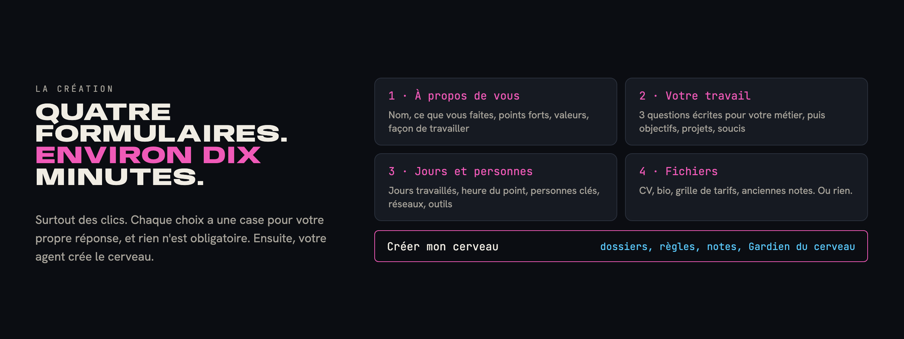</p>

Il vous faut un agent IA capable de travailler dans un dossier, un cloud auquel votre agent peut se connecter, et un ordinateur. Pas besoin de coder. Nous recommandons Claude avec Google Drive, le duo que nous avons le plus testé, donc les étapes ci-dessous les utilisent. Toutes les étapes, avec d'autres clouds et d'autres agents, sont dans [Bien démarrer](docs/getting-started.md).

| Étape | Ce que vous faites | Temps |
|---|---|---|
| 1 | Choisissez votre agent : nous recommandons l'[app de bureau Claude](https://claude.ai/download) avec un abonnement payant | 3 min |
| 2 | Installez l'app de bureau de votre cloud (par exemple Google Drive), et créez dedans un dossier pour votre cerveau | 3 min |
| 3 | Dans votre agent, lancez une tâche et choisissez ce dossier | 1 min |
| 4 | Connectez le cloud à votre agent (dans Claude : Paramètres, Connecteurs), pour que votre téléphone puisse accéder au cerveau | 1 min |
| 5 | Téléchargez [Baalda](https://github.com/naveedharri/baalda) et ouvrez le même dossier | 2 min |
| 6 | Installez Phygital Brain (en un clic, ci-dessous) et dites **« Crée mon second cerveau. »** | 10 min |

**Installation :** cliquez sur le bouton de votre agent.

<p align="center">
<a href="https://github.com/Phygital-Brain/phygital-brain/releases/latest/download/phygital-brain.mcpb">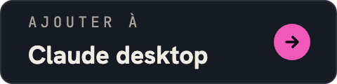</a>
<a href="docs/install.md#claude-code">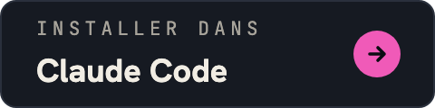</a>
<a href="https://cursor.com/en/install-mcp?name=phygital-brain&config=eyJjb21tYW5kIjoibnB4IiwiYXJncyI6WyIteSIsInBoeWdpdGFsLWJyYWluIl19">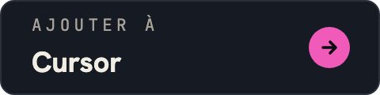</a>
<br>
<a href="https://insiders.vscode.dev/redirect?url=vscode%3Amcp%2Finstall%3F%257B%2522name%2522%253A%2522phygital-brain%2522%252C%2522command%2522%253A%2522npx%2522%252C%2522args%2522%253A%255B%2522-y%2522%252C%2522phygital-brain%2522%255D%257D">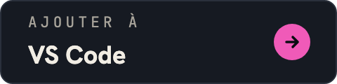</a>
<a href="docs/install.md#codex">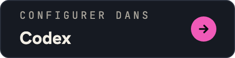</a>
<a href="docs/install.md#hermes-agent-and-openclaw">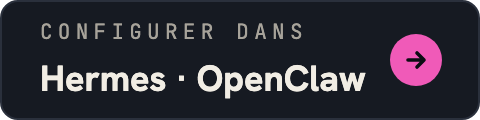</a>
</p>

**Ou dans un terminal, pour tout agent qui utilise des skills** (Claude Code, Codex, Cursor, Gemini CLI et d'autres) :

```bash
npx skills add Phygital-Brain/phygital-brain
```

La commande vous demande à quels agents l'ajouter. L'app de bureau Claude et Claude Code n'ont besoin de rien d'autre. Les autres méthodes demandent [Node.js](https://nodejs.org), à installer une seule fois, gratuitement.

Toutes les méthodes, étape par étape : [Installation](docs/install.md).

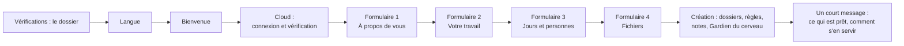

À la fin, votre agent vous accueille comme votre assistant personnel, et vous propose Baalda pour parcourir vos notes comme dans une app.

## Une semaine avec votre cerveau

Ana est illustratrice à Lisbonne. Elle vend des illustrations d'albums jeunesse à des éditeurs, et elle a créé son cerveau lundi.

- **Lundi, 10 h.** Elle remplit les quatre formulaires et dépose son CV et sa grille de tarifs. Son agent crée `About/me.md`, `goals.md`, `services.md`, trois projets et une note pour la maison d'édition de son éditrice.
- **Mardi, 8 h.** Son point du matin liste trois choses : envoyer les croquis, répondre à une boulangerie pour un logo, et fixer son prix pour une couverture.
- **Mardi, 15 h.** Après un appel, elle dit : « Marta veut la couverture pour le 15. » Le projet, la note du client et la journée sont mis à jour et reliés.
- **Mercredi, dans le bus.** Dans l'app mobile de son agent, elle demande : « Qu'est-ce qu'on a décidé avec Marta mardi ? » L'agent trouve la note dans son cloud.
- **Jeudi.** « J'ai décidé de passer mon prix pour une couverture à 400 à partir de janvier. » Son agent lui pose quelques questions sur ses raisons, puis écrit `Memory/decisions/2026-10-23-raise-cover-price.md`.
- **Chaque jour travaillé, 7 h.** Le Gardien du cerveau crée la note du lendemain, ferme les anciennes et corrige les petites choses. Chaque matin, il indique que la décision sur le prix de la couverture est toujours en cours, jusqu'à ce qu'elle la ferme.

D'autres profils, d'une boulangère à un étudiant, sont dans [Exemples d'utilisation](docs/use-cases.md).

## Sur votre téléphone

| Mode | Ce que ça fait | Votre ordinateur |
|---|---|---|
| **Demander :** l'app mobile de votre agent, avec votre cloud connecté | Trouve et lit ce qu'il y a dans votre cerveau | Peut être éteint |
| **Faire :** envoyer une tâche à votre agent sur votre ordinateur (dans Claude, Dispatch) | Ajoute et range les choses en suivant toutes les règles | Doit être allumé, avec l'app de votre agent ouverte |

Configuration, quoi dire, et solutions aux problèmes courants : [Votre cerveau sur votre téléphone](docs/phone.md).

## Langues

Phygital Brain est prêt dans **41 langues**. Choisissez la vôtre au début de la création, et tout le cerveau est construit dans cette langue : les formulaires, les règles, les noms de dossiers et de notes, le Gardien du cerveau et chaque message.

Voir [la liste complète des langues](languages/README.md#ready-languages).

**Votre langue n'y est pas ?** Choisissez Autre et tapez-la. Votre agent traduit tout le cerveau pendant la création, noms de dossiers compris, sans rien vous demander. Pour créer une version vérifiée que tous ceux qui parlent votre langue pourront utiliser, dites :

> Traduis Phygital Brain dans ma langue.

La skill `add-language` vous pose trois questions (« tu » ou « vous », les noms des dossiers principaux, et les noms du Gardien du cerveau et du point du matin), traduit tout, vérifie le résultat, puis vous montre comment l'utiliser et le partager. Comment ça marche, étape par étape : [Langues](languages/README.md).

**Changer plus tard :** dites « Passe mon cerveau en espagnol ». Votre agent renomme les dossiers et remplace les règles, avec une sauvegarde d'abord et votre accord.

## Compatible avec votre agent

| | App de bureau Claude | Agents qui travaillent dans un dossier (Claude Code, Codex, Hermes Agent, OpenClaw) | Apps de discussion qui ne peuvent pas enregistrer de fichiers |
|---|---|---|---|
| Créer le cerveau | Oui | Oui | Non |
| Les quatre fenêtres de formulaire | Oui | Les mêmes questions, dans la discussion | Non |
| Usage quotidien | Oui | Oui | Lecture seule |
| Gardien du cerveau et point du matin | Oui, programmés | Si l'app peut programmer des tâches | Non |

Les fichiers de règles s'appellent `CLAUDE.md`. Les agents qui cherchent un autre nom, comme `AGENTS.md` dans Codex, reçoivent un fichier d'une ligne qui renvoie vers `CLAUDE.md` : il n'y a donc qu'un seul jeu de règles. Plus de détails dans [Autres agents](docs/other-agents.md).

## Confidentialité

Vos notes sont lues par votre agent IA et stockées dans votre cloud. Phygital Brain lui-même n'a pas de serveur et ne collecte rien. Plus de détails dans [Ce que vous partagez avec votre IA](SECURITY.md#what-you-share-with-your-ai).

- **Les infos privées restent au même endroit.** Numéros fiscaux, coordonnées bancaires, numéros de carte, votre nom officiel complet et votre date de naissance ne se trouvent que dans la note qui en a besoin. Votre agent ne les copie jamais dans d'autres notes, et ne les répète jamais dans une réponse.
- **Une liste « à ne jamais lire ».** `.claudeignore` couvre les fichiers de mots de passe et de clés, et `Memory/finances/`. Votre agent ne les ouvre que si vous lui demandez un fichier précis. Votre agent suit cette règle, mais rien n'est verrouillé.
- **Pas de secrets dans les notes.** Les mots de passe, les clés et les jetons ont leur place dans un gestionnaire de mots de passe.

## Ce que ce n'est pas

La liste complète est dans [Limites](docs/limits.md).

- **Pas une app.** Il n'y a rien à lancer. Votre agent IA fait le travail, en suivant les fichiers de ce dépôt.
- **Pas encore de verrou.** Les règles ne marchent que parce que votre agent les suit. Gardez ce qui est vraiment secret hors du dossier du cerveau. Les dossiers verrouillés sont dans la [feuille de route](#feuille-de-route).
- **Pas toujours actif, sauf si vous le passez dans le cloud.** Sur votre ordinateur, le Gardien du cerveau et le point du matin ne tournent que quand l'app de votre agent est ouverte. En routine dans le cloud, ils tournent ordinateur éteint.
- **Une première version.** C'est la version 0.1.12, et la création n'a pas encore été testée par beaucoup de monde.

## Feuille de route

Prévu, pas encore construit :

- **Des dossiers verrouillés.** Vous choisissez les dossiers à verrouiller, comme `Memory/finances/`. Leurs notes sont chiffrées dans votre cloud : aucune app ni aucun agent ne peut les lire sans vous. Vous les déverrouillez avec votre mot de passe ou votre empreinte, depuis l'agent que vous utilisez déjà, et seulement pour ce que vous autorisez.

Les idées sont les bienvenues : ouvrez une issue sur GitHub.

## Mettre à jour et partir

**Pour mettre à jour :** mettez à jour le plugin (dans Claude Code, `/plugin marketplace update phygital-brain`), puis dites **« Mets à jour mon second cerveau. »** Votre agent vous montre les nouveautés et demande votre accord avant tout. Vos notes et vos propres règles restent telles quelles.

**Pour changer vos réponses :** dites **« Modifie mes réponses. »** Les formulaires s'ouvrent à nouveau, et vos pages About sont mises à jour.

**Pour partir :** désinstallez le plugin. Votre cerveau est un dossier de fichiers texte simples, dans votre propre cloud. N'importe quelle app qui lit le Markdown peut l'ouvrir.

## FAQ

Les questions les plus fréquentes sont ci-dessous. La liste complète, avec 92 réponses classées par thème, est dans la [FAQ](docs/faq.md).

<details>
<summary><b>Faut-il savoir coder ?</b></summary>

Non. Vous installez quelques apps, remplissez quatre formulaires et parlez avec des mots simples. Les seules lignes qui ressemblent à du code sont les deux lignes d'installation pour Claude Code, et vous pouvez les coller.
</details>

<details>
<summary><b>Avec quels agents IA est-ce que ça marche ?</b></summary>

Avec tout agent capable de lire, modifier et créer des fichiers dans un dossier de votre ordinateur. C'est Claude que nous utilisons et recommandons : c'est le seul qui affiche la création sous forme de fenêtres de formulaire, et il peut programmer le Gardien du cerveau. Codex, Hermes Agent, OpenClaw et les agents du même genre posent les mêmes questions dans la discussion. Voir [Autres agents](docs/other-agents.md).
</details>

<details>
<summary><b>Quels clouds fonctionnent ?</b></summary>

Tout cloud qui garde une copie du dossier sur votre ordinateur et auquel votre agent peut se connecter, pour y lire, modifier et créer des fichiers : Google Drive, Nextcloud, Dropbox, OneDrive et d'autres. Claude a un connecteur Google Drive intégré ; les autres clouds se connectent en général via un serveur MCP. Voir [Stockages cloud](docs/faq.md#cloud-drives).
</details>

<details>
<summary><b>Va-t-il modifier mes notes sans demander ?</b></summary>

Il enregistre les petites mises à jour des notes qui existent déjà et vous le dit en une ligne. Il demande avant de créer une note, d'en réécrire une, ou de déplacer, renommer ou supprimer quoi que ce soit. Le Gardien du cerveau ne supprime jamais vos notes.
</details>

<details>
<summary><b>Combien ça coûte ?</b></summary>

Phygital Brain est gratuit et open source. Vous payez votre agent IA et, si l'espace gratuit ne suffit pas, votre cloud.
</details>

## Tous les guides

| Guide | Ce qu'il contient |
|---|---|
| [Exemples d'utilisation](docs/use-cases.md) | Cinq personnes, à quoi ressemble leur cerveau, et ce qu'elles disent un jour normal |
| [FAQ](docs/faq.md) | 92 questions et réponses, classées par thème |
| [Installation](docs/install.md) | Un clic pour l'app de bureau Claude, Cursor et VS Code, et les étapes pour Claude Code, Codex, Hermes Agent, OpenClaw et d'autres |
| [Bien démarrer](docs/getting-started.md) | Chaque étape, de zéro à un cerveau qui marche, avec des vérifications et des solutions |
| [Connecter vos apps](docs/connect-your-apps.md) | Gmail, Agenda, Drive et d'autres services, en lecture seule, et tout en ligne |
| [Ajouter des skills](docs/add-skills.md) | Ajouter n'importe quelle skill à votre cerveau, faire des vidéos avec [HyperFrames](https://github.com/heygen-com/hyperframes) et créer des visuels avec [Canva](https://www.canva.com) |
| [Équipes](docs/teams.md) | Partager un cerveau via le cloud de Baalda |
| [Importer vos anciennes notes](docs/importing.md) | Exporter depuis Notion, Google Docs, Notes d'Apple et d'autres, puis tout ranger |
| [Exemple de cerveau](docs/example-brain/README.md) | Quelques notes inventées, pour voir les fichiers avant de créer les vôtres |
| [Comment ça marche](docs/how-it-works.md) | Ce que fait votre agent à chaque étape, quand il enregistre et quand il demande |
| [Les dossiers de votre cerveau](docs/folders/README.md) | Une page par dossier et sous-dossier, avec des exemples et des règles |
| [Règles principales](docs/folders/main-rules.md) | Le `CLAUDE.md` principal, en mots simples |
| [Votre cerveau sur votre téléphone](docs/phone.md) | Poser des questions depuis l'app mobile de votre agent, envoyer des tâches à votre ordinateur |
| [Autres agents](docs/other-agents.md) | Utiliser Codex, Hermes Agent, OpenClaw ou un autre agent, les noms des fichiers de règles, deux agents sur un même cerveau |
| [Langues](languages/README.md) | Comment marchent les autres langues |
| [Limites](docs/limits.md) | Ce qu'il fait mal, ou pas encore |
| [Glossaire](docs/glossary.md) | Chaque terme, en mots simples |
| [Sécurité et confidentialité](SECURITY.md) | Ce que vous partagez avec votre IA, et comment signaler un problème |

## Ce dépôt

| Dossier | Contenu |
|---|---|
| `skills/brain-setup/` | La création : les instructions de l'agent, les quatre formulaires, et tous les fichiers que reçoit un nouveau cerveau |
| `skills/brain-keeper/` | Le Gardien du cerveau : le rangement quotidien et le bilan |
| `skills/add-language/` | Créer une version complète dans une nouvelle langue, ou changer la langue d'un cerveau |
| `skills/brain-setup/i18n/` | Les versions de langue prêtes que la création copie |
| `docs/` | Les guides ci-dessus, et les images |
| `languages/` | Les traductions (un fichier et un dossier par langue) et comment en ajouter une |
| `scripts/` | Les vérifications à lancer avant un changement (`python3 scripts/check.py`) |
| `.claude-plugin/` | Les fichiers du plugin, pour l'installer dans Claude |
| `mcp/` | Le connecteur (un serveur MCP, sans dépendances) pour les agents qui acceptent les serveurs MCP |
| `package.json` | Le paquet npm, pour que `npx -y phygital-brain` lance le connecteur |
| `.github/workflows/` | Publie chaque nouvelle version : npm, et la release GitHub avec le fichier pour l'app de bureau Claude |

<p align="center">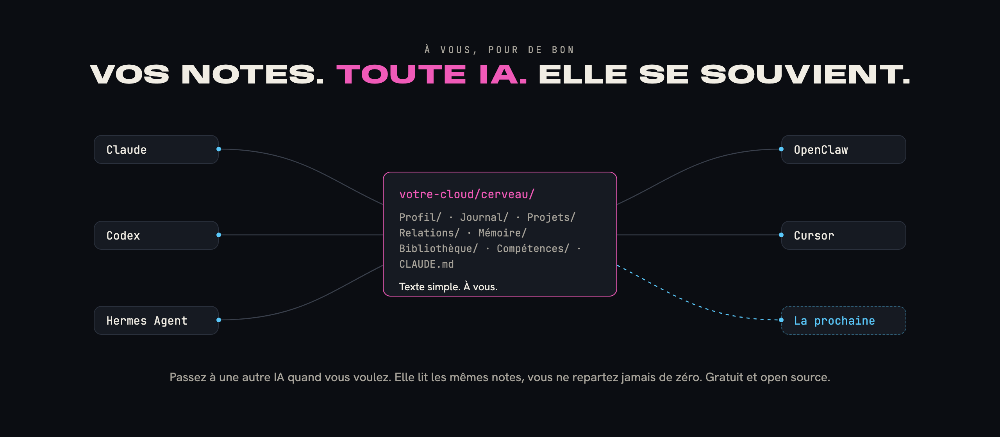</p>

## Aide et contributions

Questions, bugs et idées : ouvrez une issue sur GitHub. Pour changer quelque chose, lisez [CONTRIBUTING.md](CONTRIBUTING.md) et [AGENTS.md](AGENTS.md). Signalez les problèmes de sécurité ou de confidentialité en privé, comme l'explique [SECURITY.md](SECURITY.md). Pour citer le projet, utilisez [CITATION.cff](CITATION.cff).

## Open source et crédits

Gratuit et open source sous [licence Apache 2.0](LICENSE). Gardez le fichier [NOTICE](NOTICE) : il contient la ligne "Created by Phygital-Brain".

La licence ne couvre pas le nom ni le logo (voir [TRADEMARKS.md](TRADEMARKS.md)). Vous pouvez dire que votre travail est « construit sur Phygital Brain », mais vous ne pouvez pas le vendre sous ce nom.

## Aucune garantie

Phygital Brain est fourni tel quel, sans garantie d'aucune sorte (voir les sections 7 et 8 de la [licence](LICENSE)). Vous êtes responsable de ce que vous mettez dans votre cerveau et de ce que vous partagez avec votre fournisseur d'IA.
