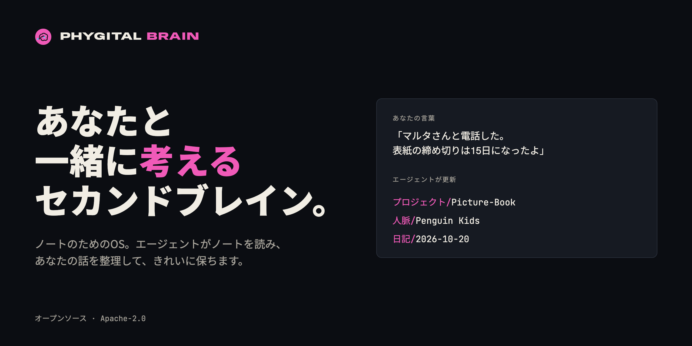
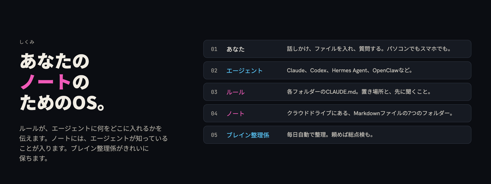
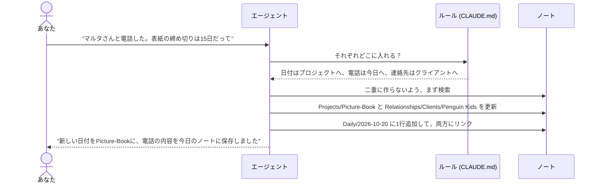
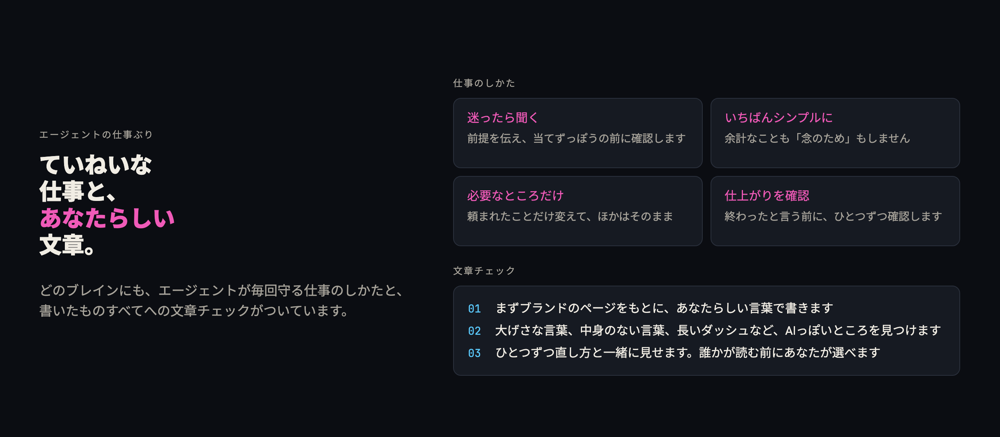
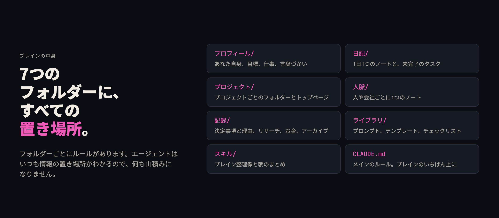
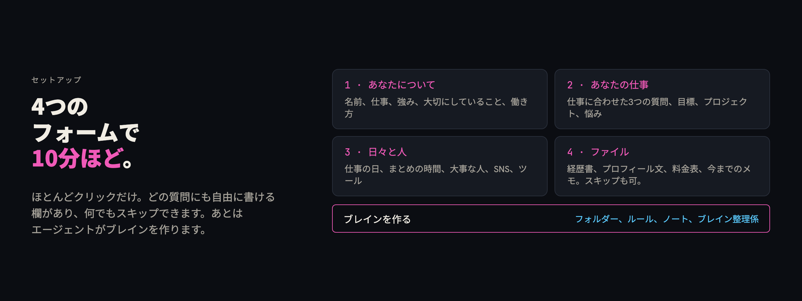
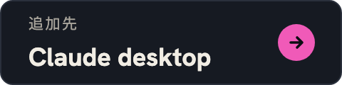
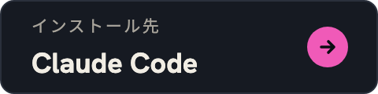
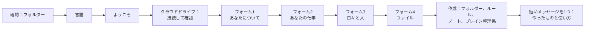
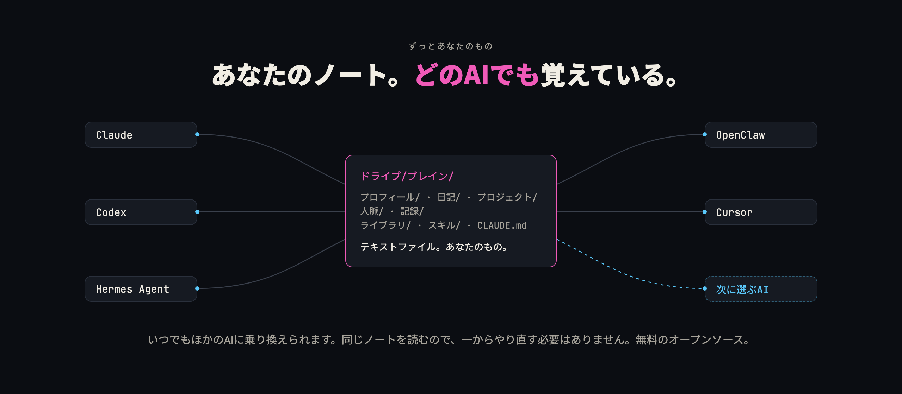

<p align="center"><a href="README.md">English</a> · <a href="README.zh-CN.md">简体中文</a> · <a href="README.pt-BR.md">Português (Brasil)</a> · <a href="README.es.md">Español</a> · <a href="README.fr.md">Français</a> · <b>日本語</b> · <a href="README.ar.md">العربية</a></p>
<p align="center"><sub>このREADMEは英語版から翻訳したものです。内容が違う場合は、英語版のREADMEを正としてください。ここからリンクしているガイドは英語です。</sub></p>

<p align="center"></p>

<h1 align="center">Phygital Brain</h1>

<p align="center"><b>あなたと一緒に考えるセカンドブレイン。</b><br>ノートのためのOS（オペレーティングシステム）です。クラウドドライブの中にフォルダーをひとつ作り、AIエージェントがそこを読み書きして、きれいに整理しておきます。4つの短いフォームに答えれば、10分ほどで完成します。あとは話しかけるだけで、エージェントがあなたの話を正しい場所に整理します。</p>

<p align="center">
<a href="#オープンソースとクレジット"></a>
<a href="LICENSE"></a>
<a href="https://www.npmjs.com/package/phygital-brain"></a>
<a href="#クイックスタート"></a>
<a href="docs/install.md"></a>
<a href="CONTRIBUTING.md"></a>
</p>
<p align="center">
<a href="docs/other-agents.md"></a>
<a href="docs/getting-started.md#2-a-cloud-drive-folder"></a>
<a href="docs/how-it-works.md"></a>
<a href="SECURITY.md#what-you-share-with-your-ai"></a>
</p>
<p align="center">
<a href="https://github.com/Phygital-Brain/phygital-brain/stargazers"></a>
<a href="https://github.com/Phygital-Brain/phygital-brain/commits/main"></a>
<a href="https://www.npmjs.com/package/phygital-brain"></a>
<a href="#言語"></a>
</p>

<p align="center">
<a href="#概要">概要</a> ·
<a href="#ずっとあなたのもの">ずっとあなたのもの</a> ·
<a href="#しくみ">しくみ</a> ·
<a href="#クイックスタート">クイックスタート</a> ·
<a href="#ブレインとの1週間">1週間の使い方</a> ·
<a href="#スマホで使う">スマホ</a> ·
<a href="#言語">言語</a> ·
<a href="#プライバシー">プライバシー</a> ·
<a href="docs/faq.md">よくある質問</a> ·
<a href="#ガイド一覧">ガイド</a>
</p>

## 概要

Phygital Brainは、あなたのノートとAIエージェントのためのOS（オペレーティングシステム）です。クラウドドライブ（Google Drive、Nextcloud、Dropbox、またはエージェントが接続できるドライブ）の中にフォルダーをひとつ作り、そこに3種類のものを入れます：

- **ルール：** すべてのフォルダーに`CLAUDE.md`ファイルがあります。どの情報をどこに入れるか、ノートをどう書き始めるか、何かを変える前に何を確認するかを、エージェントに伝えます。
- **ノート：** シンプルなMarkdownファイル（軽い書式のついたテキストファイル）です。あなた自身、プロジェクト、まわりの人、決めたこと、毎日のことを記録します。あなたが話すとエージェントがノートを書き、ノート同士をリンクでつなぎます。
- **ブレイン整理係：** 仕事の日に毎日ブレインを整理する予定タスクです。頼めばいつでも総点検もします。

そのフォルダーでチャットを始めると、エージェントはまずルールと最新のノートを読みます。だから、あなたの名前、クライアント、目標、昨日やったことを最初から知っています。同じノートは[Baalda](https://github.com/naveedharri/baalda)で読んだり見て回ったりできますし、ドライブを通してスマホからも見られます。

中身は2つのスキル（エージェントが従う指示のセット）です。ひとつはブレインを作り、もうひとつはブレインを整理します。私たちが使っていておすすめしているのがClaudeなので、Claudeプラグインとしてまとめていますが、フォルダーの中で作業できるエージェントならどれでも使えます。[ほかのエージェント](docs/other-agents.md)を見てください。

## ずっとあなたのもの

- **持ち主はあなた。** ブレインは、あなたのクラウドドライブにあるテキストファイルのフォルダーです。私たちのサービスへのアカウント登録は不要で、エクスポートする必要もありません。
- **どのAIにも持っていける。** ほかのエージェントに乗り換えても、同じフォルダーを開くだけ。新しいエージェントも同じノートを読みます。
- **あなたのことを覚えている。** エージェントに話したことはノートとして保存されます。だから次のチャットでも、次のAIでも、前回の続きから始められます。
- **無料のオープンソース。** しくみは誰でも確認できます。ノートはあなたのドライブの中で非公開のままです。Phygital Brainは何も集めず、ノートはあなたが選んだAIにだけ渡ります。

## 作った理由

AIとのチャットが終わると、話した内容も一緒に消えてしまいます。次のチャットでは、仕事のこと、クライアントのこと、プロジェクトのことをまた一から説明することになります。残しているメモも5つのアプリにばらばらで、どれもエージェントとはつながっていません。

Phygital Brainは、エージェントが読み書きできる場所をひとつにまとめ、毎回守るルールを用意します：

| これまで | Phygital Brainなら |
|---|---|
| 新しいチャットのたびに自己紹介する | エージェントが答える前に`About/me.md`を読む |
| 電話のメモが、二度と見つからないチャットに埋もれる | 電話の内容がプロジェクト、クライアントのノート、今日の日記に入り、リンクでつながる |
| なぜそう決めたのかを忘れてしまう | `Memory/decisions/`が決めたことと理由を残し、30日後に見直すよう知らせる |
| ノートがたまって古くなる | ブレイン整理係が古いノートを閉じ、止まっているプロジェクトを知らせ、あなたの確認が必要なことをリストにする |
| エージェントが勝手にファイルを変える | 作成、移動、名前の変更、削除の前に必ず確認する |

## しくみ

<p align="center"></p>

パソコンのOSの部品は、それぞれブレインの中にも対応するものがあります：

| パソコンでは | Phygital Brainでは |
|---|---|
| ユーザー | ふだんの言葉で話すあなた |
| 作業をするプロセッサー | AIエージェント |
| システムのルール | `CLAUDE.md`ファイル：メインのファイルが1つと、フォルダーごとに1つずつ |
| ファイルシステム | クラウドドライブにある、Markdownノートの7つのフォルダー |
| 設定 | `About/me.md`：エージェントにどう動いてほしいか、言語、タイムゾーン、仕事の日 |
| バックグラウンドのサービス | 仕事の日に毎日動くブレイン整理係 |
| アプリ | スキル：朝のまとめ、総点検、あなたが追加したスキル |

エージェントに何か話すと、こうなります：



すでにあるノートへの小さな更新はすぐに行われ、エージェントが1行で知らせます。新しいノートの作成、移動、名前の変更、削除は、必ずあなたのOKを待ちます。詳しくは[しくみ](docs/how-it-works.md)へ。

## できること

- **あなたの答えから作るブレイン。** 何かを売っている人には、ビジネス、サービス、顧客のページができます。売っていない人には、それらのページは作りません。朝のまとめは、頼んだときだけ作られます。
- **あなたの仕事に合わせた質問。** 2つ目のフォームは、エージェントがあなたの仕事に合わせて考えた3つの質問から始まります。イラストレーターなら出版社や料金の決め方について、開発者ならプロジェクトや使っているツールについて聞かれます。
- **プロジェクト、人、日々がつながる。** 人、会社、プロジェクトはすべて`[[リンク]]`になります。だからBaaldaでクリックひとつで、プロジェクトからクライアントへ、さらに話した日へと移動できます。
- **理由つきの決定事項。** 決定事項のノートには、何を選んだか、なぜか、何をあきらめたか、どんなリスクがあるかを書きます。未完了の決定事項は、閉じるまで毎日の日記に表示されます。
- **ブレイン整理係。** 仕事の日には毎日、翌日のノートを作り、古いノートを閉じ、未完了の決定事項をリストにし、小さな問題を最大5つ直して、レポートを書きます。「ブレインを総点検して」と言えば、いつでも総点検をします。
- **朝のまとめ、** ほしい人だけ：いちばん大事な3つのこと、返事待ちのこと、決めるべきことを1つ。
- **打ち合わせ準備。** 「マルタさんとの打ち合わせの準備をして」と言えば、ノートから短いまとめを作ります：最後に話したのはいつか、今どうなっているか、何を決めたか、何を話題にするか。
- **思考ツール。** 「このアイデアの弱点を指摘して」と言えば、あなた自身のノートと照らし合わせて検討します。「どんなパターンが見える？」と聞けば、何度も出てくることを見つけます。「矛盾を探して」と言えば、食い違っているノートを見つけます。
- **アプリは読むだけ。** GmailとGoogleカレンダー（またはOutlook、Nextcloudなど）を接続すると、ブレイン整理係が、まわりの人との昨日のメールや明日の打ち合わせをノートに書き留めます。何かを送ったり変えたりすることはありません。
- **すべてオンラインでも動く。** ブレイン整理係はクラウドのルーティンとしても動かせます。パソコンの電源が切れていても、クラウドドライブを通してノートを読み書きします。
- **バックアップと元に戻す。** 大きな変更の前に、エージェントがファイルを隠しフォルダー`.backups/`に10日間コピーしておきます。「さっきの変更を元に戻して」と言えば元どおりになります。
- **今までのメモも、いつでも。** 「今までのメモを取り込んで」と言えば、Notion、Google Docs、Apple Notesなどから取り込みます。先にあなたが計画を確認してから進めます。
- **チーム。** Baaldaのクラウドで1つのブレインを共有できます。ルールにはチームの欄があり、メンバーそれぞれの役割を書けます。
- **スマホ。** クラウドドライブを通して、エージェントのスマホアプリからブレインに質問できます。パソコンに作業を送ることもできます（Claudeなら、Dispatchで）。
- **あなたの言語で。** フォーム、メッセージ、ノートは、あなたが選んだ言語になります。フォルダー名とノート名も同じです。`CLAUDE.md`など、いくつかのシステムファイルだけが英語の名前のままです。
- **あなたらしい文章。** すべてのブレインに[no-ai-slop](https://github.com/petergyang/no-ai-slop)スキルが入っています。エージェントはあなたらしい言葉で書き、ほかの人が読む前に、AIっぽい書き方がないかチェックします。
- **ていねいな仕事のしかた。** メインのルールには、Andrej KarpathyによるAIアシスタント向けのガイドラインが入っています：迷ったら聞く、いちばんシンプルな方法を選ぶ、必要なところだけ変える、仕上がりを確認する。
- **あなた自身のルール。** エージェントの間違いを直すと、その指摘をあなたの言葉のまま新しいルールとして保存します。アップグレードしても、そのルールは変わりません。

## エージェントの働き方

<p align="center"></p>

仕事のしかたは、Andrej KarpathyによるAIアシスタント向けのガイドライン（[andrej-karpathy-skills](https://github.com/multica-ai/andrej-karpathy-skills)）を、私たちの言葉ですべてのブレインのメインのルールに組み込んだものです。文章チェックには[no-ai-slop](https://github.com/petergyang/no-ai-slop)スキルを使います。このスキルは、すべてのブレインの`Skills/no-ai-slop/`に入っています。詳しくは[メインのルール](docs/folders/main-rules.md)へ。

## ブレインの中身

<p align="center"></p>

```
My Brain/
├── CLAUDE.md          メインのルール
├── .claudeignore      頼まない限りエージェントが読まないもの
├── About/             me.md, goals.md, business.md, services.md, brand.md ...
├── Daily/             2026-10-20.md, 2026-10-21.md ... と tasks.md
├── Projects/          Picture-Book/README.md, Portfolio-Website/README.md ...
├── Relationships/     Clients/, Collaborators/, Team/, Partners/
├── Memory/            decisions/, research/, finances/ (非公開), archive/
├── Library/           プロンプト、テンプレート、チェックリスト
└── Skills/            brain-keeper/, morning-brief/
```

フォルダーにはそれぞれガイドがあります：何を入れるか、どう話しかければいいか、例、ルール。まずは[ブレインのフォルダー](docs/folders/README.md)から読んでください。

## クイックスタート

<p align="center"></p>

必要なのは、フォルダーの中で作業できるAIエージェント、エージェントが接続できるクラウドドライブ、そしてパソコンです。コードは必要ありません。おすすめは、いちばん多くテストしたClaudeとGoogle Driveの組み合わせなので、下の手順もこの2つを使っています。ほかのドライブやエージェントも含めた詳しい手順は[はじめに](docs/getting-started.md)にあります。

| 手順 | やること | 時間 |
|---|---|---|
| 1 | エージェントを用意します：おすすめは有料プランの[Claudeデスクトップアプリ](https://claude.ai/download)です | 3分 |
| 2 | クラウドドライブのデスクトップアプリ（たとえばGoogle Drive）をインストールし、その中にブレイン用のフォルダーを作ります | 3分 |
| 3 | エージェントでタスクを始めて、そのフォルダーを選びます | 1分 |
| 4 | ドライブをエージェントに接続します（Claudeなら「設定」の「コネクター」）。これでスマホからもブレインを使えます | 1分 |
| 5 | [Baalda](https://github.com/naveedharri/baalda)をダウンロードして、同じフォルダーを開きます | 2分 |
| 6 | Phygital Brainをインストールして（下のボタンでワンクリック）、「**セカンドブレインを作って**」と言います | 10分 |

**インストール：** お使いのエージェントのボタンをクリックしてください。

<p align="center">
<a href="https://github.com/Phygital-Brain/phygital-brain/releases/latest/download/phygital-brain.mcpb"></a>
<a href="docs/install.md#claude-code"></a>
<a href="https://cursor.com/en/install-mcp?name=phygital-brain&config=eyJjb21tYW5kIjoibnB4IiwiYXJncyI6WyIteSIsInBoeWdpdGFsLWJyYWluIl19"></a>
<br>
<a href="https://insiders.vscode.dev/redirect?url=vscode%3Amcp%2Finstall%3F%257B%2522name%2522%253A%2522phygital-brain%2522%252C%2522command%2522%253A%2522npx%2522%252C%2522args%2522%253A%255B%2522-y%2522%252C%2522phygital-brain%2522%255D%257D"></a>
<a href="docs/install.md#codex"></a>
<a href="docs/install.md#hermes-agent-and-openclaw"></a>
</p>

**またはターミナルで。スキルを使えるエージェントならどれでもOKです**（Claude Code、Codex、Cursor、Gemini CLIなど）：

```bash
npx skills add Phygital-Brain/phygital-brain
```

どのエージェントに追加するかを聞かれます。ClaudeデスクトップとClaude Codeなら、ほかに必要なものはありません。それ以外の方法では[Node.js](https://nodejs.org)が必要です（無料で、インストールは1回だけ）。

すべての方法の手順は[インストール](docs/install.md)にあります。



最後に、エージェントがあなた専属のアシスタントとしてあいさつし、ノートをアプリのように見られるBaaldaをすすめます。

## ブレインとの1週間

アナさんはリスボンに住むイラストレーターです。出版社から絵本の仕事を受けていて、月曜日にブレインを作りました。

- **月曜日 10:00。** 4つのフォームに答え、経歴書と料金表を入れます。エージェントが`About/me.md`、`goals.md`、`services.md`、3つのプロジェクト、担当編集者がいる出版社のノートを作ります。
- **火曜日 08:00。** 朝のまとめに3つのことが並びます：スケッチを送る、パン屋さんにロゴの件で返事をする、表紙の料金を決める。
- **火曜日 15:00。** 電話のあとで「マルタさんが表紙を15日までにほしいって」と話します。プロジェクト、クライアントのノート、その日のノートが更新され、リンクでつながります。
- **水曜日、バスの中。** エージェントのスマホアプリで「火曜日にマルタさんと何を決めたっけ？」と聞きます。エージェントがドライブの中からノートを見つけます。
- **木曜日。** 「1月から表紙の料金を400に上げることにした」。エージェントが理由を少し聞いてから、`Memory/decisions/2026-10-23-raise-cover-price.md`を書きます。
- **仕事の日は毎日 07:00。** ブレイン整理係が翌日のノートを作り、古いノートを閉じ、小さな問題を直します。毎朝、表紙の料金の決定事項を未完了としてリストに出し、アナさんが閉じるまで続けます。

パン屋さんの店主から学生まで、ほかの人の例は[活用例](docs/use-cases.md)にあります。

## スマホで使う

| 方法 | できること | パソコン |
|---|---|---|
| **聞く：** ドライブを接続した、エージェントのスマホアプリ | ブレインの中身を探して読む | 電源オフでもOK |
| **頼む：** パソコンのエージェントに作業を送る（Claudeなら、Dispatch） | すべてのルールに沿って追加し、整理する | 電源オンで、エージェントのアプリを開いておく |

設定方法、話しかけ方、よくあるトラブルの直し方は[スマホでブレインを使う](docs/phone.md)にあります。

## 言語

Phygital Brainは**41言語**に対応しています。セットアップの最初に言語を選ぶと、フォーム、ルール、フォルダーとノートの名前、ブレイン整理係、すべてのメッセージまで、ブレイン全体がその言語で作られます。

[対応言語の一覧](languages/README.md#ready-languages)を見てください。

**あなたの言語がない場合は？** 「その他」を選んで言語名を入力してください。エージェントがセットアップ中にフォルダー名も含めてブレイン全体を翻訳します。あなたに何か聞くことはありません。同じ言語を話す人なら誰でも使える、チェック済みのセットを作りたいときは、こう言ってください：

> Phygital Brainを私の言語に翻訳して

`add-language`スキルが3つのこと（「あなた」をていねいにするか気軽にするか、主なフォルダーの名前、ブレイン整理係と朝のまとめの名前）を聞いてから、すべてを翻訳してチェックし、使い方と共有のしかたを教えてくれます。手順の詳しい説明は[言語](languages/README.md)にあります。

**あとで切り替えるには：** 「ブレインをスペイン語に切り替えて」と言ってください。エージェントが先にバックアップを取り、あなたのOKをもらってから、フォルダーの名前を変えてルールを入れ替えます。

## 対応エージェント

| | Claudeデスクトップアプリ | フォルダーの中で作業するエージェント（Claude Code、Codex、Hermes Agent、OpenClaw） | ファイルを保存できないチャットアプリ |
|---|---|---|---|
| ブレインを作る | 対応 | 対応 | 非対応 |
| 4つのフォーム画面 | 対応 | 同じ質問をチャットで | 非対応 |
| 毎日の利用 | 対応 | 対応 | 読むだけ |
| ブレイン整理係と朝のまとめ | 対応（予定タスクで） | アプリがタスクを予約できれば | 非対応 |

ルールファイルの名前は`CLAUDE.md`です。Codexの`AGENTS.md`のように別の名前を探すエージェントには、`CLAUDE.md`を指す1行のファイルを用意します。だからルールは1セットだけです。詳しくは[ほかのエージェント](docs/other-agents.md)へ。

## プライバシー

ノートを読むのはあなたのAIエージェントで、保存先はあなたのクラウドドライブです。Phygital Brain自体にはサーバーがなく、何も集めません。詳しくは[AIと共有するもの](SECURITY.md#what-you-share-with-your-ai)へ。

- **個人情報は1か所だけに。** 税番号、銀行口座、カード番号、正式な氏名、生年月日は、それが必要なノートにだけ置きます。エージェントがほかのノートにコピーすることも、返事の中でくり返すこともありません。
- **「読まない」リスト。** `.claudeignore`は、パスワードや鍵のファイルと`Memory/finances/`を対象にしています。エージェントがそれらを開くのは、あなたがファイルを指定して頼んだときだけです。エージェントはこれをルールとして守りますが、鍵がかかっているわけではありません。
- **ノートに秘密を書かない。** パスワード、鍵、トークンはパスワード管理アプリに入れてください。

## できないこと

すべての一覧は[制限事項](docs/limits.md)にあります。

- **アプリではありません。** 起動するものはありません。作業をするのはAIエージェントで、このリポジトリのファイルに沿って動きます。
- **まだ鍵はかけられません。** ルールが守られるのは、エージェントがルールに従うからです。本当に秘密にしたいものは、ブレインのフォルダーの外に置いてください。鍵つきフォルダーは[ロードマップ](#ロードマップ)にあります。
- **クラウドに移さない限り、常に動いているわけではありません。** パソコンで使う場合、ブレイン整理係と朝のまとめは、エージェントのアプリが開いているあいだだけ動きます。クラウドのルーティンにすれば、パソコンの電源が切れていても動きます。
- **まだ初期のバージョンです。** 今はバージョン0.1.10で、セットアップはまだ多くの人に試してもらっていません。

## ロードマップ

予定していて、まだできていないもの：

- **鍵つきフォルダー。** `Memory/finances/`のように、鍵をかけるフォルダーを選べます。中のノートはドライブ上で暗号化され、あなたなしではどのアプリもエージェントも読めません。いつも使っているエージェントから、パスワードか指紋で、あなたが許可したものだけを開けます。

アイデアは大歓迎です。GitHubでissueを作ってください。

## アップデートとやめ方

**アップデートするには：** プラグインを更新して（Claude Codeなら`/plugin marketplace update phygital-brain`）、「**セカンドブレインをアップグレードして**」と言います。エージェントが新しい内容を見せて、先に確認します。ノートとあなた自身のルールはそのまま残ります。

**答えを変えるには：** 「**回答を更新して**」と言います。フォームがもう一度開き、Aboutのページが新しくなります。

**やめるには：** プラグインをアンインストールします。ブレインは、あなたのクラウドドライブにあるテキストファイルのフォルダーです。Markdownを読めるアプリなら、どれでも開けます。

## よくある質問

よく聞かれる質問を下にまとめました。トピック別に92の回答を集めた完全版は[よくある質問](docs/faq.md)にあります。

<details>
<summary><b>コードの知識は必要ですか？</b></summary>

いいえ。いくつかのアプリをインストールし、4つのフォームに答えて、ふだんの言葉で話すだけです。コードのように見えるのは、Claude Code用の2行のインストールコマンドだけで、それも貼り付ければOKです。
</details>

<details>
<summary><b>どのAIエージェントで使えますか？</b></summary>

パソコンのフォルダーの中でファイルを読み、編集し、作成できるエージェントなら、どれでも使えます。私たちが使っていておすすめしているのはClaudeです。セットアップをフォーム画面で表示できるのはClaudeだけで、ブレイン整理係を予定タスクとして動かすこともできます。Codex、Hermes Agent、OpenClawなどのエージェントは、同じ質問をチャットで聞きます。[ほかのエージェント](docs/other-agents.md)を見てください。
</details>

<details>
<summary><b>どのクラウドドライブが使えますか？</b></summary>

フォルダーのコピーをパソコンに置いておけて、エージェントが接続してファイルを読み、編集し、作成できるドライブなら使えます：Google Drive、Nextcloud、Dropbox、OneDriveなど。ClaudeにはGoogle Driveのコネクターが最初から入っています。ほかのドライブは、たいていMCPサーバーを通して接続します。[クラウドドライブ](docs/faq.md#cloud-drives)を見てください。
</details>

<details>
<summary><b>勝手にノートを変えたりしませんか？</b></summary>

すでにあるノートへの小さな更新は保存して、1行で知らせます。新しいノートを作る、ノートを書き直す、何かを移動する、名前を変える、削除する、といったときは先に確認します。ブレイン整理係がノートを削除することはありません。
</details>

<details>
<summary><b>料金はかかりますか？</b></summary>

Phygital Brainは無料のオープンソースです。お金がかかるのはAIエージェントと、無料の容量では足りない場合のクラウドドライブです。
</details>

## ガイド一覧

| ガイド | 内容 |
|---|---|
| [活用例](docs/use-cases.md) | 5人の例：それぞれのブレインの中身と、ふだんの日に話しかけていること |
| [よくある質問](docs/faq.md) | トピック別の92の質問と回答 |
| [インストール](docs/install.md) | ClaudeデスクトップとCursorとVS Codeはワンクリック、Claude Code、Codex、Hermes Agent、OpenClawなどは手順つき |
| [はじめに](docs/getting-started.md) | ゼロから動くブレインができるまでの全手順、確認と直し方つき |
| [アプリを接続する](docs/connect-your-apps.md) | Gmail、カレンダー、ドライブなどのサービスを読むだけで接続、すべてオンラインで動かす方法 |
| [スキルを追加する](docs/add-skills.md) | ブレインに好きなスキルを追加する方法、[HyperFrames](https://github.com/heygen-com/hyperframes)で動画を作る方法、[Canva](https://www.canva.com)でデザインを作る方法 |
| [チーム](docs/teams.md) | Baaldaのクラウドで1つのブレインを共有する |
| [今までのメモを取り込む](docs/importing.md) | Notion、Google Docs、Apple Notesなどからエクスポートして、すべて整理する |
| [ブレインの例](docs/example-brain/README.md) | 架空のノートをいくつか。自分のブレインを作る前にファイルを見られます |
| [しくみ](docs/how-it-works.md) | エージェントが各ステップで何をするか、いつ保存していつ確認するか |
| [ブレインのフォルダー](docs/folders/README.md) | フォルダーとサブフォルダーごとに1ページ、例とルールつき |
| [メインのルール](docs/folders/main-rules.md) | メインの`CLAUDE.md`を、やさしい言葉で |
| [スマホでブレインを使う](docs/phone.md) | エージェントのスマホアプリから聞く、パソコンに作業を送る |
| [ほかのエージェント](docs/other-agents.md) | Codex、Hermes Agent、OpenClawなどのエージェントを使う方法、ルールファイルの名前、1つのブレインで2つのエージェントを使う方法 |
| [言語](languages/README.md) | ほかの言語のしくみ |
| [制限事項](docs/limits.md) | 苦手なこと、まだできないこと |
| [用語集](docs/glossary.md) | すべての用語を、やさしい言葉で |
| [セキュリティとプライバシー](SECURITY.md) | AIと共有するもの、問題を報告する方法 |

## このリポジトリ

| フォルダー | 中身 |
|---|---|
| `skills/brain-setup/` | セットアップ：エージェントへの指示、4つのフォーム、新しいブレインに入るすべてのファイル |
| `skills/brain-keeper/` | ブレイン整理係：毎日の整理と総点検 |
| `skills/add-language/` | 新しい言語でのセット一式の作成、ブレインの言語の切り替え |
| `skills/brain-setup/i18n/` | セットアップがコピーする、作成済みの言語セット |
| `docs/` | 上のガイドと画像 |
| `languages/` | 翻訳（言語ごとにファイルとフォルダーが1つずつ）と、言語の追加方法 |
| `scripts/` | 変更の前に実行するチェック（`python3 scripts/check.py`） |
| `.claude-plugin/` | Claudeにインストールするためのプラグインファイル |
| `mcp/` | MCPサーバーを使えるエージェント向けのコネクター（MCPサーバー、依存パッケージなし） |
| `package.json` | npmパッケージ。`npx -y phygital-brain`でコネクターが動きます |
| `.github/workflows/` | 新しいバージョンごとのリリース：npmと、Claudeデスクトップ用ファイルつきのGitHubリリース |

<p align="center"></p>

## ヘルプと協力

質問、バグ、アイデアは、GitHubでissueを作ってください。何かを変えたいときは、[CONTRIBUTING.md](CONTRIBUTING.md)と[AGENTS.md](AGENTS.md)を読んでください。セキュリティやプライバシーの問題は、[SECURITY.md](SECURITY.md)の説明に沿って非公開で報告してください。このプロジェクトを引用するときは[CITATION.cff](CITATION.cff)を使ってください。

## オープンソースとクレジット

[Apache License 2.0](LICENSE)のもとで公開している、無料のオープンソースです。[NOTICE](NOTICE)ファイルは残してください。そこには「Created by Phygital-Brain」という一文があります。

名前とロゴはライセンスの対象外です（[TRADEMARKS.md](TRADEMARKS.md)を見てください）。自分の作品について「built on Phygital Brain」（Phygital Brainをもとに作った）と言うことはできますが、その名前で販売することはできません。

## 無保証

Phygital Brainは現状のまま提供され、どんな保証もありません（[ライセンス](LICENSE)の第7条と第8条を見てください）。ブレインに何を入れるか、AIの提供元と何を共有するかは、あなたの責任です。
