<p align="center"><b>English</b> · <a href="README.zh-CN.md">简体中文</a> · <a href="README.pt-BR.md">Português (Brasil)</a> · <a href="README.es.md">Español</a> · <a href="README.fr.md">Français</a> · <a href="README.ja.md">日本語</a> · <a href="README.ar.md">العربية</a></p>

<p align="center">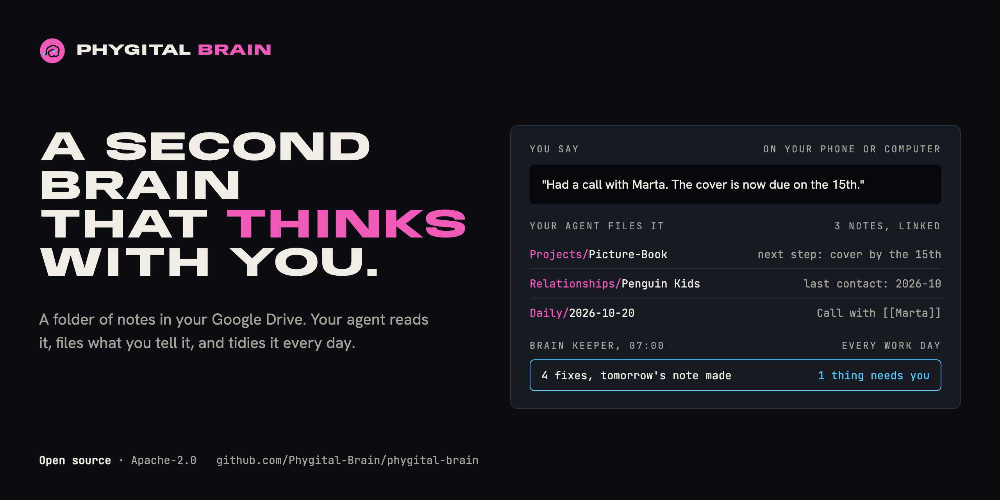</p>

<h1 align="center">Phygital Brain</h1>

<p align="center"><b>A second brain that thinks with you.</b><br>An OS (operating system) for your notes: one folder in your cloud drive that your AI agent reads, writes and keeps tidy. Four short forms build it in about ten minutes. After that, you talk, and your agent files what you say in the right place.</p>

<p align="center">
<a href="#open-source-and-credit"></a>
<a href="LICENSE"></a>
<a href="https://www.npmjs.com/package/phygital-brain"></a>
<a href="#quick-start"></a>
<a href="docs/install.md"></a>
<a href="CONTRIBUTING.md"></a>
</p>
<p align="center">
<a href="docs/other-agents.md"></a>
<a href="docs/getting-started.md#2-a-cloud-drive-folder"></a>
<a href="docs/how-it-works.md"></a>
<a href="SECURITY.md#what-you-share-with-your-ai"></a>
</p>
<p align="center">
<a href="https://github.com/Phygital-Brain/phygital-brain/stargazers"></a>
<a href="https://github.com/Phygital-Brain/phygital-brain/commits/main"></a>
<a href="https://www.npmjs.com/package/phygital-brain"></a>
<a href="#languages"></a>
</p>

<p align="center">
<a href="#what-it-is">What it is</a> ·
<a href="#yours-to-keep">Yours to keep</a> ·
<a href="#how-it-works">How it works</a> ·
<a href="#quick-start">Quick start</a> ·
<a href="#a-week-with-your-brain">A week with it</a> ·
<a href="#on-your-phone">Phone</a> ·
<a href="#languages">Languages</a> ·
<a href="#privacy">Privacy</a> ·
<a href="docs/faq.md">FAQ</a> ·
<a href="#all-the-guides">Guides</a>
</p>

## What it is

Phygital Brain is an OS (operating system) for your notes and your AI agent. It builds one folder in your cloud drive (Google Drive, Nextcloud, Dropbox or any drive your agent can connect to), with three kinds of things inside:

- **Rules:** a `CLAUDE.md` file in every folder. It tells your agent where each kind of information goes, how each note starts, and what to ask you before it changes anything.
- **Notes:** plain Markdown files (simple text files with light formatting) about you, your projects, your people, your decisions and your days. Your agent writes them as you talk, and links them together.
- **The Brain Keeper:** a scheduled task that tidies the brain every work day, plus a full check-up whenever you ask for one.

Every chat on that folder starts with your agent reading the rules and the latest notes. So it already knows your name, your clients, your goals and what you did yesterday. You can read and browse the same notes in [Baalda](https://github.com/naveedharri/baalda), or from your phone through your drive.

It comes as two skills (sets of instructions your agent follows): one builds the brain, one keeps it tidy. They're packaged as a Claude plugin, because Claude is what we use and recommend, but any agent that can work in a folder can follow them. See [Other agents](docs/other-agents.md).

## Yours to keep

- **You own it.** Your brain is a folder of plain text files in your own cloud drive. There's no account with us and nothing to export.
- **Take it to any AI.** Switch to another agent and open the same folder. The new one reads the same notes.
- **It remembers you.** What you tell your agent is saved as notes, so the next chat, or the next AI, starts where you left off.
- **Free and open source.** Anyone can check how it works. Your notes stay private, in your drive: Phygital Brain collects nothing, and your notes go only to the AI you choose.

## Why it exists

A chat with an AI ends, and what you told it goes with it. Next time you explain your business, your clients and your project again. The notes you do keep sit in five apps, and none of them talk to your agent.

Phygital Brain gives the agent one place to read from and write to, with rules it follows every time:

| Without it | With Phygital Brain |
|---|---|
| You explain who you are in every new chat | Your agent reads `About/me.md` before it answers |
| Call notes sit in a chat you'll never find again | The call goes in the project, the client's note and today's daily note, linked |
| You forget why you made a decision | `Memory/decisions/` keeps the decision and the reason, and flags it for review after 30 days |
| Notes pile up and go stale | The Brain Keeper closes old notes, flags stale projects and lists what needs you |
| Your agent changes files without asking | It asks before it creates, moves, renames or deletes anything |

## How it works

<p align="center">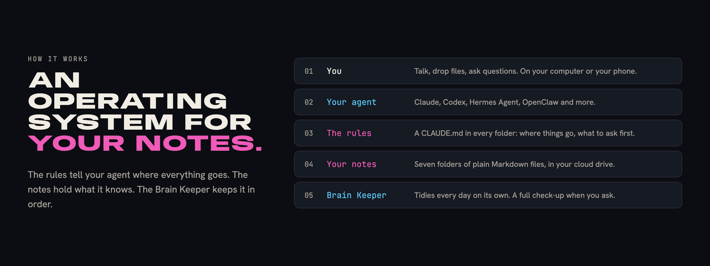</p>

The parts of a computer's operating system each have a match in your brain:

| In a computer | In Phygital Brain |
|---|---|
| The user | You, talking in plain words |
| The processor that does the work | Your AI agent |
| The system rules | `CLAUDE.md` files: one main file, plus one per folder |
| The file system | Seven folders of Markdown notes in your cloud drive |
| Settings | `About/me.md`: how you want your agent to work, your language, time zone and work days |
| A background service | The Brain Keeper, running every work day |
| Apps | Skills: the morning brief, the check-up, and any skill you add |

This is what happens when you tell your agent something:

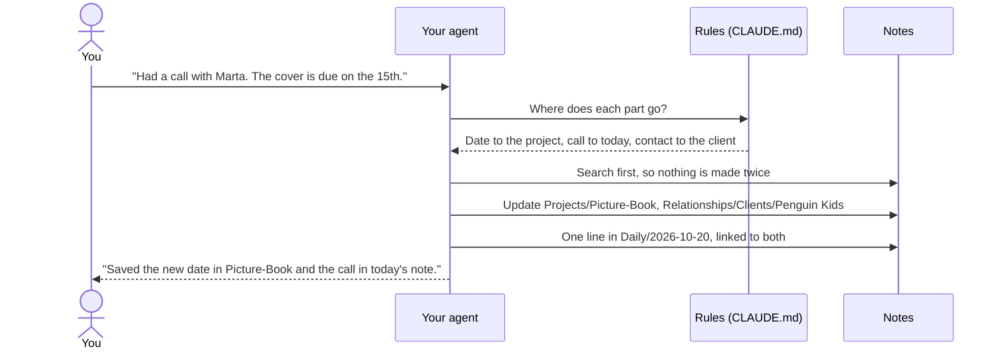

Small updates to notes that already exist happen right away, and your agent tells you in one line. New notes, moves, renames and deletes always wait for your yes. More in [How it works](docs/how-it-works.md).

## What you get

- **A brain built from your answers.** People who sell get pages for their business, services and customers. People who don't sell get none of those. A morning brief appears only if you ask for one.
- **Questions written for your work.** The second form starts with three questions your agent writes for your job. An illustrator gets asked about publishers and how they charge; a developer gets asked about their projects and tools.
- **Projects, people and days, linked.** Every person, company and project is a `[[link]]`, so one click in Baalda takes you from a project to the client to the day you talked.
- **Decisions with the reason.** Each decision note says what you chose, why, what you gave up, and the risk. Open decisions show up in your daily note until you close them.
- **The Brain Keeper.** Every work day it makes tomorrow's note, closes old ones, lists open decisions, fixes up to 5 small things and writes a report. A full check-up runs whenever you say "check up my brain".
- **A morning brief,** if you want one: your three most important things, what you're waiting on, and one decision to make.
- **Meeting prep.** Say "prep me for Marta" and get a short brief from your notes: when you last talked, what's going on, what was agreed, what to bring up.
- **Thinking tools.** "Challenge my idea" weighs it against your own notes. "What patterns do you see?" finds what keeps coming up. "Find contradictions" finds notes that disagree.
- **Your apps, read only.** Connect Gmail and Google Calendar (or Outlook, Nextcloud and others) and the Brain Keeper notes yesterday's emails with your people and tomorrow's meetings. It never sends or changes anything.
- **Fully online, if you want.** The Brain Keeper can run as a cloud routine, reading and writing your notes through your cloud drive, with your computer off.
- **Backups and undo.** Before a big change, your agent copies the files into a hidden `.backups/` folder for 10 days. "Undo the last change" puts them back.
- **Old notes, any time.** "Bring in my old notes" imports from Notion, Google Docs, Apple Notes and others, with a plan you approve first.
- **Teams.** Share one brain through Baalda's cloud, with a Team section in the rules for each person's role.
- **Your phone.** Ask your brain things from your agent's phone app through your cloud drive, or send tasks to your computer (in Claude, with Dispatch).
- **Your language.** The forms, messages and notes are in the language you pick. The folder and note names are too. Only a few system files, like `CLAUDE.md`, keep their English names.
- **Writing that sounds like you.** Every brain comes with the [no-ai-slop](https://github.com/petergyang/no-ai-slop) skill. Your agent writes in your voice, then checks for AI-sounding patterns before anyone else reads it.
- **Careful work habits.** The main rules include Andrej Karpathy's guidelines for AI assistants: ask when unsure, pick the simplest way, change only what's needed, check the work.
- **Your own rules.** When you correct your agent, it saves the correction as a new rule, in your words. Upgrades never change those rules.

## How your agent works

<p align="center"></p>

The work habits are Andrej Karpathy's guidelines for AI assistants ([andrej-karpathy-skills](https://github.com/multica-ai/andrej-karpathy-skills)), built into every brain's main rules in our own words. The Writing Check uses the [no-ai-slop](https://github.com/petergyang/no-ai-slop) skill, which every brain gets in `Skills/no-ai-slop/`. More in [Main rules](docs/folders/main-rules.md).

## Inside your brain

<p align="center">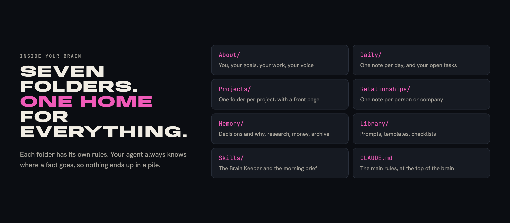</p>

```
My Brain/
├── CLAUDE.md          the main rules
├── .claudeignore      what your agent never reads unless you ask
├── About/             me.md, goals.md, business.md, services.md, brand.md ...
├── Daily/             2026-10-20.md, 2026-10-21.md ... and tasks.md
├── Projects/          Picture-Book/README.md, Portfolio-Website/README.md ...
├── Relationships/     Clients/, Collaborators/, Team/, Partners/
├── Memory/            decisions/, research/, finances/ (private), archive/
├── Library/           prompts, templates, checklists
└── Skills/            brain-keeper/, morning-brief/
```

Each folder has its own guide: what goes in it, what you can say, examples and its rules. Start at [The folders in your brain](docs/folders/README.md).

## Quick start

<p align="center">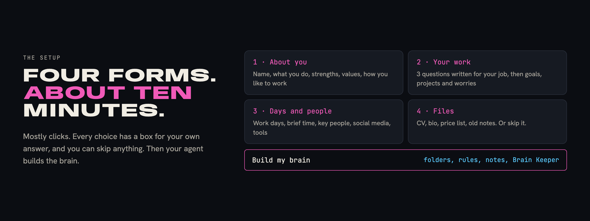</p>

You need an AI agent that can work in a folder, a cloud drive your agent can connect to, and a computer. No code. We recommend Claude with Google Drive, the pair we tested most, so the steps below use them. The full steps, with other drives and agents, are in [Getting started](docs/getting-started.md).

| Step | What you do | Time |
|---|---|---|
| 1 | Get your agent: we recommend the [Claude desktop app](https://claude.ai/download) with a paid plan | 3 min |
| 2 | Install your cloud drive's desktop app (for example Google Drive), and make a folder for your brain inside it | 3 min |
| 3 | In your agent, start a task and choose that folder | 1 min |
| 4 | Connect the drive to your agent (in Claude: Settings, Connectors), so your phone can reach the brain | 1 min |
| 5 | Download [Baalda](https://github.com/naveedharri/baalda) and open the same folder | 2 min |
| 6 | Install Phygital Brain (one click, below) and say **"Set up my second brain."** | 10 min |

**Install:** click the button for your agent.

<p align="center">
<a href="https://github.com/Phygital-Brain/phygital-brain/releases/latest/download/phygital-brain.mcpb">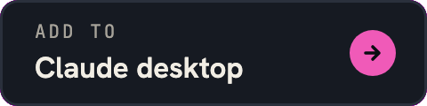</a>
<a href="docs/install.md#claude-code">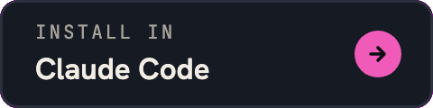</a>
<a href="https://cursor.com/en/install-mcp?name=phygital-brain&config=eyJjb21tYW5kIjoibnB4IiwiYXJncyI6WyIteSIsInBoeWdpdGFsLWJyYWluIl19">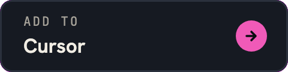</a>
<br>
<a href="https://insiders.vscode.dev/redirect?url=vscode%3Amcp%2Finstall%3F%257B%2522name%2522%253A%2522phygital-brain%2522%252C%2522command%2522%253A%2522npx%2522%252C%2522args%2522%253A%255B%2522-y%2522%252C%2522phygital-brain%2522%255D%257D">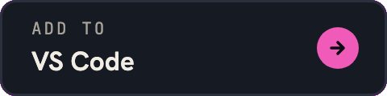</a>
<a href="docs/install.md#codex">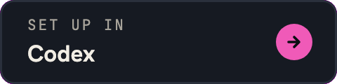</a>
<a href="docs/install.md#hermes-agent-and-openclaw">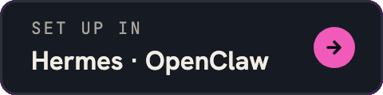</a>
</p>

**Or in a terminal, for any agent that uses skills** (Claude Code, Codex, Cursor, Gemini CLI and others):

```bash
npx skills add Phygital-Brain/phygital-brain
```

It asks which of your agents to add it to. Claude desktop and Claude Code need nothing more. The other ways need [Node.js](https://nodejs.org), a free one-time install.

Every way, step by step: [Install](docs/install.md).

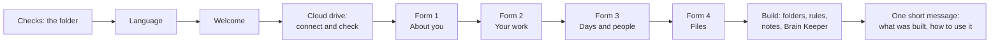

At the end, your agent welcomes you as your personal assistant, and offers Baalda to browse your notes like an app.

## A week with your brain

Ana is an illustrator in Lisbon. She sells picture-book work to publishers and set up her brain on Monday.

- **Monday, 10:00.** She answers the four forms and drops in her CV and price list. Her agent builds `About/me.md`, `goals.md`, `services.md`, three projects and a note for her editor's publisher.
- **Tuesday, 08:00.** Her morning brief lists three things: send the sketches, reply to a bakery about a logo, and decide on her cover price.
- **Tuesday, 15:00.** After a call she says: "Marta wants the cover by the 15th." The project, the client note and the day are updated and linked.
- **Wednesday, on the bus.** In her agent's phone app she asks: "What did Marta and I agree on Tuesday?" It finds the note in her drive.
- **Thursday.** "I decided to raise my cover price to 400 from January." Her agent asks a little about why, then writes `Memory/decisions/2026-10-23-raise-cover-price.md`.
- **Every work day, 07:00.** The Brain Keeper makes the next day's note, closes old ones and fixes small things. Each morning it lists the cover-price decision as still open, until she closes it.

More people, from a bakery owner to a student, are in [Use cases](docs/use-cases.md).

## On your phone

| Way | What it does | Your computer |
|---|---|---|
| **Ask:** your agent's phone app, with your drive connected | Finds and reads what's in your brain | Can be off |
| **Do:** sending a task to your agent on your computer (in Claude, Dispatch) | Adds and files things with all the rules | Must be on, with your agent's app open |

Setup, what to say, and fixes for common problems: [Your brain on your phone](docs/phone.md).

## Languages

Phygital Brain is ready in **41 languages**. Pick yours at the start of the setup, and the whole brain is built in it: the forms, the rules, the folder and note names, the Brain Keeper and every message.

See [the full list of languages](languages/README.md#ready-languages).

**Your language isn't here?** Pick Other and type it. Your agent translates the whole brain during the setup, folder names included, without asking you anything. To make a checked set that everyone who speaks your language can use, say:

> Translate Phygital Brain into my language.

The `add-language` skill asks you three things (formal or informal "you", the main folder names, and the names for the Brain Keeper and the morning brief), translates everything, checks it, and shows you how to use it and share it. How it works, step by step: [Languages](languages/README.md).

**Switching later:** say "Switch my brain to Spanish". Your agent renames the folders and swaps the rules, with a backup first and your yes.

## Works with your agent

| | Claude desktop app | Agents that work in a folder (Claude Code, Codex, Hermes Agent, OpenClaw) | Chat apps that can't save files |
|---|---|---|---|
| Build the brain | Yes | Yes | No |
| The four form windows | Yes | The same questions, in chat | No |
| Daily use | Yes | Yes | Read only |
| Brain Keeper and morning brief | Yes, scheduled | If the app can schedule tasks | No |

The rule files are called `CLAUDE.md`. Agents that look for another name, like `AGENTS.md` in Codex, get a one-line file that points to `CLAUDE.md`, so there's only one set of rules. More in [Other agents](docs/other-agents.md).

## Privacy

Your notes are read by your AI agent and stored in your cloud drive. Phygital Brain itself has no server and collects nothing. More in [What you share with your AI](SECURITY.md#what-you-share-with-your-ai).

- **Private details stay in one place.** Tax IDs, bank details, card numbers, your full legal name and your birth date live only in the note that needs them. Your agent never copies them into other notes, and never repeats them in a reply.
- **A "never read" list.** `.claudeignore` covers password and key files and `Memory/finances/`. Your agent opens those only when you ask for an exact file. Your agent follows this as a rule, but nothing is locked.
- **No secrets in notes.** Passwords, keys and tokens belong in a password manager.

## What it isn't

The full list is in [Limits](docs/limits.md).

- **No app.** There's nothing to run. Your AI agent does the work, following the files in this repository.
- **No lock yet.** The rules work only because your agent follows them. Keep truly secret things outside the brain folder. Locked folders are on the [roadmap](#roadmap).
- **Not always on, unless you move it to the cloud.** On your computer, the Brain Keeper and the morning brief run only while your agent's app is open. As a cloud routine, they run with the computer off.
- **An early version.** This is version 0.1.10, and the setup hasn't been tested with many people yet.

## Roadmap

Planned, not built yet:

- **Locked folders.** You choose which folders to lock, like `Memory/finances/`. Their notes are encrypted in your drive, so no app or agent can read them without you. You unlock them with your password or fingerprint, from the agent you already use, and only for what you approve.

Ideas are welcome: open an issue on GitHub.

## Updating and leaving

**To update:** update the plugin (in Claude Code, `/plugin marketplace update phygital-brain`), then say **"Upgrade my second brain."** Your agent shows what's new and asks first. Your notes and your own rules stay as they are.

**To change your answers:** say **"Update my answers."** The forms open again, and your About pages are refreshed.

**To leave:** uninstall the plugin. Your brain is a folder of plain text files in your own cloud drive. Any app that reads Markdown can open it.

## FAQ

The most asked questions are below. The full list, with 92 answers grouped by topic, is in the [FAQ](docs/faq.md).

<details>
<summary><b>Do I need to know how to code?</b></summary>

No. You install a few apps, answer four forms and talk in plain words. The only lines that look like code are the two install lines for Claude Code, and you can paste them.
</details>

<details>
<summary><b>Which AI agents does it work with?</b></summary>

Any agent that can read, edit and create files in a folder on your computer. Claude is what we use and recommend: it's the only one that shows the setup as form windows, and it can schedule the Brain Keeper. Codex, Hermes Agent, OpenClaw and similar agents ask the same questions in chat. See [Other agents](docs/other-agents.md).
</details>

<details>
<summary><b>Which cloud drives work?</b></summary>

Any drive that keeps a copy of the folder on your computer and that your agent can connect to, so it can read, edit and create files there: Google Drive, Nextcloud, Dropbox, OneDrive and others. Claude has a built-in Google Drive connector; other drives usually connect through an MCP server. See [Cloud drives](docs/faq.md#cloud-drives).
</details>

<details>
<summary><b>Will it change my notes without asking?</b></summary>

It saves small updates to notes that already exist and tells you in one line. It asks before it makes a new note, rewrites one, or moves, renames or deletes anything. The Brain Keeper never deletes your notes.
</details>

<details>
<summary><b>What does it cost?</b></summary>

Phygital Brain is free and open source. You pay for your AI agent and, if you need more than the free space, your cloud drive.
</details>

## All the guides

| Guide | What's in it |
|---|---|
| [Use cases](docs/use-cases.md) | Five people, what their brain looks like, and what they say on a normal day |
| [FAQ](docs/faq.md) | 92 questions and answers, grouped by topic |
| [Install](docs/install.md) | One click for Claude desktop, Cursor and VS Code, and steps for Claude Code, Codex, Hermes Agent, OpenClaw and others |
| [Getting started](docs/getting-started.md) | Every step from nothing to a working brain, with checks and fixes |
| [Connect your apps](docs/connect-your-apps.md) | Gmail, Calendar, Drive and other services, read only, and running fully online |
| [Add more skills](docs/add-skills.md) | Adding any skill to your brain, making videos with [HyperFrames](https://github.com/heygen-com/hyperframes) and making designs with [Canva](https://www.canva.com) |
| [Teams](docs/teams.md) | Sharing one brain through Baalda's cloud |
| [Bringing in your old notes](docs/importing.md) | Exporting from Notion, Google Docs, Apple Notes and others, and filing it all |
| [Example brain](docs/example-brain/README.md) | A few made-up notes, so you can see the files before you build yours |
| [How it works](docs/how-it-works.md) | What your agent does at each step, when it saves and when it asks |
| [The folders in your brain](docs/folders/README.md) | One page per folder and subfolder, with examples and rules |
| [Main rules](docs/folders/main-rules.md) | The main `CLAUDE.md`, in plain words |
| [Your brain on your phone](docs/phone.md) | Ask from your agent's phone app, send tasks to your computer |
| [Other agents](docs/other-agents.md) | Using Codex, Hermes Agent, OpenClaw or another agent, rule file names, two agents on one brain |
| [Languages](languages/README.md) | How other languages work |
| [Limits](docs/limits.md) | What it does badly, or not yet |
| [Glossary](docs/glossary.md) | Every term, in plain words |
| [Security and privacy](SECURITY.md) | What you share with your AI, and how to report a problem |

## This repository

| Folder | What |
|---|---|
| `skills/brain-setup/` | The setup: the agent's instructions, the four forms, and every file a new brain gets |
| `skills/brain-keeper/` | The Brain Keeper: the daily tidy and the check-up |
| `skills/add-language/` | Making a full set in a new language, or switching a brain's language |
| `skills/brain-setup/i18n/` | The built language sets the setup copies |
| `docs/` | The guides above, and the images |
| `languages/` | The translations (one file and folder per language) and how to add one |
| `scripts/` | The checks to run before a change (`python3 scripts/check.py`) |
| `.claude-plugin/` | The plugin files, for installing it in Claude |
| `mcp/` | The connector (an MCP server, no dependencies) for agents that take MCP servers |
| `package.json` | The npm package, so `npx -y phygital-brain` runs the connector |
| `.github/workflows/` | Releases each new version: npm, and the GitHub release with the Claude desktop file |

<p align="center">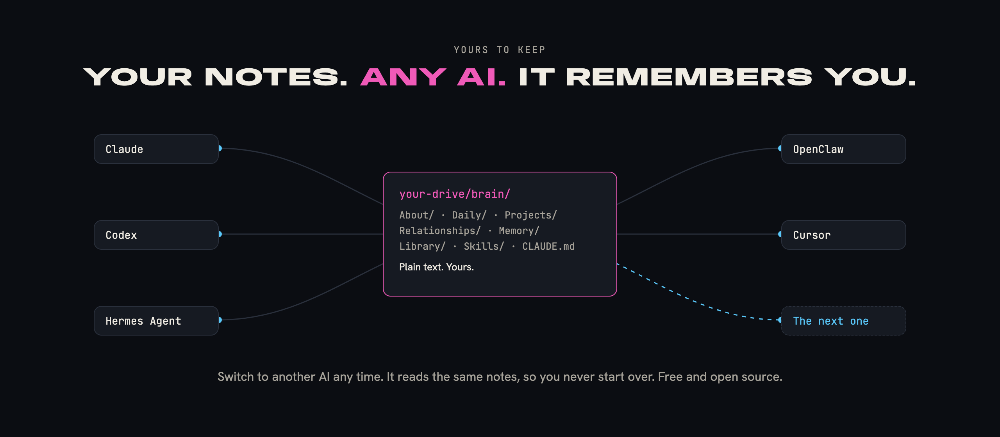</p>

## Help and contributing

Questions, bugs and ideas: open an issue on GitHub. To change something, read [CONTRIBUTING.md](CONTRIBUTING.md) and [AGENTS.md](AGENTS.md). Report security or privacy problems privately, as [SECURITY.md](SECURITY.md) explains. To cite the project, use [CITATION.cff](CITATION.cff).

## Open source and credit

Free and open source under the [Apache License 2.0](LICENSE). Keep the [NOTICE](NOTICE) file: it carries the line "Created by Phygital-Brain".

The licence doesn't cover the name and logo (see [TRADEMARKS.md](TRADEMARKS.md)). You can say your work is "built on Phygital Brain", but you can't sell it under that name.

## No warranty

Phygital Brain is provided as is, without warranty of any kind (see sections 7 and 8 of the [licence](LICENSE)). You're responsible for what you put in your brain and what you share with your AI provider.
