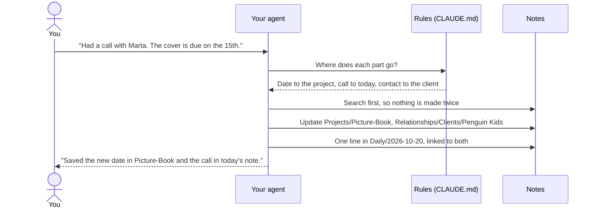
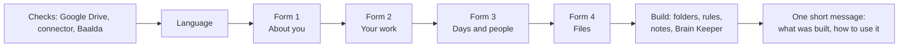

<p align="center"></p>

<h1 align="center">Phygital Brain</h1>

<p align="center"><b>A second brain that thinks with you.</b><br>A folder of notes in your Google Drive that your AI agent reads, writes and keeps tidy. Four short forms build it in about ten minutes. After that, you talk, and your agent files what you say in the right place.</p>

<p align="center">
<a href="LICENSE"></a>
<a href="CHANGELOG.md"></a>
<a href="docs/other-agents.md"></a>
<a href="docs/getting-started.md"></a>
</p>
<p align="center">
<a href="docs/how-it-works.md"></a>
<a href="docs/phone.md"></a>
<a href="languages/README.md"></a>
<a href="SECURITY.md#what-you-share-with-your-ai"></a>
</p>

<p align="center">
<a href="#what-it-is">What it is</a> ·
<a href="#how-it-works">How it works</a> ·
<a href="#quick-start">Quick start</a> ·
<a href="#a-week-with-your-brain">A week with it</a> ·
<a href="#on-your-phone">Phone</a> ·
<a href="#privacy">Privacy</a> ·
<a href="#faq">FAQ</a> ·
<a href="#all-the-guides">Guides</a>
</p>

## What it is

Phygital Brain is an operating system for your notes. It's a Claude plugin (an add-on for Claude) with two skills (sets of instructions your agent follows), and it builds one folder in your Google Drive with three kinds of things inside:

- **Rules:** a `CLAUDE.md` file in every folder. It tells your agent where each kind of information goes, how each note starts, and what to ask you before it changes anything.
- **Notes:** plain Markdown files (simple text files with light formatting) about you, your projects, your people, your decisions and your days. Your agent writes them as you talk, and links them together.
- **The Brain Keeper:** a scheduled task that tidies the brain every work day, plus a full check-up whenever you ask for one.

Every chat on that folder starts with your agent reading the rules and the latest notes. So it already knows your name, your clients, your goals and what you did yesterday. You can read and browse the same notes in [Baalda](https://github.com/naveedharri/baalda), or from your phone through Google Drive.

## Why it exists

A chat with an AI ends, and what you told it goes with it. Next time you explain your business, your clients and your project again. The notes you do keep sit in five apps, and none of them talk to your agent.

Phygital Brain gives the agent one place to read from and write to, with rules it follows every time:

| Without it | With Phygital Brain |
|---|---|
| You explain who you are in every new chat | Your agent reads `About/me.md` before it answers |
| Call notes sit in a chat you'll never find again | The call goes in the project, the client's note and today's daily note, linked |
| You forget why you made a decision | `Memory/decisions/` keeps the decision and the reason, and flags it for review after 30 days |
| Notes pile up and go stale | The Brain Keeper closes old notes, flags stale projects and lists what needs you |
| Your agent changes files without asking | It asks before it creates, moves, renames or deletes anything |

## How it works

<p align="center"></p>

The parts of a computer's operating system each have a match in your brain:

| In a computer | In Phygital Brain |
|---|---|
| The user | You, talking in plain words |
| The processor that does the work | Your AI agent |
| The system rules | `CLAUDE.md` files: one main file, plus one per folder |
| The file system | Seven folders of Markdown notes in Google Drive |
| Settings | `About/me.md`: how you want your agent to work, your language, time zone and work days |
| A background service | The Brain Keeper, running every work day |
| Apps | Skills: the morning brief, the check-up, and any skill you add |

This is what happens when you tell your agent something:



Small updates to notes that already exist happen right away, and your agent tells you in one line. New notes, moves, renames and deletes always wait for your yes. More in [How it works](docs/how-it-works.md).

## What you get

- **A brain built from your answers.** People who sell get pages for their business, services and customers. People who don't sell get none of those. A morning brief appears only if you ask for one.
- **Questions written for your work.** The second form starts with three questions your agent writes for your job. An illustrator gets asked about publishers and how they charge; a developer gets asked about their projects and tools.
- **Projects, people and days, linked.** Every person, company and project is a `[[link]]`, so one click in Baalda takes you from a project to the client to the day you talked.
- **Decisions with the reason.** Each decision note says what you chose, why, what you gave up, and the risk. Open decisions show up in your daily note until you close them.
- **The Brain Keeper.** Every work day it makes tomorrow's note, closes old ones, lists open decisions, fixes up to 5 small things and writes a report. A full check-up runs whenever you say "check up my brain".
- **A morning brief,** if you want one: your three most important things, what you're waiting on, and one decision to make.
- **Your phone.** Ask your brain things from the Claude phone app, or send it tasks with Dispatch.
- **Your language.** The forms, messages and notes are in the language you pick. File and folder names stay in English, so the rules work the same everywhere.
- **Your own rules.** When you correct your agent, it saves the correction as a new rule, in your words. Upgrades never change those rules.

## Inside your brain

<p align="center"></p>

```
My Brain/
├── CLAUDE.md          the main rules
├── .claudeignore      what your agent never reads unless you ask
├── About/             me.md, goals.md, business.md, services.md, brand.md ...
├── Daily/             2026-10-20.md, 2026-10-21.md ... and tasks.md
├── Projects/          Picture-Book/README.md, Portfolio-Website/README.md ...
├── Relationships/     Clients/, Collaborators/, Team/, Partners/
├── Memory/            decisions/, research/, finances/ (private), archive/
├── Library/           prompts, templates, checklists
└── Skills/            brain-keeper/, morning-brief/
```

Each folder has its own guide: what goes in it, what you can say, examples and its rules. Start at [The folders in your brain](docs/folders/README.md).

## Quick start

<p align="center"></p>

You need a paid Claude plan, a Google account and a computer. No code. The full steps, with what to check after each one, are in [Getting started](docs/getting-started.md).

| Step | What you do | Time |
|---|---|---|
| 1 | Download the [Claude desktop app](https://claude.ai/download) and pick a paid plan | 3 min |
| 2 | Install Google Drive for desktop, and make a folder for your brain inside it | 3 min |
| 3 | In Claude, start a task and choose that folder | 1 min |
| 4 | Connect Google Drive in Claude's settings, so your phone can reach the brain | 1 min |
| 5 | Download [Baalda](https://github.com/naveedharri/baalda) and open the same folder | 2 min |
| 6 | Install Phygital Brain (below) and say **"Set up my second brain."** | 10 min |

**Install in Claude Code:**

```
/plugin marketplace add Phygital-Brain/phygital-brain
```

```
/plugin install phygital-brain@phygital-brain
```

**In the Claude desktop app:** add `Phygital-Brain/phygital-brain` as a plugin from GitHub in the plugin settings.

**With another agent:** see [Other agents](docs/other-agents.md).



At the end, your agent also gives you a short text to paste into your agent's settings, so it talks to you the same way in every chat.

## A week with your brain

Ana is an illustrator in Lisbon. She sells picture-book work to publishers and set up her brain on Monday.

- **Monday, 10:00.** She answers the four forms and drops in her CV and price list. Her agent builds `About/me.md`, `goals.md`, `services.md`, three projects and a note for her editor's publisher.
- **Tuesday, 08:00.** Her morning brief lists three things: send the sketches, reply to a bakery about a logo, and decide on her cover price.
- **Tuesday, 15:00.** After a call she says: "Marta wants the cover by the 15th." The project, the client note and the day are updated and linked.
- **Wednesday, on the bus.** In the Claude phone app she asks: "What did Marta and I agree on Tuesday?" It finds the note in Google Drive.
- **Thursday.** "I decided to raise my cover price to 400 from January." Her agent asks a little about why, then writes `Memory/decisions/2026-10-23-raise-cover-price.md`.
- **Every work day, 07:00.** The Brain Keeper makes the next day's note, closes old ones and fixes small things. Each morning it lists the cover-price decision as still open, until she closes it.

## On your phone

| Way | What it does | Your computer |
|---|---|---|
| **Ask:** the Claude phone app with Google Drive connected | Finds and reads what's in your brain | Can be off |
| **Do:** Dispatch, sending a task to your computer | Adds and files things with all the rules | Must be on, with the Claude app open |

Setup, what to say, and fixes for common problems: [Your brain on your phone](docs/phone.md).

## Works with your agent

| | Claude desktop app | Agents that work in a folder (Codex, Claude Code) | Chat apps that can't save files |
|---|---|---|---|
| Build the brain | Yes | Yes | No |
| The four form windows | Yes | The same questions, in chat | No |
| Daily use | Yes | Yes | Read only |
| Brain Keeper and morning brief | Yes, scheduled | If the app can schedule tasks | No |

The rule files are called `CLAUDE.md`. Agents that look for another name, like `AGENTS.md` in Codex, get a one-line file that points to `CLAUDE.md`, so there's only one set of rules. More in [Other agents](docs/other-agents.md).

## Privacy

> [!IMPORTANT]
> Your agent reads your notes to help you, so everything it reads goes to the company that runs your AI, and your files are stored by Google. Some AI companies may use your chats to train their models, depending on your plan and settings. Read [What you share with your AI](SECURITY.md#what-you-share-with-your-ai) before you start.

- **Private details stay in one place.** Tax IDs, bank details, card numbers, your full legal name and your birth date live only in the note that needs them. Your agent never copies them into other notes, and never repeats them in a reply.
- **A "never read" list.** `.claudeignore` covers password and key files and `Memory/finances/`. Your agent opens those only when you ask for an exact file. Your agent follows this as a rule, but nothing is locked.
- **No secrets in notes.** Passwords, keys and tokens belong in a password manager.
- **Nothing calls home.** Phygital Brain is files and instructions. It has no server and collects nothing.

## What it isn't

- **No app.** There's nothing to run. Your AI agent does the work, following the files in this repository.
- **No lock.** The rules work only because your agent follows them. Keep truly secret things outside the brain folder.
- **Not always on.** The Brain Keeper and the morning brief run only while the Claude app is open and your computer is awake.
- **An early version.** This is version 0.1.0, and the setup hasn't been tested with many people yet.

## Updating and leaving

**To update:** update the plugin (in Claude Code, `/plugin marketplace update phygital-brain`), then say **"Upgrade my second brain."** Your agent shows what's new and asks first. Your notes and your own rules stay as they are.

**To change your answers:** say **"Update my answers."** The forms open again, and your About pages are refreshed.

**To leave:** uninstall the plugin. Your brain is a folder of plain text files in your own Google Drive. Any app that reads Markdown can open it.

## FAQ

<details>
<summary><b>Do I need to know how to code?</b></summary>

No. You install three apps, answer four forms and talk in plain words. The only typing that looks like code is the two install lines, and you can paste them.
</details>

<details>
<summary><b>Which AI does it work with?</b></summary>

Claude is the easiest, because the setup forms open as windows in the Claude desktop app. Codex and other agents that can read and write files in a folder work too; they ask the same questions in chat. See [Other agents](docs/other-agents.md).
</details>

<details>
<summary><b>Do I have to use Google Drive and Baalda?</b></summary>

They're part of the setup, and the setup checks for both. Google Drive matters most: it backs up your brain and lets you use it from your phone. If you don't want one, say so and the setup goes on without it. Baalda is for browsing on your computer; you don't need it on your phone.
</details>

<details>
<summary><b>What if my agent does something I don't want?</b></summary>

Tell it: "Don't do that, do this instead." It saves your correction as a rule and follows it from then on. It never deletes, moves or renames anything without asking, and the Brain Keeper never deletes your notes at all.
</details>

<details>
<summary><b>Can I add my own folders?</b></summary>

Yes. Ask: "I want a place for my students." Your agent suggests where it fits, asks first, and adds it to the rules so it's used the same way every time.
</details>

<details>
<summary><b>Does it work in my language?</b></summary>

Yes. The setup asks which language your brain should speak, and the forms, messages and notes follow it. File and folder names stay in English so the rules keep working. See [Languages](languages/README.md).
</details>

<details>
<summary><b>What does it cost?</b></summary>

Phygital Brain is free and open source. You need a paid Claude plan (or another agent you pay for), and Google Drive storage, which has a free tier.
</details>

## All the guides

| Guide | What's in it |
|---|---|
| [Getting started](docs/getting-started.md) | Every step from nothing to a working brain, with checks and fixes |
| [How it works](docs/how-it-works.md) | What your agent does at each step, when it saves and when it asks |
| [The folders in your brain](docs/folders/README.md) | One page per folder and subfolder, with examples and rules |
| [Main rules](docs/folders/main-rules.md) | The main `CLAUDE.md`, in plain words |
| [Your brain on your phone](docs/phone.md) | Ask from the Claude app, do with Dispatch |
| [Other agents](docs/other-agents.md) | Using Codex or another agent, rule file names, two agents on one brain |
| [Languages](languages/README.md) | How other languages work |
| [Security and privacy](SECURITY.md) | What you share with your AI, and how to report a problem |

## This repository

| Folder | What |
|---|---|
| `skills/brain-setup/` | The setup: the agent's instructions, the four forms, and every file a new brain gets |
| `skills/brain-keeper/` | The Brain Keeper: the daily tidy and the check-up |
| `docs/` | The guides above, and the images |
| `languages/` | How other languages work |
| `scripts/` | The checks to run before a change (`python3 scripts/check.py`) |
| `.claude-plugin/` | What makes this a Claude plugin |

## Help and contributing

Questions, bugs and ideas: open an issue on GitHub. To change something, read [CONTRIBUTING.md](CONTRIBUTING.md) and [AGENTS.md](AGENTS.md). Report security or privacy problems privately, as [SECURITY.md](SECURITY.md) explains. To cite the project, use [CITATION.cff](CITATION.cff).

## Open source and credit

Free and open source under the [Apache License 2.0](LICENSE). Keep the [NOTICE](NOTICE) file: it carries the line "Created by Phygital-Brain".

The licence doesn't cover the name and logo (see [TRADEMARKS.md](TRADEMARKS.md)). You can say your work is "built on Phygital Brain", but you can't sell it under that name.

## No warranty

Phygital Brain is provided as is, without warranty of any kind (see sections 7 and 8 of the [licence](LICENSE)). You're responsible for what you put in your brain and what you share with your AI provider.
