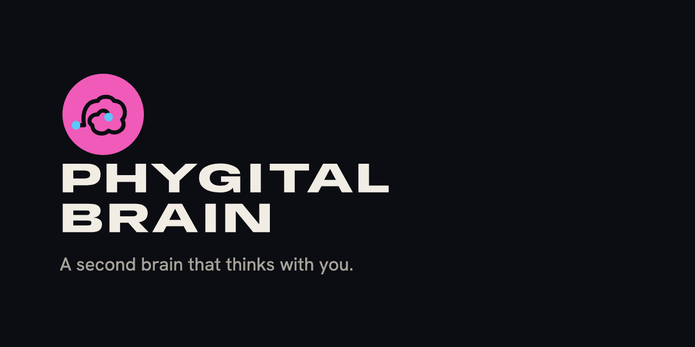

<p align="center"></p>

<h1 align="center">Phygital Brain</h1>

<p align="center"><b>A second brain that thinks with you.</b><br>A folder of notes in your Google Drive that your agent reads, writes and keeps tidy. Four short forms build it in about 10 minutes. Then you talk normally, and your agent files everything in the right place.</p>

<p align="center">
<a href="LICENSE"></a>
<a href="CHANGELOG.md"></a>

</p>

## What you get

- **A brain that knows you.** Pages about you, your goals, your work, your customers and your voice, filled from your answers and the files you drop in.
- **Projects and people.** One page per project and per person, linked together, kept up to date as you talk.
- **A daily journal.** One note per day, with what happened and what's open.
- **Rules your agent follows.** A `CLAUDE.md` file in each folder says where everything goes, so nothing ends up in a pile.
- **A daily tidy.** The Brain Keeper closes old notes, lists open decisions, fixes small things and tells you what needs you. It never deletes or moves your notes.
- **A morning brief,** if you want one: your three most important things, every work day.
- **On your phone.** Your brain lives in Google Drive, so you can ask it things from the Claude phone app, and send it tasks from anywhere. See [Your brain on your phone](docs/phone.md).

It's plain Markdown files, so you can open them in [Baalda](https://github.com/naveedharri/baalda) and they're yours.

## Set it up

You need a paid Claude plan, Google Drive and Baalda. The full steps are in [Getting started](docs/getting-started.md).

1. **Claude:** download the Claude desktop app and pick a paid plan.
2. **Google Drive:** install Google Drive for desktop, and make a folder for your brain inside it.
3. **Attach the folder:** in Claude, pick that folder for your chat.
4. **Connect Google Drive** to Claude, so you can reach your brain from the web and your phone.
5. **[Baalda](https://github.com/naveedharri/baalda):** download it and open the same folder.
6. **Install Phygital Brain** in Claude (below), then say **"Set up my second brain."**

### Install

In Claude Code:

```
/plugin marketplace add Phygital-Brain/phygital-brain
/plugin install phygital-brain@phygital-brain
```

In the Claude desktop app, add `Phygital-Brain/phygital-brain` as a plugin from GitHub in the plugin settings.

**Other agents** (ChatGPT, Codex and others): see [Other agents](docs/other-agents.md).

### What happens next

1. Your agent asks which language your brain should speak.
2. Four short forms, one at a time: about you, your work, your days and people, and files to read. Mostly clicks. Every choice has a box to write your own answer, and you can skip anything.
3. Your agent builds the brain and sets up the Brain Keeper.
4. One short message tells you what was built and how to use it.

More in [How it works](docs/how-it-works.md), and a page for each folder in [The folders in your brain](docs/folders/README.md).

## What's in this repository

| Folder | What |
|---|---|
| `skills/brain-setup/` | The setup: instructions for the agent, the four forms, and every file the brain gets |
| `skills/brain-keeper/` | The Brain Keeper: the daily tidy and the check-up |
| `docs/` | Getting started, your brain on your phone, how it works, a page for each folder, other agents, and the logo |
| `languages/` | How other languages work |
| `.claude-plugin/` | What makes this a Claude plugin |
| `scripts/` | The checks to run before a change (`python3 scripts/check.py`) |

## Help and contributing

Questions, bugs and ideas: open an issue on GitHub. To change something, read [CONTRIBUTING.md](CONTRIBUTING.md). Security or privacy problems: [SECURITY.md](SECURITY.md), privately. To cite the project: [CITATION.cff](CITATION.cff).

## Open source and credit

Apache License 2.0 (see [LICENSE](LICENSE) and [NOTICE](NOTICE)). Created by Phygital-Brain.

The name and logo are not part of the licence: see [TRADEMARKS.md](TRADEMARKS.md). You can say your work is "built on Phygital Brain", but you can't sell it under that name.
