<p align="center"><a href="README.md">English</a> · <a href="README.zh-CN.md">简体中文</a> · <b>Português (Brasil)</b> · <a href="README.es.md">Español</a> · <a href="README.fr.md">Français</a> · <a href="README.ja.md">日本語</a> · <a href="README.ar.md">العربية</a></p>
<p align="center"><sub>Traduzido do inglês. Se algo estiver diferente, vale o README em inglês. Os guias indicados aqui estão em inglês.</sub></p>

<p align="center">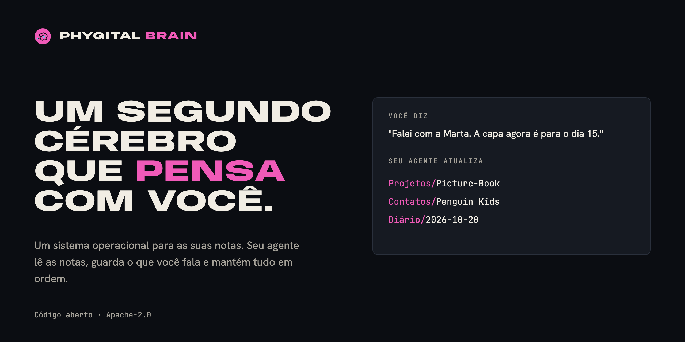</p>

<h1 align="center">Phygital Brain</h1>

<p align="center"><b>Um segundo cérebro que pensa com você.</b><br>Um sistema operacional (o "OS") para as suas notas: uma pasta no seu drive na nuvem que seu agente de IA lê, escreve e mantém em ordem. Quatro formulários curtos montam tudo em uns dez minutos. Depois disso, é só falar, e seu agente guarda o que você diz no lugar certo.</p>

<p align="center">
<a href="#código-aberto-e-créditos"></a>
<a href="LICENSE"></a>
<a href="https://www.npmjs.com/package/phygital-brain"></a>
<a href="#início-rápido"></a>
<a href="docs/install.md"></a>
<a href="CONTRIBUTING.md"></a>
</p>
<p align="center">
<a href="docs/other-agents.md"></a>
<a href="docs/getting-started.md#2-a-cloud-drive-folder"></a>
<a href="docs/how-it-works.md"></a>
<a href="SECURITY.md#what-you-share-with-your-ai"></a>
</p>
<p align="center">
<a href="https://github.com/Phygital-Brain/phygital-brain/stargazers"></a>
<a href="https://github.com/Phygital-Brain/phygital-brain/commits/main"></a>
<a href="https://www.npmjs.com/package/phygital-brain"></a>
<a href="#idiomas"></a>
</p>

<p align="center">
<a href="#o-que-é">O que é</a> ·
<a href="#é-seu-de-verdade">É seu</a> ·
<a href="#como-funciona">Como funciona</a> ·
<a href="#início-rápido">Início rápido</a> ·
<a href="#uma-semana-com-seu-cérebro">Uma semana com ele</a> ·
<a href="#no-celular">Celular</a> ·
<a href="#idiomas">Idiomas</a> ·
<a href="#privacidade">Privacidade</a> ·
<a href="docs/faq.md">Perguntas frequentes</a> ·
<a href="#todos-os-guias">Guias</a>
</p>

## O que é

O Phygital Brain é um sistema operacional para as suas notas e para o seu agente de IA. Ele cria uma pasta no seu drive na nuvem (Google Drive, Nextcloud, Dropbox ou qualquer drive que seu agente consiga conectar), com três tipos de coisa dentro:

- **Regras:** um arquivo `CLAUDE.md` em cada pasta. Ele diz ao seu agente onde guardar cada tipo de informação, como cada nota começa e o que perguntar para você antes de mudar qualquer coisa.
- **Notas:** arquivos Markdown simples (arquivos de texto com uma formatação leve) sobre você, seus projetos, as pessoas com quem você trabalha, suas decisões e seus dias. Seu agente escreve as notas enquanto você fala e liga uma à outra.
- **O Guardião do Cérebro:** uma tarefa agendada que arruma o cérebro todo dia de trabalho, além de um check-up completo sempre que você pedir.

Toda conversa nessa pasta começa com seu agente lendo as regras e as notas mais recentes. Então ele já sabe seu nome, seus clientes, suas metas e o que você fez ontem. Você pode ler e navegar pelas mesmas notas no [Baalda](https://github.com/naveedharri/baalda), ou pelo celular, através do seu drive.

Ele vem em duas skills (conjuntos de instruções que seu agente segue): uma monta o cérebro, a outra mantém tudo em ordem. Elas vêm num plugin para o Claude, porque é o Claude que a gente usa e recomenda, mas qualquer agente que trabalhe numa pasta consegue seguir as duas. Veja [Outros agentes](docs/other-agents.md).

## É seu de verdade

- **Ele é seu.** Seu cérebro é uma pasta de arquivos de texto simples no seu próprio drive na nuvem. Você não cria conta com a gente e não tem nada para exportar.
- **Leve para qualquer IA.** Troque de agente e abra a mesma pasta. O novo lê as mesmas notas.
- **Ele lembra de você.** O que você conta para o seu agente vira nota, então a próxima conversa, ou a próxima IA, começa de onde você parou.
- **Grátis e de código aberto.** Qualquer pessoa pode ver como ele funciona. Suas notas continuam privadas, no seu drive: o Phygital Brain não coleta nada, e suas notas vão só para a IA que você escolher.

## Por que ele existe

Uma conversa com uma IA acaba, e o que você contou vai embora junto. Na próxima vez, você explica de novo seu negócio, seus clientes e seu projeto. As notas que você guarda ficam espalhadas em cinco apps, e nenhum deles conversa com o seu agente.

O Phygital Brain dá ao agente um lugar só para ler e escrever, com regras que ele segue sempre:

| Sem ele | Com o Phygital Brain |
|---|---|
| Você explica quem é em toda conversa nova | Seu agente lê `About/me.md` antes de responder |
| As notas de uma ligação ficam numa conversa que você nunca mais acha | A ligação vai para o projeto, para a nota do cliente e para a nota do dia, tudo ligado |
| Você esquece por que tomou uma decisão | `Memory/decisions/` guarda a decisão e o motivo, e avisa para revisar depois de 30 dias |
| As notas se acumulam e ficam velhas | O Guardião do Cérebro fecha notas antigas, avisa sobre projetos parados e lista o que precisa de você |
| Seu agente mexe nos arquivos sem perguntar | Ele pergunta antes de criar, mover, renomear ou apagar qualquer coisa |

## Como funciona

<p align="center">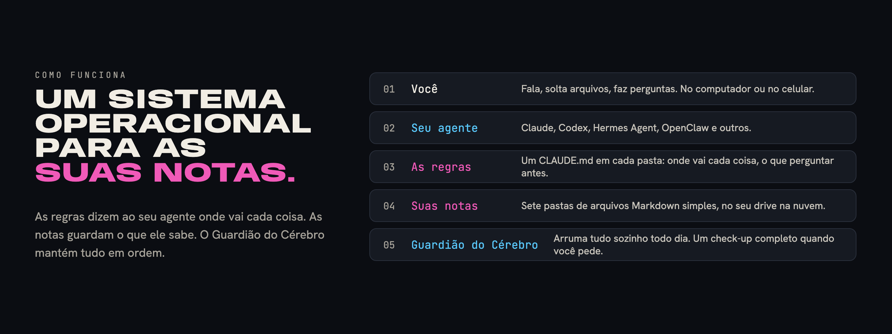</p>

Cada parte do sistema operacional de um computador tem um equivalente no seu cérebro:

| Num computador | No Phygital Brain |
|---|---|
| O usuário | Você, falando com palavras simples |
| O processador, que faz o trabalho | Seu agente de IA |
| As regras do sistema | Arquivos `CLAUDE.md`: um principal, mais um por pasta |
| O sistema de arquivos | Sete pastas de notas em Markdown no seu drive na nuvem |
| Configurações | `About/me.md`: como você quer que seu agente trabalhe, seu idioma, fuso horário e dias de trabalho |
| Um serviço em segundo plano | O Guardião do Cérebro, rodando todo dia de trabalho |
| Apps | Skills: o resumo da manhã, o check-up e qualquer skill que você adicionar |

Veja o que acontece quando você conta algo para o seu agente:

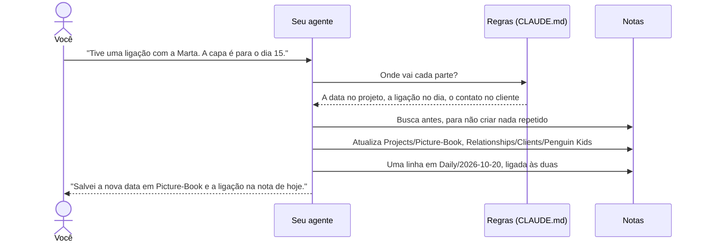

Pequenas atualizações em notas que já existem acontecem na hora, e seu agente avisa numa linha. Notas novas, mudanças de lugar, novos nomes e exclusões sempre esperam o seu sim. Mais em [Como funciona](docs/how-it-works.md).

## O que você ganha

- **Um cérebro feito a partir das suas respostas.** Quem vende ganha páginas para o negócio, os serviços e o público. Quem não vende não ganha nenhuma delas. O resumo da manhã só aparece se você pedir.
- **Perguntas escritas para o seu trabalho.** O segundo formulário começa com três perguntas que seu agente escreve para a sua profissão. Uma ilustradora ouve perguntas sobre editoras e como ela cobra; um desenvolvedor, sobre os projetos e as ferramentas dele.
- **Projetos, pessoas e dias, tudo ligado.** Cada pessoa, empresa e projeto vira um `[[link]]`, então com um clique no Baalda você vai de um projeto para o cliente e para o dia em que vocês conversaram.
- **Decisões com o motivo.** Cada nota de decisão diz o que você escolheu, por quê, do que abriu mão e qual é o risco. As decisões em aberto aparecem na sua nota do dia até você fechar.
- **O Guardião do Cérebro.** Todo dia de trabalho, ele cria a nota de amanhã, fecha as antigas, lista as decisões em aberto, corrige até 5 coisinhas e escreve um relatório. Um check-up completo roda sempre que você diz "faz um check-up no meu cérebro".
- **Um resumo da manhã,** se você quiser: suas três coisas mais importantes, o que você está esperando e uma decisão para tomar.
- **Preparo de reunião.** Diga "me prepara para a reunião com a Marta" e receba um resumo curto das suas notas: quando vocês se falaram pela última vez, o que está rolando, o que foi combinado e o que vale comentar.
- **Ferramentas de pensamento.** "Questiona minha ideia" compara a ideia com as suas próprias notas. "Que padrões você vê?" encontra o que sempre volta. "Acha as contradições" encontra notas que não batem.
- **Seus apps, só leitura.** Conecte o Gmail e o Google Agenda (ou Outlook, Nextcloud e outros), e o Guardião do Cérebro anota os e-mails de ontem com os seus contatos e as reuniões de amanhã. Ele nunca envia nem muda nada.
- **Tudo online, se você quiser.** O Guardião do Cérebro pode rodar como uma rotina na nuvem, lendo e escrevendo suas notas pelo seu drive, com o computador desligado.
- **Backup e desfazer.** Antes de uma mudança grande, seu agente copia os arquivos para uma pasta escondida `.backups/` por 10 dias. "Desfaz a última mudança" põe tudo de volta.
- **Notas antigas, quando quiser.** "Traz minhas notas antigas" importa do Notion, Google Docs, Notas da Apple e outros, com um plano que você aprova antes.
- **Equipes.** Compartilhe um cérebro pela nuvem do Baalda, com uma seção Equipe nas regras para o papel de cada pessoa.
- **Seu celular.** Pergunte coisas para o seu cérebro pelo app de celular do seu agente, através do seu drive na nuvem, ou mande tarefas para o seu computador (no Claude, com o Dispatch).
- **Seu idioma.** Os formulários, as mensagens e as notas ficam no idioma que você escolher. Os nomes das pastas e das notas também. Só alguns arquivos do sistema, como o `CLAUDE.md`, continuam com o nome em inglês.
- **Textos com a sua cara.** Todo cérebro vem com a skill [no-ai-slop](https://github.com/petergyang/no-ai-slop). Seu agente escreve com a sua voz e depois procura padrões com cara de IA antes que alguém leia.
- **Jeito cuidadoso de trabalhar.** As regras principais trazem as diretrizes de Andrej Karpathy para assistentes de IA: perguntar quando estiver em dúvida, escolher o caminho mais simples, mudar só o necessário e conferir o trabalho.
- **Suas próprias regras.** Quando você corrige seu agente, ele salva a correção como uma regra nova, com as suas palavras. As atualizações nunca mudam essas regras.

## Como seu agente trabalha

<p align="center"></p>

Os hábitos de trabalho são as diretrizes de Andrej Karpathy para assistentes de IA ([andrej-karpathy-skills](https://github.com/multica-ai/andrej-karpathy-skills)), colocadas nas regras principais de todo cérebro com as nossas palavras. A Revisão de Texto usa a skill [no-ai-slop](https://github.com/petergyang/no-ai-slop), que todo cérebro recebe em `Skills/no-ai-slop/`. Mais em [Regras principais](docs/folders/main-rules.md).

## Por dentro do seu cérebro

<p align="center">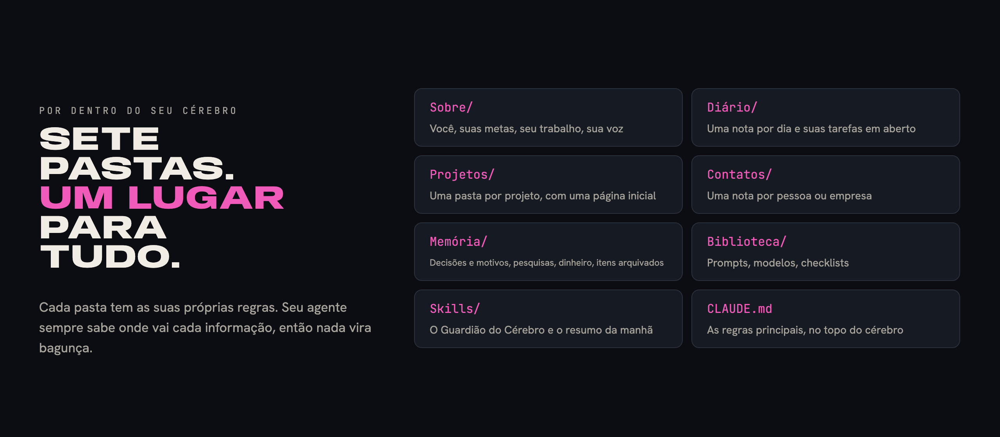</p>

```
My Brain/
├── CLAUDE.md          as regras principais
├── .claudeignore      o que seu agente nunca lê, a não ser que você peça
├── About/             me.md, goals.md, business.md, services.md, brand.md ...
├── Daily/             2026-10-20.md, 2026-10-21.md ... e tasks.md
├── Projects/          Picture-Book/README.md, Portfolio-Website/README.md ...
├── Relationships/     Clients/, Collaborators/, Team/, Partners/
├── Memory/            decisions/, research/, finances/ (privada), archive/
├── Library/           prompts, modelos, checklists
└── Skills/            brain-keeper/, morning-brief/
```

Cada pasta tem seu próprio guia: o que vai nela, o que você pode dizer, exemplos e as regras dela. Comece em [As pastas do seu cérebro](docs/folders/README.md).

## Início rápido

<p align="center"></p>

Você precisa de um agente de IA que trabalhe numa pasta, de um drive na nuvem que seu agente consiga conectar e de um computador. Nada de código. A gente recomenda o Claude com o Google Drive, a dupla que mais testamos, então os passos abaixo usam os dois. O passo a passo completo, com outros drives e agentes, está em [Primeiros passos](docs/getting-started.md).

| Passo | O que você faz | Tempo |
|---|---|---|
| 1 | Escolha seu agente: a gente recomenda o [app do Claude para computador](https://claude.ai/download) com um plano pago | 3 min |
| 2 | Instale o app para computador do seu drive na nuvem (por exemplo, o Google Drive) e crie uma pasta para o seu cérebro dentro dele | 3 min |
| 3 | No seu agente, comece uma tarefa e escolha essa pasta | 1 min |
| 4 | Conecte o drive ao seu agente (no Claude: Configurações, Conectores), para o seu celular conseguir acessar o cérebro | 1 min |
| 5 | Baixe o [Baalda](https://github.com/naveedharri/baalda) e abra a mesma pasta | 2 min |
| 6 | Instale o Phygital Brain (um clique, logo abaixo) e diga **"Monta meu segundo cérebro."** | 10 min |

**Instalar:** clique no botão do seu agente.

<p align="center">
<a href="https://github.com/Phygital-Brain/phygital-brain/releases/latest/download/phygital-brain.mcpb">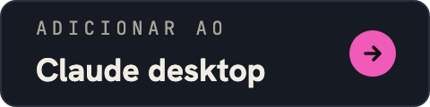</a>
<a href="docs/install.md#claude-code">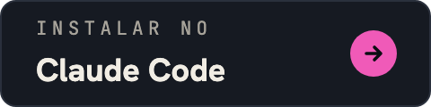</a>
<a href="https://cursor.com/en/install-mcp?name=phygital-brain&config=eyJjb21tYW5kIjoibnB4IiwiYXJncyI6WyIteSIsInBoeWdpdGFsLWJyYWluIl19">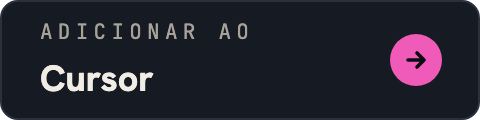</a>
<br>
<a href="https://insiders.vscode.dev/redirect?url=vscode%3Amcp%2Finstall%3F%257B%2522name%2522%253A%2522phygital-brain%2522%252C%2522command%2522%253A%2522npx%2522%252C%2522args%2522%253A%255B%2522-y%2522%252C%2522phygital-brain%2522%255D%257D">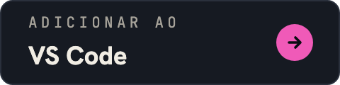</a>
<a href="docs/install.md#codex">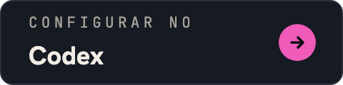</a>
<a href="docs/install.md#hermes-agent-and-openclaw">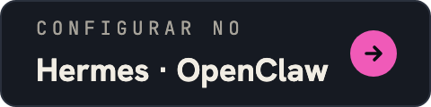</a>
</p>

**Ou num terminal, para qualquer agente que usa skills** (Claude Code, Codex, Cursor, Gemini CLI e outros):

```bash
npx skills add Phygital-Brain/phygital-brain
```

Ele pergunta em quais dos seus agentes instalar. O Claude para computador e o Claude Code não precisam de mais nada. Os outros jeitos precisam do [Node.js](https://nodejs.org), que é grátis e se instala uma vez só.

Todos os jeitos, passo a passo: [Instalação](docs/install.md).

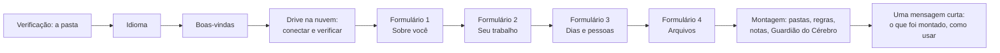

No final, seu agente se apresenta como seu assistente pessoal e sugere o Baalda para você navegar pelas suas notas como num app.

## Uma semana com seu cérebro

A Ana é ilustradora em Lisboa. Ela faz ilustrações de livros infantis para editoras e montou o cérebro dela na segunda-feira.

- **Segunda, 10:00.** Ela responde os quatro formulários e solta o currículo e a tabela de preços. O agente dela cria `About/me.md`, `goals.md`, `services.md`, três projetos e uma nota para a editora com quem ela trabalha.
- **Terça, 08:00.** O resumo da manhã lista três coisas: mandar os esboços, responder uma padaria sobre um logo e decidir o preço da capa.
- **Terça, 15:00.** Depois de uma ligação, ela diz: "A Marta quer a capa até o dia 15." O projeto, a nota do cliente e o dia são atualizados e ligados.
- **Quarta, no ônibus.** No app de celular do agente dela, ela pergunta: "O que eu e a Marta combinamos na terça?" Ele acha a nota no drive dela.
- **Quinta.** "Decidi aumentar o preço da capa para 400 a partir de janeiro." O agente dela pergunta um pouco sobre o motivo e escreve `Memory/decisions/2026-10-23-raise-cover-price.md`.
- **Todo dia de trabalho, 07:00.** O Guardião do Cérebro cria a nota do dia seguinte, fecha as antigas e corrige coisinhas. Toda manhã, ele lista a decisão do preço da capa como ainda em aberto, até ela fechar.

Mais pessoas, da dona de uma padaria a um estudante, estão em [Casos de uso](docs/use-cases.md).

## No celular

| Jeito | O que faz | Seu computador |
|---|---|---|
| **Perguntar:** o app de celular do seu agente, com seu drive conectado | Encontra e lê o que está no seu cérebro | Pode estar desligado |
| **Fazer:** mandar uma tarefa para o seu agente no computador (no Claude, o Dispatch) | Adiciona e guarda coisas seguindo todas as regras | Precisa estar ligado, com o app do seu agente aberto |

Configuração, o que dizer e soluções para problemas comuns: [Seu cérebro no celular](docs/phone.md).

## Idiomas

O Phygital Brain está pronto em **41 idiomas**. Escolha o seu no começo da configuração, e o cérebro inteiro é montado nele: os formulários, as regras, os nomes das pastas e das notas, o Guardião do Cérebro e todas as mensagens.

Veja [a lista completa de idiomas](languages/README.md#ready-languages).

**Seu idioma não está aqui?** Escolha Outro e digite o nome dele. Seu agente traduz o cérebro inteiro durante a configuração, até os nomes das pastas, sem perguntar nada. Para criar um conjunto revisado que todo mundo que fala o seu idioma possa usar, diga:

> Traduz o Phygital Brain para o meu idioma.

A skill `add-language` pergunta três coisas para você (tratamento formal ou informal, os nomes das pastas principais e os nomes do Guardião do Cérebro e do resumo da manhã), traduz tudo, revisa e mostra como usar e compartilhar. Como funciona, passo a passo: [Idiomas](languages/README.md).

**Para trocar depois:** diga "Muda meu cérebro para espanhol". Seu agente renomeia as pastas e troca as regras, fazendo um backup antes e com o seu sim.

## Funciona com seu agente

| | App do Claude para computador | Agentes que trabalham numa pasta (Claude Code, Codex, Hermes Agent, OpenClaw) | Apps de chat que não salvam arquivos |
|---|---|---|---|
| Montar o cérebro | Sim | Sim | Não |
| As quatro janelas de formulário | Sim | As mesmas perguntas, no chat | Não |
| Uso no dia a dia | Sim | Sim | Só leitura |
| Guardião do Cérebro e resumo da manhã | Sim, agendados | Se o app conseguir agendar tarefas | Não |

Os arquivos de regras se chamam `CLAUDE.md`. Agentes que procuram outro nome, como o `AGENTS.md` no Codex, recebem um arquivo de uma linha que aponta para o `CLAUDE.md`, então existe um conjunto só de regras. Mais em [Outros agentes](docs/other-agents.md).

## Privacidade

Suas notas são lidas pelo seu agente de IA e ficam guardadas no seu drive na nuvem. O Phygital Brain em si não tem servidor e não coleta nada. Mais em [O que você compartilha com a sua IA](SECURITY.md#what-you-share-with-your-ai).

- **Dados pessoais ficam num lugar só.** CPF, CNPJ e outros números de documento, dados bancários, números de cartão, seu nome completo de registro e sua data de nascimento ficam só na nota que precisa deles. Seu agente nunca copia esses dados para outras notas e nunca repete nenhum deles numa resposta.
- **Uma lista do que "nunca ler".** O `.claudeignore` inclui arquivos de senhas e chaves e a pasta `Memory/finances/`. Seu agente só abre esses arquivos quando você pede um arquivo específico. Seu agente segue isso como regra, mas nada fica trancado.
- **Nada de segredos nas notas.** Senhas, chaves e tokens ficam num gerenciador de senhas.

## O que ele não é

A lista completa está em [Limites](docs/limits.md).

- **Não é um app.** Não tem nada para rodar. Seu agente de IA faz o trabalho, seguindo os arquivos deste repositório.
- **Ainda não tem tranca.** As regras só funcionam porque seu agente segue elas. Guarde o que for realmente secreto fora da pasta do cérebro. As pastas trancadas estão nos [próximos passos](#próximos-passos).
- **Não fica sempre ligado, a não ser que você leve para a nuvem.** No seu computador, o Guardião do Cérebro e o resumo da manhã só rodam enquanto o app do seu agente está aberto. Como rotina na nuvem, eles rodam com o computador desligado.
- **Uma versão inicial.** Esta é a versão 0.1.10, e a configuração ainda não foi testada com muita gente.

## Próximos passos

Planejado, ainda não feito:

- **Pastas trancadas.** Você escolhe quais pastas trancar, como `Memory/finances/`. As notas delas ficam criptografadas no seu drive, então nenhum app ou agente consegue ler sem você. Você destranca com sua senha ou sua digital, pelo agente que você já usa, e só para o que você aprovar.

Ideias são bem-vindas: abra uma issue no GitHub.

## Atualizar e sair

**Para atualizar:** atualize o plugin (no Claude Code, `/plugin marketplace update phygital-brain`) e diga **"Atualiza meu segundo cérebro."** Seu agente mostra o que tem de novo e pergunta antes. Suas notas e suas próprias regras continuam como estão.

**Para mudar suas respostas:** diga **"Muda minhas respostas."** Os formulários abrem de novo, e suas páginas Sobre são atualizadas.

**Para sair:** desinstale o plugin. Seu cérebro é uma pasta de arquivos de texto simples no seu próprio drive na nuvem. Qualquer app que leia Markdown consegue abrir.

## Perguntas frequentes

As perguntas mais comuns estão abaixo. A lista completa, com 92 respostas separadas por assunto, está nas [Perguntas frequentes](docs/faq.md).

<details>
<summary><b>Preciso saber programar?</b></summary>

Não. Você instala alguns apps, responde quatro formulários e fala com palavras simples. As únicas linhas com cara de código são as duas linhas de instalação do Claude Code, e você pode só colar.
</details>

<details>
<summary><b>Com quais agentes de IA ele funciona?</b></summary>

Qualquer agente que consiga ler, editar e criar arquivos numa pasta do seu computador. O Claude é o que a gente usa e recomenda: é o único que mostra a configuração em janelas de formulário, e ele consegue agendar o Guardião do Cérebro. Codex, Hermes Agent, OpenClaw e agentes parecidos fazem as mesmas perguntas no chat. Veja [Outros agentes](docs/other-agents.md).
</details>

<details>
<summary><b>Quais drives na nuvem funcionam?</b></summary>

Qualquer drive que mantenha uma cópia da pasta no seu computador e que seu agente consiga conectar, para ler, editar e criar arquivos lá: Google Drive, Nextcloud, Dropbox, OneDrive e outros. O Claude já vem com um conector para o Google Drive; outros drives costumam se conectar por um servidor MCP. Veja [Drives na nuvem](docs/faq.md#cloud-drives).
</details>

<details>
<summary><b>Ele muda minhas notas sem perguntar?</b></summary>

Ele salva pequenas atualizações em notas que já existem e avisa você numa linha. Ele pergunta antes de criar uma nota nova, reescrever uma nota ou mover, renomear ou apagar qualquer coisa. O Guardião do Cérebro nunca apaga suas notas.
</details>

<details>
<summary><b>Quanto custa?</b></summary>

O Phygital Brain é grátis e de código aberto. Você paga pelo seu agente de IA e, se precisar de mais do que o espaço grátis, pelo seu drive na nuvem.
</details>

## Todos os guias

| Guia | O que tem nele |
|---|---|
| [Casos de uso](docs/use-cases.md) | Cinco pessoas, como é o cérebro de cada uma e o que elas dizem num dia normal |
| [Perguntas frequentes](docs/faq.md) | 92 perguntas e respostas, separadas por assunto |
| [Instalação](docs/install.md) | Um clique para o Claude para computador, o Cursor e o VS Code, e o passo a passo para Claude Code, Codex, Hermes Agent, OpenClaw e outros |
| [Primeiros passos](docs/getting-started.md) | Cada passo, do zero até um cérebro funcionando, com verificações e soluções |
| [Conecte seus apps](docs/connect-your-apps.md) | Gmail, Agenda, Drive e outros serviços, só leitura, e rodando tudo online |
| [Adicione mais skills](docs/add-skills.md) | Como adicionar qualquer skill ao seu cérebro, fazer vídeos com o [HyperFrames](https://github.com/heygen-com/hyperframes) e criar designs com o [Canva](https://www.canva.com) |
| [Equipes](docs/teams.md) | Como compartilhar um cérebro pela nuvem do Baalda |
| [Trazendo suas notas antigas](docs/importing.md) | Como exportar do Notion, Google Docs, Notas da Apple e outros, e guardar tudo no lugar |
| [Cérebro de exemplo](docs/example-brain/README.md) | Algumas notas inventadas, para você ver os arquivos antes de montar o seu |
| [Como funciona](docs/how-it-works.md) | O que seu agente faz em cada passo, quando ele salva e quando ele pergunta |
| [As pastas do seu cérebro](docs/folders/README.md) | Uma página por pasta e subpasta, com exemplos e regras |
| [Regras principais](docs/folders/main-rules.md) | O `CLAUDE.md` principal, com palavras simples |
| [Seu cérebro no celular](docs/phone.md) | Pergunte pelo app de celular do seu agente, mande tarefas para o seu computador |
| [Outros agentes](docs/other-agents.md) | Como usar Codex, Hermes Agent, OpenClaw ou outro agente, nomes dos arquivos de regras, dois agentes no mesmo cérebro |
| [Idiomas](languages/README.md) | Como funcionam os outros idiomas |
| [Limites](docs/limits.md) | O que ele faz mal, ou ainda não faz |
| [Glossário](docs/glossary.md) | Todos os termos, com palavras simples |
| [Segurança e privacidade](SECURITY.md) | O que você compartilha com a sua IA, e como avisar sobre um problema |

## Este repositório

| Pasta | O que tem |
|---|---|
| `skills/brain-setup/` | A configuração: as instruções do agente, os quatro formulários e todos os arquivos que um cérebro novo recebe |
| `skills/brain-keeper/` | O Guardião do Cérebro: a arrumação diária e o check-up |
| `skills/add-language/` | Criar um conjunto completo num idioma novo, ou trocar o idioma de um cérebro |
| `skills/brain-setup/i18n/` | Os conjuntos de idiomas prontos que a configuração copia |
| `docs/` | Os guias acima e as imagens |
| `languages/` | As traduções (um arquivo e uma pasta por idioma) e como adicionar uma |
| `scripts/` | As verificações para rodar antes de uma mudança (`python3 scripts/check.py`) |
| `.claude-plugin/` | Os arquivos do plugin, para instalar no Claude |
| `mcp/` | O conector (um servidor MCP, sem dependências) para agentes que aceitam servidores MCP |
| `package.json` | O pacote npm, para o `npx -y phygital-brain` rodar o conector |
| `.github/workflows/` | Publica cada versão nova: no npm e no release do GitHub, com o arquivo do Claude para computador |

<p align="center">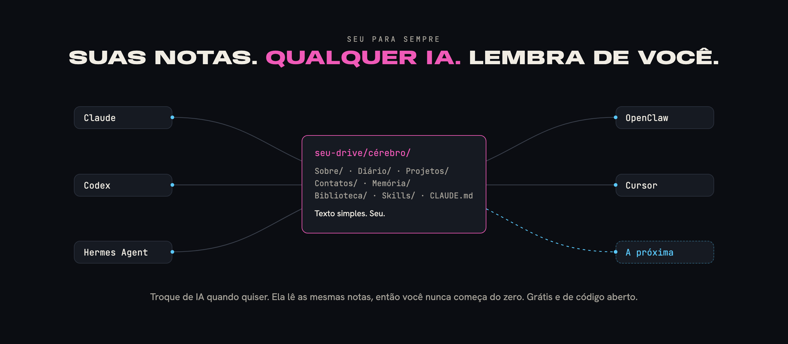</p>

## Ajuda e contribuições

Dúvidas, bugs e ideias: abra uma issue no GitHub. Para mudar alguma coisa, leia o [CONTRIBUTING.md](CONTRIBUTING.md) e o [AGENTS.md](AGENTS.md). Problemas de segurança ou privacidade devem ser avisados em particular, como o [SECURITY.md](SECURITY.md) explica. Para citar o projeto, use o [CITATION.cff](CITATION.cff).

## Código aberto e créditos

Grátis e de código aberto, sob a [Apache License 2.0](LICENSE). Mantenha o arquivo [NOTICE](NOTICE): ele traz a linha "Created by Phygital-Brain".

A licença não cobre o nome e o logo (veja o [TRADEMARKS.md](TRADEMARKS.md)). Você pode dizer que seu trabalho foi "feito com base no Phygital Brain", mas não pode vender com esse nome.

## Sem garantia

O Phygital Brain é oferecido do jeito que está, sem nenhum tipo de garantia (veja as seções 7 e 8 da [licença](LICENSE)). Você é responsável pelo que coloca no seu cérebro e pelo que compartilha com o seu provedor de IA.
