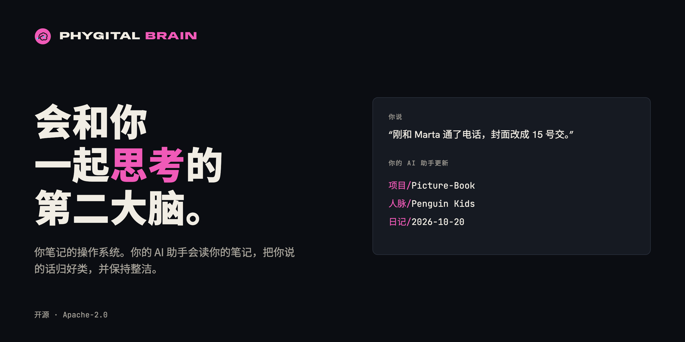
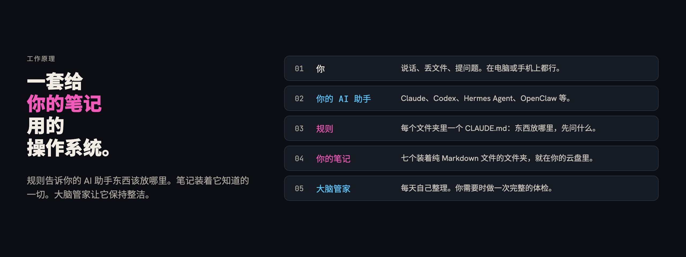
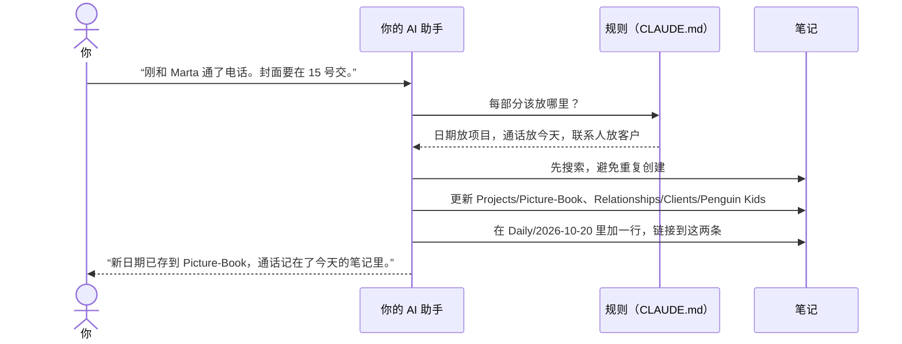
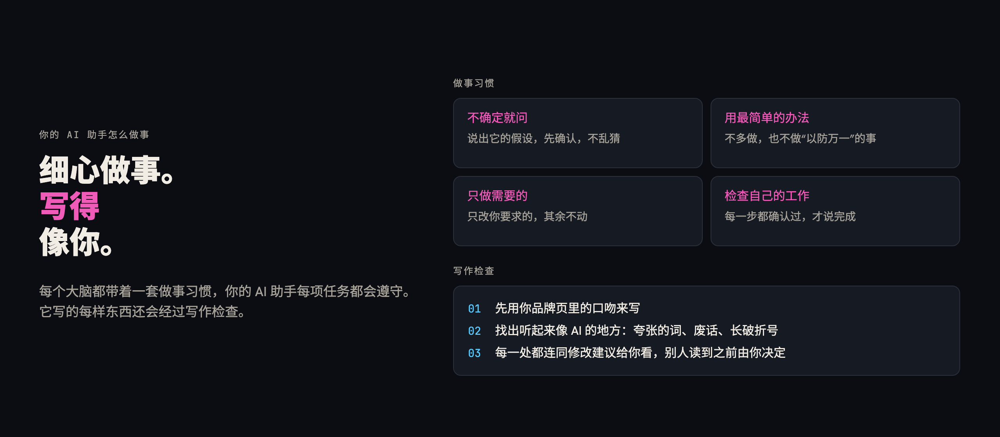
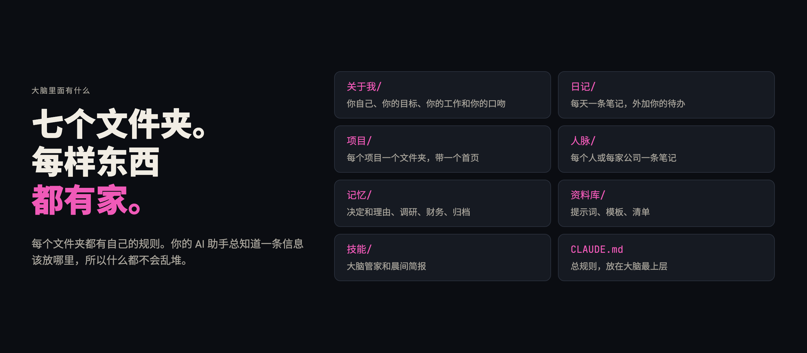
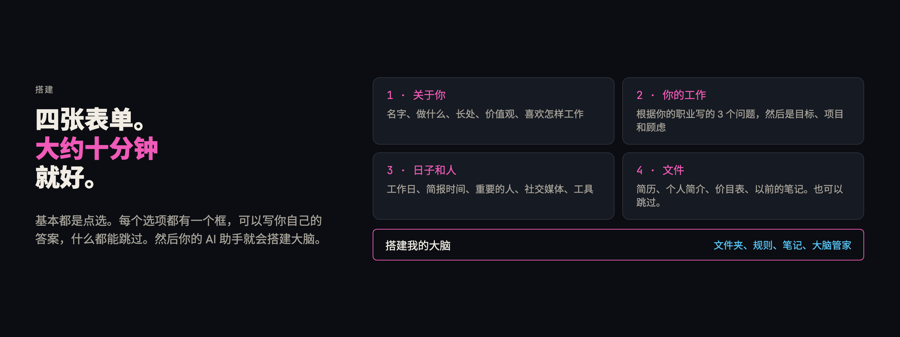
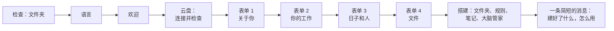
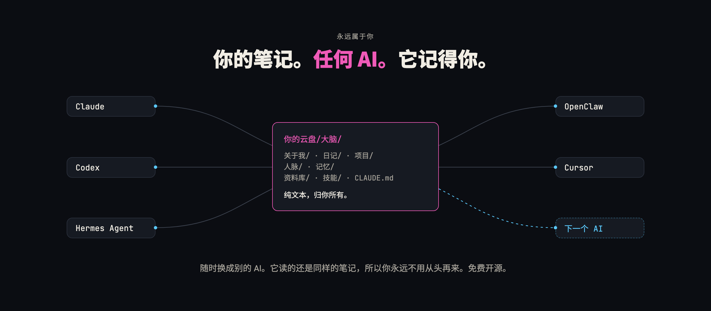

<p align="center"><a href="README.md">English</a> · <b>简体中文</b> · <a href="README.pt-BR.md">Português (Brasil)</a> · <a href="README.es.md">Español</a> · <a href="README.fr.md">Français</a> · <a href="README.ja.md">日本語</a> · <a href="README.ar.md">العربية</a></p>
<p align="center"><sub>本文译自英文。如有出入，以英文 README 为准。文中链接的指南都是英文的。</sub></p>

<p align="center"></p>

<h1 align="center">Phygital Brain</h1>

<p align="center"><b>会和你一起思考的第二大脑。</b><br>给你的笔记用的 OS（操作系统）：云盘里的一个文件夹，由你的 AI 助手来读、来写、来整理。填四张简短的表单，大约十分钟就能建好。之后你只管说话，你的 AI 助手会把你说的内容放到该放的地方。</p>

<p align="center">
<a href="#开源和署名"></a>
<a href="LICENSE"></a>
<a href="https://www.npmjs.com/package/phygital-brain"></a>
<a href="#快速开始"></a>
<a href="docs/install.md"></a>
<a href="CONTRIBUTING.md"></a>
</p>
<p align="center">
<a href="docs/other-agents.md"></a>
<a href="docs/getting-started.md#2-a-cloud-drive-folder"></a>
<a href="docs/how-it-works.md"></a>
<a href="SECURITY.md#what-you-share-with-your-ai"></a>
</p>
<p align="center">
<a href="https://github.com/Phygital-Brain/phygital-brain/stargazers"></a>
<a href="https://github.com/Phygital-Brain/phygital-brain/commits/main"></a>
<a href="https://www.npmjs.com/package/phygital-brain"></a>
<a href="#语言"></a>
</p>

<p align="center">
<a href="#它是什么">它是什么</a> ·
<a href="#永远属于你">永远属于你</a> ·
<a href="#工作原理">工作原理</a> ·
<a href="#快速开始">快速开始</a> ·
<a href="#和你的大脑过一周">用上一周</a> ·
<a href="#在手机上用">手机</a> ·
<a href="#语言">语言</a> ·
<a href="#隐私">隐私</a> ·
<a href="docs/faq.md">常见问题</a> ·
<a href="#全部指南">指南</a>
</p>

## 它是什么

Phygital Brain 是给你的笔记和你的 AI 助手用的 OS（操作系统）。它会在你的云盘里建一个文件夹（Google Drive、Nextcloud、Dropbox，或者任何你的 AI 助手能连接的云盘），里面有三样东西：

- **规则**：每个文件夹里都有一个 `CLAUDE.md` 文件。它告诉你的 AI 助手每类信息该放哪里、每条笔记怎么开头，以及改动任何东西之前要先问你什么。
- **笔记**：纯 Markdown 文件（带一点简单格式的文本文件），记录你、你的项目、你身边的人、你做的决定和你的每一天。你的 AI 助手会在你说话时把它们写下来，并互相链接起来。
- **大脑管家**：一个定时任务，每个工作日帮你整理大脑；你想要的时候，还能做一次完整的体检。

在这个文件夹里开始的每个对话，你的 AI 助手都会先读规则和最新的笔记。所以它已经知道你的名字、你的客户、你的目标，还有你昨天做了什么。你也可以用 [Phygital Memory](https://github.com/Phygital-Brain/Phygital-Memory) 阅读和浏览这些笔记，或者通过云盘在手机上看。

它由两个技能（你的 AI 助手会照着做的一套说明）组成：一个负责搭建大脑，一个负责保持整洁。它们打包成了一个 Claude 插件，因为我们自己用的、推荐的都是 Claude，但任何能在文件夹里工作的 AI 助手都能照着用。详见[其他 AI 助手](docs/other-agents.md)。

## 永远属于你

- **归你所有**。你的大脑就是你自己云盘里的一个纯文本文件夹。不用在我们这里注册账号，也不用导出什么。
- **哪个 AI 都能用**。换一个 AI 助手，打开同一个文件夹就行。新的 AI 助手读的还是同样的笔记。
- **它记得你**。你告诉 AI 助手的事都会存成笔记，所以下一次对话，或者下一个 AI，都能接着上次的地方继续。
- **免费开源**。谁都可以查看它是怎么运作的。你的笔记保存在你的云盘里，不会公开：Phygital Brain 什么都不收集，你的笔记只会发给你选的那个 AI。

## 为什么要做它

和 AI 的对话一结束，你跟它说过的话也就没了。下次你又得重新介绍一遍你的生意、你的客户和你的项目。你留下来的笔记散落在五个应用里，没有一个能和你的 AI 助手打通。

Phygital Brain 给 AI 助手一个固定的地方来读和写，还有一套它每次都会遵守的规则：

| 没有它 | 有了 Phygital Brain |
|---|---|
| 每开一个新对话，你都要介绍自己是谁 | 你的 AI 助手回答前会先读 `About/me.md` |
| 通话记录留在某个再也找不到的对话里 | 这次通话会记进项目、客户的笔记和今天的日记，并互相链接 |
| 你忘了当初为什么做某个决定 | `Memory/decisions/` 会记下决定和理由，30 天后提醒你复查 |
| 笔记越堆越多，越来越旧 | 大脑管家会关掉旧笔记，标出停滞的项目，列出需要你处理的事 |
| 你的 AI 助手不打招呼就改文件 | 新建、移动、重命名或删除任何东西之前，它都会先问你 |

## 工作原理

<p align="center"></p>

电脑操作系统的每个部分，在你的大脑里都有对应：

| 在电脑里 | 在 Phygital Brain 里 |
|---|---|
| 用户 | 你，用平常的话说话 |
| 干活的处理器 | 你的 AI 助手 |
| 系统规则 | `CLAUDE.md` 文件：一个总文件，每个文件夹再各有一个 |
| 文件系统 | 云盘里七个装着 Markdown 笔记的文件夹 |
| 设置 | `About/me.md`：你希望 AI 助手怎么做事，以及你的语言、时区和工作日 |
| 后台服务 | 大脑管家，每个工作日运行 |
| 应用 | 技能：晨间简报、体检，以及你添加的任何技能 |

你告诉 AI 助手一件事时，会发生这些：



对已有笔记的小更新会马上完成，你的 AI 助手会用一句话告诉你。新建笔记、移动、重命名和删除，一定会等你点头。详见[工作原理](docs/how-it-works.md)。

## 你能得到什么

- **根据你的回答搭建的大脑**。做买卖的人会有生意、服务和客户的页面。不做买卖的人就不会有这些。晨间简报只有在你要的时候才会出现。
- **为你的工作量身写的问题**。第二张表单开头是你的 AI 助手根据你的职业写的三个问题。插画师会被问到出版社和收费方式；开发者会被问到项目和工具。
- **项目、人和日子，全都连在一起**。每个人、每家公司、每个项目都是一个 `[[link]]`，所以在 Phygital Memory 里点一下，就能从项目跳到客户，再跳到你们聊天的那一天。
- **带理由的决定**。每条决定笔记都写清楚你选了什么、为什么、放弃了什么，以及有什么风险。还没定下来的决定会一直出现在你的日记里，直到你把它关掉。
- **大脑管家**。每个工作日，它会建好明天的笔记、关掉旧的、列出待定的决定、修好最多 5 个小问题，并写一份报告。只要你说“给我的大脑做个体检”，它就会做一次完整的体检。
- **晨间简报**，想要的话就有：你最重要的三件事、你在等的事，以及一个要做的决定。
- **会前准备**。说一句“帮我准备和 Marta 的会”，就能从你的笔记里得到一份简短的简报：你们上次什么时候聊过、现在进展如何、之前说好了什么、这次要提什么。
- **思考工具**。“挑战一下我的想法”会拿你自己的笔记来检验它。“你看出什么规律了吗？”会找出反复出现的事。“找找有哪些矛盾”会找出说法互相冲突的笔记。
- **你的应用，只读**。连接 Gmail 和 Google 日历（或者 Outlook、Nextcloud 等），大脑管家就会记下昨天你和联系人之间的邮件，以及明天的会议。它从不发送或修改任何东西。
- **想的话，可以完全在线运行**。大脑管家可以作为云端例行任务运行，通过你的云盘读写笔记，电脑关机也没关系。
- **备份和撤销**。大改动之前，你的 AI 助手会把文件复制到隐藏的 `.backups/` 文件夹，保留 10 天。说一句“撤销上一次修改”，就能恢复回来。
- **以前的笔记，随时搬进来**。说“把我以前的笔记搬进来”，就能从 Notion、Google Docs、苹果备忘录等导入，并且会先给你一个计划，你同意了才开始。
- **团队**。通过 Phygital Memory 在电脑之间直接共享同一个大脑，规则里有“团队”部分，写明每个人的角色。
- **你的手机**。通过云盘，在 AI 助手的手机应用里向你的大脑提问，或者把任务发到你的电脑上（在 Claude 里用 Dispatch）。
- **你的语言**。表单、消息和笔记都用你选的语言。文件夹名和笔记名也一样。只有少数系统文件（比如 `CLAUDE.md`）保留英文名。
- **听起来像你自己写的**。每个大脑都自带 [no-ai-slop](https://github.com/petergyang/no-ai-slop) 技能。你的 AI 助手会先用你的口吻写，然后在别人看到之前，检查有没有 AI 味的写法。
- **细心的做事习惯**。总规则里包含 Andrej Karpathy 给 AI 助手的准则：不确定就问，选最简单的办法，只改需要改的，做完检查一遍。
- **你自己的规则**。你纠正 AI 助手时，它会用你的原话把这次纠正存成一条新规则。升级永远不会改动这些规则。

## 你的 AI 助手怎么做事

<p align="center"></p>

这些做事习惯来自 Andrej Karpathy 给 AI 助手的准则（[andrej-karpathy-skills](https://github.com/multica-ai/andrej-karpathy-skills)），我们用自己的话把它写进了每个大脑的总规则。写作检查用的是 [no-ai-slop](https://github.com/petergyang/no-ai-slop) 技能，每个大脑都会在 `Skills/no-ai-slop/` 里有一份。详见[总规则](docs/folders/main-rules.md)。

## 大脑里有什么

<p align="center"></p>

```
My Brain/
├── CLAUDE.md          总规则
├── .claudeignore      除非你要求，否则你的 AI 助手永远不读的内容
├── About/             me.md, goals.md, business.md, services.md, brand.md ...
├── Daily/             2026-10-20.md, 2026-10-21.md ... 以及 tasks.md
├── Projects/          Picture-Book/README.md, Portfolio-Website/README.md ...
├── Relationships/     Clients/, Collaborators/, Team/, Partners/
├── Memory/            decisions/, research/, finances/（私密）, archive/
├── Library/           提示词、模板、清单
└── Skills/            brain-keeper/, morning-brief/
```

每个文件夹都有自己的指南：里面放什么、你可以怎么说、示例和它的规则。从[大脑里的文件夹](docs/folders/README.md)开始看吧。

## 快速开始

<p align="center"></p>

你需要一个能在文件夹里工作的 AI 助手、一个你的 AI 助手能连接的云盘，还有一台电脑。不用写代码。我们推荐 Claude 搭配 Google Drive，这是我们测试最多的组合，所以下面的步骤都用它们。完整步骤（包括其他云盘和 AI 助手）在[入门指南](docs/getting-started.md)里。

| 步骤 | 你要做什么 | 时间 |
|---|---|---|
| 1 | 选好你的 AI 助手：我们推荐 [Claude 桌面应用](https://claude.ai/download)，搭配付费套餐 | 3 分钟 |
| 2 | 安装云盘的桌面应用（比如 Google Drive），并在里面给你的大脑建一个文件夹 | 3 分钟 |
| 3 | 在你的 AI 助手里新建一个任务，选中这个文件夹 | 1 分钟 |
| 4 | 把云盘连接到你的 AI 助手（在 Claude 里：设置，连接器），这样手机也能访问你的大脑 | 1 分钟 |
| 5 | 下载 [Phygital Memory](https://github.com/Phygital-Brain/Phygital-Memory)，打开同一个文件夹 | 2 分钟 |
| 6 | 安装 Phygital Brain（下面一键安装），然后说 **“搭建我的第二大脑。”** | 10 分钟 |

**安装**：点击你的 AI 助手对应的按钮。

<p align="center">
<a href="https://github.com/Phygital-Brain/phygital-brain/releases/latest/download/phygital-brain.mcpb"></a>
<a href="docs/install.md#claude-code"></a>
<a href="https://cursor.com/en/install-mcp?name=phygital-brain&config=eyJjb21tYW5kIjoibnB4IiwiYXJncyI6WyIteSIsInBoeWdpdGFsLWJyYWluIl19"></a>
<br>
<a href="https://insiders.vscode.dev/redirect?url=vscode%3Amcp%2Finstall%3F%257B%2522name%2522%253A%2522phygital-brain%2522%252C%2522command%2522%253A%2522npx%2522%252C%2522args%2522%253A%255B%2522-y%2522%252C%2522phygital-brain%2522%255D%257D"></a>
<a href="docs/install.md#codex"></a>
<a href="docs/install.md#hermes-agent-and-openclaw"></a>
</p>

**也可以在终端里安装，适用于任何支持技能的 AI 助手**（Claude Code、Codex、Cursor、Gemini CLI 等）：

```bash
npx skills add Phygital-Brain/phygital-brain
```

它会问你要添加到哪些 AI 助手。Claude 桌面应用和 Claude Code 不需要再装别的。其他方式需要 [Node.js](https://nodejs.org)，免费，装一次就行。

每种方式的详细步骤：[安装](docs/install.md)。



最后，你的 AI 助手会以你私人助理的身份欢迎你，并推荐你用 Phygital Memory 像用应用一样浏览笔记。

## 和你的大脑过一周

Ana 是里斯本的一位插画师。她给出版社画绘本，星期一搭好了她的大脑。

- **星期一 10:00**。她填完四张表单，丢进她的简历和价目表。她的 AI 助手建好了 `About/me.md`、`goals.md`、`services.md`、三个项目，还有一条关于她编辑所在出版社的笔记。
- **星期二 08:00**。她的晨间简报列出三件事：把草图发出去、回复一家面包店关于 logo 的消息，以及决定她的封面报价。
- **星期二 15:00**。打完电话后她说：“Marta 要我 15 号前交封面。”项目、客户笔记和当天的日记都更新了，并且互相链接。
- **星期三，在公交车上**。她在 AI 助手的手机应用里问：“星期二我和 Marta 说好了什么？”它在她的云盘里找到了那条笔记。
- **星期四**。“我决定从一月起把封面报价涨到 400。”她的 AI 助手问了几句原因，然后写下 `Memory/decisions/2026-10-23-raise-cover-price.md`。
- **每个工作日 07:00**。大脑管家会建好第二天的笔记、关掉旧笔记、修好小问题。每天早上它都会把封面报价这个决定列为待定，直到她把它关掉。

更多人的例子，从面包店老板到学生，都在[使用场景](docs/use-cases.md)里。

## 在手机上用

| 方式 | 能做什么 | 你的电脑 |
|---|---|---|
| **问**：你的 AI 助手的手机应用，连接好云盘 | 查找并读取大脑里的内容 | 可以关机 |
| **做**：把任务发给电脑上的 AI 助手（在 Claude 里用 Dispatch） | 按照所有规则添加和归类内容 | 必须开着，并打开 AI 助手的应用 |

设置方法、该怎么说，以及常见问题的解决办法：[在手机上用你的大脑](docs/phone.md)。

## 语言

Phygital Brain 已支持 **41 种语言**。在搭建开始时选好你的语言，整个大脑都会用它来建：表单、规则、文件夹和笔记的名字、大脑管家，以及每一条消息。

查看[完整的语言列表](languages/README.md#ready-languages)。

**没有你的语言**？选“其他”，然后输入你的语言。你的 AI 助手会在搭建时翻译整个大脑，包括文件夹名，不会问你任何问题。如果想做一套检查过的、所有说你这种语言的人都能用的版本，就说：

> 把 Phygital Brain 翻译成我的语言。

`add-language` 技能会问你三件事（称呼用“您”还是“你”、主要文件夹的名字，以及大脑管家和晨间简报的叫法），然后翻译所有内容、检查一遍，再告诉你怎么使用和分享。具体步骤：[语言](languages/README.md)。

**以后想换语言**：说“把我的大脑换成西班牙语”。你的 AI 助手会先备份，等你同意后，再重命名文件夹并换掉规则。

## 适用的 AI 助手

| | Claude 桌面应用 | 能在文件夹里工作的 AI 助手（Claude Code、Codex、Hermes Agent、OpenClaw） | 不能保存文件的聊天应用 |
|---|---|---|---|
| 搭建大脑 | 可以 | 可以 | 不行 |
| 四个表单窗口 | 可以 | 同样的问题，在对话里问 | 不行 |
| 日常使用 | 可以 | 可以 | 只能读 |
| 大脑管家和晨间简报 | 可以，定时运行 | 如果应用能安排定时任务 | 不行 |

规则文件叫 `CLAUDE.md`。有些 AI 助手找的是别的文件名，比如 Codex 找 `AGENTS.md`，它们会得到一个只有一行的文件，指向 `CLAUDE.md`，所以始终只有一套规则。详见[其他 AI 助手](docs/other-agents.md)。

当你的大脑有几千条笔记时，[Phygital Engram](https://github.com/Phygital-Brain/phygital-engram) 可以加上一个快速搜索，你的 AI 助手会先用它来找。它是一个单独的附加组件，没有它你的大脑也能正常用：详见[用 Phygital Engram 快速搜索](docs/search-with-phygital-engram.md)。

## 隐私

你的笔记由你的 AI 助手读取，保存在你的云盘里。Phygital Brain 本身没有服务器，什么都不收集。详见[你和 AI 分享了什么](SECURITY.md#what-you-share-with-your-ai)。

- **私密信息只放在一个地方**。税号、银行信息、卡号、你的法定全名和出生日期，只放在需要它们的那条笔记里。你的 AI 助手绝不会把它们复制到其他笔记，也绝不会在回复里重复。
- **“永远不读”清单。**`.claudeignore` 包括密码和密钥文件，以及 `Memory/finances/`。只有你指名要某个文件时，你的 AI 助手才会打开它们。你的 AI 助手会把这当成规则来遵守，但并没有真正上锁。
- **笔记里不放机密**。密码、密钥和令牌应该放在密码管理器里。

## 它不是什么

完整列表在[局限](docs/limits.md)里。

- **不是应用**。没有什么要运行的。干活的是你的 AI 助手，它照着这个仓库里的文件做事。
- **还没有锁**。规则能起作用，只是因为你的 AI 助手会遵守它们。真正机密的东西请放在大脑文件夹之外。上锁的文件夹在[路线图](#路线图)上。
- **不会一直运行，除非你把它搬到云端**。在你的电脑上，大脑管家和晨间简报只在 AI 助手的应用开着时才运行。作为云端例行任务，电脑关机它们也能运行。
- **早期版本**。目前是 0.1.12 版，搭建流程还没有经过很多人测试。

## 路线图

已计划，还没做：

- **上锁的文件夹**。你自己选要锁哪些文件夹，比如 `Memory/finances/`。里面的笔记会在你的云盘里加密，没有你的同意，任何应用或 AI 助手都读不了。你可以在正在用的 AI 助手里，用密码或指纹解锁，而且只解锁你同意的内容。

欢迎提想法：在 GitHub 上提一个 issue。

## 更新和停用

**更新**：更新插件（在 Claude Code 里用 `/plugin marketplace update phygital-brain`），然后说 **“升级我的第二大脑。”** 你的 AI 助手会告诉你有哪些新内容，并先征求你的同意。你的笔记和你自己的规则都会保持原样。

**修改你的回答**：说 **“更新我的回答。”** 表单会重新打开，你的“关于我”页面也会更新。

**停用**：卸载插件。你的大脑就是你自己云盘里的一个纯文本文件夹。任何能读 Markdown 的应用都能打开它。

## 常见问题

下面是问得最多的几个问题。完整列表共有 92 个回答，按主题分组，在[常见问题](docs/faq.md)里。

<details>
<summary><b>我需要会写代码吗？</b></summary>

不需要。你只要装几个应用、填四张表单，然后用平常的话说话。唯一看起来像代码的，是 Claude Code 的两行安装命令，而且直接粘贴就行。
</details>

<details>
<summary><b>它支持哪些 AI 助手？</b></summary>

任何能在你电脑上的文件夹里读取、编辑和创建文件的 AI 助手都行。我们自己用的、推荐的是 Claude：只有它会用表单窗口来展示搭建流程，而且它能定时运行大脑管家。Codex、Hermes Agent、OpenClaw 等类似的 AI 助手会在对话里问同样的问题。详见[其他 AI 助手](docs/other-agents.md)。
</details>

<details>
<summary><b>哪些云盘可以用？</b></summary>

任何会在你电脑上保留一份文件夹副本、并且你的 AI 助手能连接上去读取、编辑和创建文件的云盘都行：Google Drive、Nextcloud、Dropbox、OneDrive 等。Claude 自带 Google Drive 连接器；其他云盘通常通过 MCP 服务器连接。详见[云盘](docs/faq.md#cloud-drives)。
</details>

<details>
<summary><b>它会不问我就改我的笔记吗？</b></summary>

对已有笔记的小更新，它会直接保存，并用一句话告诉你。新建笔记、重写笔记，或者移动、重命名、删除任何东西之前，它都会先问你。大脑管家永远不会删除你的笔记。
</details>

<details>
<summary><b>要花多少钱？</b></summary>

Phygital Brain 免费开源。你需要付费的是你的 AI 助手，以及在免费空间不够用时，你的云盘。
</details>

## 全部指南

| 指南 | 内容 |
|---|---|
| [使用场景](docs/use-cases.md) | 五个人，他们的大脑长什么样，平常一天会说些什么 |
| [常见问题](docs/faq.md) | 92 个问题和回答，按主题分组 |
| [安装](docs/install.md) | Claude 桌面应用、Cursor 和 VS Code 一键安装，以及 Claude Code、Codex、Hermes Agent、OpenClaw 等的安装步骤 |
| [入门指南](docs/getting-started.md) | 从零到一个能用的大脑的每一步，附带检查和解决办法 |
| [连接你的应用](docs/connect-your-apps.md) | Gmail、日历、Drive 和其他服务，只读，以及完全在线运行 |
| [添加更多技能](docs/add-skills.md) | 给你的大脑添加任何技能，用 [HyperFrames](https://github.com/heygen-com/hyperframes) 做视频，用 [Canva](https://www.canva.com) 做设计 |
| [Phygital Memory](docs/phygital-memory.md) | 在应用里阅读笔记，并和团队共享同一个大脑 |
| [把以前的笔记搬进来](docs/importing.md) | 从 Notion、Google Docs、苹果备忘录等导出，再全部归好类 |
| [示例大脑](docs/example-brain/README.md) | 几条虚构的笔记，让你在搭建自己的大脑之前先看看文件长什么样 |
| [工作原理](docs/how-it-works.md) | 你的 AI 助手每一步做什么，什么时候直接保存，什么时候先问你 |
| [大脑里的文件夹](docs/folders/README.md) | 每个文件夹和子文件夹一页，附带示例和规则 |
| [总规则](docs/folders/main-rules.md) | 用平常的话解释总的 `CLAUDE.md` |
| [在手机上用你的大脑](docs/phone.md) | 在 AI 助手的手机应用里提问，把任务发到你的电脑上 |
| [用 Phygital Engram 快速搜索](docs/search-with-phygital-engram.md) | 一个单独的附加组件，当你的大脑有几千条笔记时，让 AI 助手搜索得更快 |
| [其他 AI 助手](docs/other-agents.md) | 使用 Codex、Hermes Agent、OpenClaw 或其他 AI 助手；规则文件的名字；两个 AI 助手共用一个大脑 |
| [语言](languages/README.md) | 其他语言是怎么实现的 |
| [局限](docs/limits.md) | 它做得不好或者还做不到的事 |
| [术语表](docs/glossary.md) | 每个术语，用平常的话解释 |
| [安全和隐私](SECURITY.md) | 你和 AI 分享了什么，以及怎么报告问题 |

## 这个仓库

| 文件夹 | 内容 |
|---|---|
| `skills/brain-setup/` | 搭建：给 AI 助手的说明、四张表单，以及新大脑会得到的每个文件 |
| `skills/brain-keeper/` | 大脑管家：每日整理和体检 |
| `skills/add-language/` | 用一种新语言做一整套，或者切换大脑的语言 |
| `skills/brain-setup/i18n/` | 搭建时复制的、已做好的语言包 |
| `docs/` | 上面那些指南，以及图片 |
| `languages/` | 各种翻译（每种语言一个文件和一个文件夹），以及如何添加新语言 |
| `scripts/` | 改动之前要运行的检查（`python3 scripts/check.py`） |
| `.claude-plugin/` | 插件文件，用来把它安装到 Claude 里 |
| `mcp/` | 连接器（一个 MCP 服务器，没有依赖），给支持 MCP 服务器的 AI 助手用 |
| `package.json` | npm 包，这样 `npx -y phygital-brain` 就能运行连接器 |
| `.github/workflows/` | 发布每个新版本：npm，以及附带 Claude 桌面应用文件的 GitHub release |

<p align="center"></p>

## 帮助和贡献

有问题、发现 bug 或有想法：在 GitHub 上提一个 issue。想改点什么，请先读 [CONTRIBUTING.md](CONTRIBUTING.md) 和 [AGENTS.md](AGENTS.md)。安全或隐私问题请私下报告，方法见 [SECURITY.md](SECURITY.md)。要引用这个项目，请用 [CITATION.cff](CITATION.cff)。

## 开源和署名

基于 [Apache License 2.0](LICENSE) 免费开源。请保留 [NOTICE](NOTICE) 文件：里面有一行“Created by Phygital-Brain”。

许可证不包括名称和 logo（见 [TRADEMARKS.md](TRADEMARKS.md)）。你可以说你的作品“基于 Phygital Brain 构建”，但不能用这个名字来卖它。

## 免责声明

Phygital Brain 按原样提供，不附带任何形式的担保（见[许可证](LICENSE)第 7 条和第 8 条）。你放进大脑里的内容，以及你和 AI 服务商分享的内容，由你自己负责。
