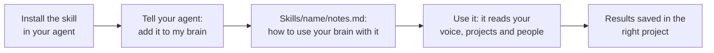

# Add more skills

A skill is a set of instructions your agent follows for one kind of job. Your brain comes with the Brain Keeper, meeting prep, thinking tools, import and the Writing Check. You can add others, like one that makes videos or one that edits images, and point them at what your brain already knows.



## How a skill fits in your brain

- **The skill itself** is installed in your agent (as a plugin, or with the skill's own install line). It isn't copied into your brain, and it's never edited.
- **Your notes for it** live in your brain, in `Skills/{skill-name}/notes.md`: what to read first, where to save results, and how you like things done. This is how one skill works your way.
- **The list of skills** is in `Skills/CLAUDE.md`. Each new skill gets a line there, so every chat knows it exists.

## Add any skill

1. Install it in your agent, the way the skill's own page says.
2. In a chat on your brain folder, say: **"Add the {skill name} skill to my brain."**
3. Your agent asks first, then:
   - makes `Skills/{skill-name}/notes.md` with what the skill should read in your brain (for example `About/brand.md` for your voice and colours) and where it saves its work (usually a project folder),
   - adds a line for it in `Skills/CLAUDE.md`.
4. Use it like any other: "Use {skill} to..." Your agent reads your notes for it first.

To change how it works for you, say "From now on, {skill} should...". Your agent updates `notes.md`, never the skill.

## Make videos with HyperFrames and Keyframes

[HyperFrames](https://github.com/heygen-com/hyperframes) is an open-source tool by HeyGen (Apache 2.0) that turns HTML and animations into MP4 videos. Its **Keyframes** part handles animation: your agent writes the motion, checks it, and you can fine-tune keyframes by hand on a timeline in HyperFrames Studio or the HyperFrames app. HyperFrames isn't part of Phygital Brain; this is how to use the two together.

### What you need

- An agent that can run commands on your computer, like Claude Code (the Claude desktop app's Code tab, or the terminal).
- **Node.js 22 or newer** and **FFmpeg** installed. Your agent can help install them.
- Disk space: rendered videos are large files.

### Install it

In Claude Code:

```
claude plugin marketplace add heygen-com/hyperframes
```

```
claude plugin install hyperframes@hyperframes
```

With another agent, follow the [HyperFrames quickstart](https://hyperframes.heygen.com/quickstart). Then, in a chat on your brain folder, say **"Add HyperFrames to my brain."**

### Connect it to your brain

Your agent writes `Skills/hyperframes/notes.md`. A good one looks like this:

```
Before a video, read:
- About/brand.md: voice, words to use and avoid, colours and fonts if listed
- the project's README.md and its drafts/ folder for the script

Save:
- the HyperFrames project in Projects/{project}/video/
- the finished MP4 in Projects/{project}/assets/, or outside the brain folder
  if it's over 100 MB, with a line in the project's README saying where it is

Style:
- calm motion, no flashy transitions
- captions on by default
```

Add your brand colours and fonts to `About/brand.md` if they aren't there yet, so every video uses them.

### Make a video

In a chat on your brain folder:

- "Make a 30-second video for the picture book from the script in drafts, in my brand."
- "Turn this week's daily notes into a 1-minute update video for my clients."
- "Make a short motion graphic of my cover price going up, for Instagram."

Your agent reads your brand and the script, builds the video, renders a preview, and saves it in the project. It logs one line in today's daily note.

### Edit the keyframes yourself

1. Open the video's project in **HyperFrames Studio** or the **HyperFrames app**.
2. Move, add or ease keyframes on the timeline.
3. Back in the chat: "I changed the keyframes in the picture book video. Check it and render it again." Your agent runs HyperFrames' keyframe check, fixes anything that breaks, and renders.

### Good to know

- Big video files make your cloud drive slow to sync. Keep renders outside the brain folder when they're large, and link to them.
- Music, voice and images the video uses need the right licences. HyperFrames' own media skill can help find them.
- Problems with HyperFrames itself go to [its repository](https://github.com/heygen-com/hyperframes), not to Phygital Brain.

## Edit images with PhotoCraft

[PhotoCraft](https://github.com/storytold/photocraft) is an open-source photo editor by the ArtCraft team (MIT or Apache 2.0), similar to Photoshop: layers, masks, adjustments, filters and export. Its command-line tool, `photocraft-cli`, works as an MCP server, so your agent can edit images for you: crop, resize, fix colours, add text and export for the web. PhotoCraft isn't part of Phygital Brain; this is how to use the two together.

### What you need

- An agent that takes MCP servers, like Claude desktop, Claude Code, Cursor or Codex.
- PhotoCraft's command-line tool, from its [releases page](https://github.com/storytold/photocraft/releases). Your agent can help with this step.
  - **Mac:** the `photocraft-cli-...-macos-universal.zip` file. Unzip it and move `photocraft-cli` to a folder your terminal knows, like `/usr/local/bin`.
  - **Windows:** it comes with the PhotoCraft installer, in `C:\Program Files\PhotoCraft\`.
  - **Linux:** the `.deb` or `.rpm` package puts it in `/usr/bin/`.
- The PhotoCraft app, if you want to see the images and change them by hand. It's on the [PhotoCraft page](https://getartcraft.com/apps/photocraft).

### Install it

PhotoCraft can only open and save files inside the folder you give it. Give it your brain's `Projects/` folder, so it can work on any project's images but never sees your About pages, your Memory or your finances.

In Claude Code, on a Mac or Linux (put your own path to the brain folder):

```
claude mcp add photocraft -- photocraft-cli mcp --automation-read-root "/path/to/brain/Projects" --automation-write-root "/path/to/brain/Projects"
```

On Windows, use the full path, `"C:\Program Files\PhotoCraft\photocraft-cli.exe"`, in place of `photocraft-cli`. Other agents take the same thing in their MCP settings:

```json
{
  "mcpServers": {
    "photocraft": {
      "command": "photocraft-cli",
      "args": ["mcp", "--automation-read-root", "/path/to/brain/Projects", "--automation-write-root", "/path/to/brain/Projects"]
    }
  }
}
```

More in [PhotoCraft's MCP guide](https://github.com/storytold/photocraft/blob/main/docs/mcp.md). Then, in a chat on your brain folder, say **"Add PhotoCraft to my brain."**

### Connect it to your brain

Your agent writes `Skills/photocraft/notes.md`. A good one looks like this:

```
Before an edit, read:
- About/brand.md: colours, fonts and the look I like
- the project's README.md: where the images are used, and their sizes

Save:
- never change the original: save each edit as a new file
  in Projects/{project}/assets/, with what changed in the name
- the PhotoCraft working file next to it, so I can open it later

Style:
- PNG for graphics, JPG for photos, under 1 MB for the web
```

### Edit an image

In a chat on your brain folder:

- "Resize the picture book cover to 1080 by 1350 for Instagram."
- "Make the photos in the shoot's assets brighter and warmer, all the same way."
- "Add the title to the cover, in my brand font and colour."

Your agent reads your brand and the project, makes the edit, shows you a preview, and saves it in the project. It logs one line in today's daily note.

### Change it yourself

1. Open the working file in the **PhotoCraft** app and change what you like.
2. Back in the chat: "I changed the cover in PhotoCraft. Export it again for the web."

### Good to know

- Big image files make your cloud drive slow to sync. Keep large working files outside the brain folder when you can, and link to them.
- Fonts and images you use need the right licences.
- Problems with PhotoCraft itself go to [its repository](https://github.com/storytold/photocraft), not to Phygital Brain.
