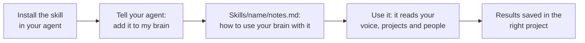

# Add more skills

A skill is a set of instructions your agent follows for one kind of job. Your brain comes with the Brain Keeper, meeting prep, thinking tools, import and the Writing Check. You can add others, like one that makes videos or one that edits images, and point them at what your brain already knows.

## How a skill fits in your brain

- **The skill itself** is installed in your agent (as a plugin, or with the skill's own install line). It isn't copied into your brain, and it's never edited.
- **Your notes for it** live in your brain, in `Skills/{skill-name}/notes.md`: what to read first, where to save results, and how you like things done. This is how one skill works your way.
- **The list of skills** is in `Skills/CLAUDE.md`. Each new skill gets a line there, so every chat knows it exists.

## Add any skill

1. Install it in your agent, the way the skill's own page says.
2. In a chat on your brain folder, say: **"Add the {skill name} skill to my brain."**
3. Your agent asks first, then:
   - makes `Skills/{skill-name}/notes.md` with what the skill should read in your brain (for example `About/brand.md` for your voice and colours) and where it saves its work (usually a project folder),
   - adds a line for it in `Skills/CLAUDE.md`.
4. Use it like any other: "Use {skill} to..." Your agent reads your notes for it first.

To change how it works for you, say "From now on, {skill} should...". Your agent updates `notes.md`, never the skill.

## Suggested skills

Skills that work well with your brain, each with a page on how to install it and connect it: [Suggested skills](../skills/suggested-skills/README.md). Right now:

- [HyperFrames](../skills/suggested-skills/hyperframes.md): make videos and animations in your brand.
- [Impeccable](../skills/suggested-skills/impeccable.md): review and polish the design of your websites and apps.
- [last30days](../skills/suggested-skills/last30days.md): research what people said about a topic in the last 30 days.
- [GEO-SEO](../skills/suggested-skills/geo-seo.md): check how easy a website is to find in AI search and Google.
- [Agent Skills](../skills/suggested-skills/agent-skills.md): plan, build, test and review software step by step.
- [Document skills](../skills/suggested-skills/document-skills.md): make Word documents, decks, spreadsheets and PDFs from your notes.
- [Skill Creator](../skills/suggested-skills/skill-creator.md): turn something you do often into your own skill.

To connect apps instead, like Gmail or Canva, see [Suggested apps](../skills/suggested-apps/README.md).

At the end of setup, your agent shows a short list of the skills and apps that fit your work, up to five, each with what it would do for you. Later, say **"What can I add to my brain?"** to see them all.
