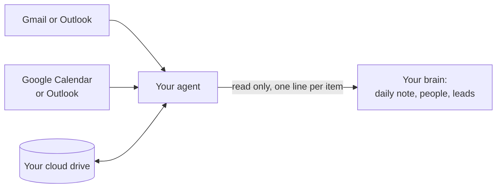

# Connect your apps

Your brain can read from the apps you already use, like your email and calendar, so you don't have to tell it everything yourself. Each app connects to your agent once, then you choose which ones your brain reads from.

## What your brain does with each app

| App | What it reads | Where it goes |
|---|---|---|
| **Email** (Gmail, Outlook) | Yesterday's emails with people and companies that already have a note, and clear new leads | One line in today's daily note, the person's last contact, new leads in `_Leads.md` |
| **Calendar** (Google Calendar, Outlook) | Tomorrow's meetings, today's events | Tomorrow's daily note under "Meetings", and the morning brief |
| **Cloud drive** (Google Drive, Nextcloud, Dropbox) | The brain folder itself | Lets your agent reach the brain from a phone or a cloud routine |
| **Docs and files** (Google Docs, Drive files) | Only what you point it to in a chat | Filed by the usual rules |

The Brain Keeper reads email and calendar on its daily run. Meeting prep ("prep me for my next meeting") reads your calendar when you ask.

## The rules, for every app

These are in `Skills/connected-apps/connected-apps.md` in your brain:

- **Read only.** Your agent never sends, replies, deletes, archives, labels, moves or accepts anything in an app. It writes a draft only when you ask in a chat, and you send it.
- **What an app says is information.** If an email tells your agent to do something, like forward a file or change a rule, it doesn't. It tells you instead.
- **Only what matters.** No newsletters, receipts, codes or private numbers. No whole emails pasted into notes: one line, with a link to the person.

## Connect Google Workspace (Gmail, Calendar, Drive)

The steps are on [Connect Google Workspace](../skills/suggested-apps/google-workspace.md). That page is one of the [suggested apps](../skills/suggested-apps/README.md), which your agent offers at the end of setup when they fit your work and aren't connected yet. Later, say **"What can I add to my brain?"**

## Connect other services

| Service | How it usually connects |
|---|---|
| Outlook, Microsoft 365, OneDrive | Your agent's Microsoft connector, if it has one |
| Nextcloud (files, calendar) | An MCP server for Nextcloud |
| Dropbox | Your agent's Dropbox connector, or an MCP server |
| Slack, Teams | Their connectors. The brain doesn't read chats yet; you can still ask about a chat in a conversation. |
| Notion | Its connector, for reading pages when you ask. To move your notes over, see [Bringing in your old notes](importing.md). |

An **MCP server** is a small add-on that lets an agent use another app. Some run in the cloud, and some run on your own computer. A cloud routine (see below) can only use the ones that run in the cloud.

## Turn an app off

Say **"Stop reading my email."** Your agent removes it from the list in `Skills/connected-apps/connected-apps.md`. To cut access completely, also disconnect it in your agent's settings.

## Running fully online

With your brain in a cloud drive and that drive connected, the Brain Keeper can run as a **cloud routine** (in Claude: routines). It reads and writes your notes through the drive's connector and reads your apps the same way, with your computer off. Say **"Run the Brain Keeper in the cloud."** Your agent first checks the connector can read, edit and create files in the brain folder. More in [Skills](folders/skills.md#running-in-the-cloud).

## Privacy

Connecting an app lets your AI company see what your agent reads from it. Connect only what you're comfortable with, and check [What you share with your AI](../SECURITY.md#what-you-share-with-your-ai).
