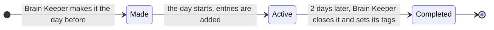

# Daily

## What it's for

`Daily/` is your diary. There's one note for each day, named by its date, like `2026-10-20.md`. It shows what happened that day. Your open tasks live in one more file here: `tasks.md`.

The rules your agent follows here: [daily-CLAUDE.md](../../skills/brain-setup/templates/daily-CLAUDE.md).

## What's inside

| File | What it holds |
|---|---|
| `YYYY-MM-DD.md` | One note per day: what happened, short |
| `tasks.md` | Open tasks that don't belong to a project. Made the first time you have one. |

## How a daily note looks

```
---
type: daily
date: 2026-10-20
day: Monday
week: W43
month: October
status: active
tags: [daily, meeting, clients]
---

**Call with [[Marta]].** Agreed on the cover sketch by Friday. Details in [[Picture-Book]].

**Invoice sent** to [[Penguin Kids]] for the first half.
```

- Each entry is a **bold headline** plus one or two sentences.
- Details go in the linked note, not here.
- The note is tidied in place, so lines don't pile up or repeat.

## A day note's life



## The day tags

Every daily note has the tag `daily`. It also gets a tag for each thing that happened that day, picked only from this list:

| Tag | Means |
|---|---|
| `problem` | Something broke or went wrong |
| `clients` | Client work or client contact (only if you sell things) |
| `meeting` | A call or a meeting |
| `money` | Invoices, payments, taxes, investments |
| `research` | You researched something or found something out |
| `decision` | You decided something |
| `travel` | You were travelling |
| `personal` | Health, life, anything outside work |

## The task list

`tasks.md` has two parts: **Open** and **Done**.

```
## Open

- [ ] 2026-10-20: Send the invoice to [[Penguin Kids]]

## Done

- [x] 2026-10-18: Book the dentist (done 2026-10-19)
```

- New tasks go at the top, with the date you added them.
- When a task is done, it gets ticked, gets the date it was done, and moves to **Done**.
- Tasks for a project go in that project's page instead.
- Done tasks older than 30 days can be cleared. Your agent asks first.

## How to use it

- "Today I finished the cover and sent it to Marta."
- "Add a task: call the printer on Thursday."
- "What did I do last week?"
- "Done: the invoice is sent."

## Examples

| You say | What happens |
|---|---|
| "I had a call with Marta, we moved the deadline to the 15th." | Today's note gets a bold line linking `[[Marta]]` and the project. The project page gets the new date. |
| "Remind me to renew my website." | A new line at the top of **Open** in `tasks.md`. |
| "The website is renewed." | That task is ticked and moved to **Done**. |
| "What's still open from last week?" | Your agent reads `tasks.md`. Old tasks are never copied into new daily notes. |

## Rules

- Every daily note starts with the info block above. The day and month stay in English.
- No `# 2026-10-20` title at the top. The file name is the title.
- Today's note holds today only. Old tasks go to `tasks.md`, not forward into new notes.
- A day's note is `active` while it's open, and becomes `completed` after 2 days.
- Dates use your computer's clock and time zone.

## What the Brain Keeper does here

- **Every day:** it makes tomorrow's note with just the info block. It closes the notes from 2, 3 and 4 days ago (sets `completed` and the right tags). It lists your open decisions in today's note. If something needs you, it adds one line: "Brain Keeper: 2 things need you".
- **It flags** tasks that have been open for more than 30 days.
- **It never** copies old items into today's note or adds "run done" lines.
