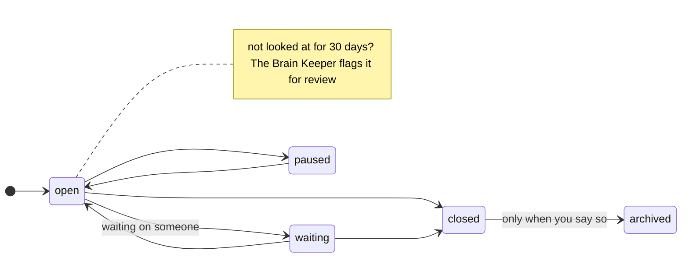

# Memory

## What it's for

`Memory/` is what your brain has learned and decided over time. It holds decisions and why you made them, things you researched, your money, applications you sent, and old things you don't need every day.

The rules your agent follows here: [memory-CLAUDE.md](../../skills/brain-setup/templates/memory-CLAUDE.md).

## What's inside

| Folder | What goes there | When it appears |
|---|---|---|
| `decisions/` | A choice you made and why. Also studies of outside things: an app, a course, a competitor | From the start |
| `research/` | What you found out: markets, prices, options | From the start |
| `finances/` | Money: invoices, taxes, payments. **Private** | From the start |
| `archive/` | Old decisions, old research, finished projects | From the start |
| `applications/` | Jobs, grants, awards, open calls you applied to | The first time you apply |
| `competitors/` | One note per competitor | The first time you need one |

Decision notes are named by date and title, like `decisions/2026-10-20-raise-cover-price.md`.

## Inside, one by one

### `decisions/`: choices and why you made them

**What it's for:** so you, and your agent, always remember *why* you chose something. Months later, "why did I stop doing logos?" has an answer.

**What goes in:** one note per decision, named by date and title, like `decisions/2026-10-20-raise-cover-price.md`. Also studies of outside things you looked at closely: an app you tried, a course, a website, a competitor's offer.

**Each note says:** the decision itself (in a box marked important), who was part of it, what started it, what you gave up, and any risk (in a box marked warning).

**You say:** "We decided to stop doing logos. Write it down with the why." "I tried a new invoicing app, here's what I think." "Why did I raise my prices?"

**Good to know:** each decision has a status (open, waiting, paused, closed) and a date it was last looked at. More below, under "How decisions work".

### `research/`: what you found out

**What it's for:** facts you looked up that are useful in many places, not just one project.

**What goes in:** one note per topic, like `research/print-shops-lisbon.md` or `research/illustration-prices-2026.md`.

**You say:** "Research the best print shops in Lisbon." "What do illustrators usually charge for a cover?"

**Good to know:** comparisons are fair. Each option is judged on its own, not on what you'd like to hear. Research for one project only goes in that project's `research/` folder.

### `finances/`: your money

**What it's for:** invoices, taxes, payments, bank details. Kept apart and private.

**What goes in:** whatever you put there: invoice notes, a tax summary for the year, your payment details.

**You say:** "Here's my October invoice, keep it with my money things." "Open my tax note for this year."

**Good to know:** this folder is on the "never read" list. Your agent opens it only when you ask for an exact file. Bank details and tax numbers live here and nowhere else, and your agent never repeats them in a reply.

### `archive/`: things you're done with

**What it's for:** keeping old things without them getting in the way. Nothing important is ever thrown away.

**What goes in:** three kinds of old things, each in its own folder:

| Folder | What |
|---|---|
| `archive/decisions/` | Decisions you closed and don't need to see anymore |
| `archive/research/` | Research that's old or was replaced |
| `archive/{project name}/` | A whole project that's finished |

**You say:** "The website project is finished, archive it." "That price research is old now."

**Good to know:** things move here only when you say so. Before moving, your agent checks which notes link to it.

### `applications/`: things you applied to

**What it's for:** jobs, grants, awards and open calls, with everything about each one in one place.

**What goes in:** one folder per application, like `applications/bologna-2027/`. Inside, a `README.md` with the deadline, the link, the status and what you sent. Your answers and statement sit next to it.

**You say:** "I'm applying to the Bologna open call, deadline March 1." "Write my answer to question 3." "I got the grant!"

**Good to know:** made the first time you apply. Big PDFs and slides stay outside the brain, and a note sums them up.

### `competitors/`: others doing what you do

**What it's for:** knowing who else is out there, what they offer and what they charge.

**What goes in:** one note per competitor, like `competitors/studio-onda.md`.

**You say:** "Look at Studio Onda, what do they offer?" "Who else does picture books in Lisbon?"

**Good to know:** made the first time you need one. A closer study, like a full look at their offer, can also go in `decisions/`.

## How decisions work

A decision note always says **why**: who was part of it, what started it, and what you gave up.

```
---
type: decision
date: 2026-10-20
updated: 2026-10-20
status: open
tags: [decision, pricing]
---

> [!important] Raise the cover price to 400 from January.

Why: three clients said yes at 350 without asking. Talked it over with [[João]].

> [!warning] Risk: small authors might go elsewhere.
```



| Status | Means |
|---|---|
| `open` | Still being decided or worked on |
| `waiting` | Waiting on someone else |
| `paused` | On hold |
| `closed` | Done |

`date` is when it was written. `updated` is the last time you looked at it. A decision not looked at for 30 days needs a review. Your agent reminds you until you keep it, close it or archive it.

## How applications work

One folder per application, with a `README.md` holding the deadline, the link, the status and what you sent. Your answers sit next to it.

| Status | Means |
|---|---|
| `draft` | Still writing |
| `submitted` | Sent |
| `accepted` | You got it |
| `rejected` | You didn't |
| `withdrawn` | You pulled out |

Big PDFs and slides stay outside the brain. A note sums them up.

## Meetings

A meeting where something was decided goes in `decisions/`. Other meetings go in that day's daily note. If you have lots of meetings, your agent can suggest a meetings folder.

## How to use it

- "We decided to stop doing logos. Write it down with the why."
- "Research the best print shops in Lisbon."
- "I'm applying to the Bologna open call, deadline March 1."
- "Here's my invoice for October." (drop the file)
- "Which decisions are still open?"

## Examples

| You say | What happens |
|---|---|
| "I decided to raise my prices." | Your agent asks a little about why, then writes `decisions/2026-10-20-raise-prices.md` with `status: open`. |
| "Compare three print shops." | A research note in `research/`. It judges each shop fairly, not by what you'd like to hear. |
| "I sent the Bologna application." | `applications/bologna-2027/README.md` gets `status: submitted`. |
| "That research is out of date." | It moves to `archive/research/` instead of being deleted. |

## Rules

- Research is fair by default. Each option is judged on its own.
- Old research moves to the archive. It isn't deleted.
- A decision moves to the archive only when you say so.
- `finances/` is opened only when you ask for an exact file.

## What the Brain Keeper does here

- **Every day:** lists every decision that isn't closed in today's daily note, with "needs review" when it's more than 30 days old. It fixes info blocks.
- **Check-up:** flags decisions that need a review, and pages that disagree with a newer decision.
- **It never** reads `finances/`.
