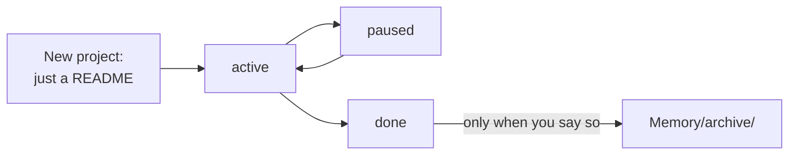

# Projects

## What it's for

`Projects/` holds the things you're working on. Each project gets its own folder. Inside, a `README.md` is the front page: what it is, where it stands, what's next.

The rules your agent follows here: [projects-CLAUDE.md](../../skills/brain-setup/templates/projects-CLAUDE.md).

## What's inside

```
Projects/
└── Picture-Book/
    ├── README.md     the front page (always)
    ├── notes/        your working notes
    ├── research/     what you found out
    ├── briefs/       briefs and requirements
    ├── drafts/       writing in progress
    ├── ideas/        ideas
    ├── feedback/     comments from others
    ├── assets/       images and media
    └── archive/      old material from this project
```

A new project starts with only the README. The other folders only appear when something needs to go in them. Folder names are short, lowercase, with hyphens, and no numbers in front.

## Inside a project, one by one

Every note inside a project starts with an info block that says which project it belongs to, and what kind of note it is:

```
---
type: notes
date: 2026-10-20
status: active
project: Picture-Book
tags: [picture-book, notes]
---
```

The `type` matches the folder: `notes`, `research`, `brief`, `draft`, `idea` or `feedback`. The front page is `type: project`. A plan is `type: plan`.

### `README.md`: the front page

**What it's for:** the one place to see the whole project at a glance.

**What goes in:** what the project is, where it stands, the very next step, and links to the folders below. The details live in the folders.

**You say:** "Update on the picture book: sketches are done." "What's the next step on the website?"

**Example:** see "How the front page looks" below.

### `notes/`: your working notes

**What it's for:** your own thinking while you work. Call notes, lists, things to remember about this project.

**What goes in:** one note per topic, like `notes/colour-choices.md` or `notes/call-with-printer.md`.

**You say:** "Note for the picture book: the printer needs files in CMYK." "Keep my notes from today's call with Marta in the project."

**Not here:** research you looked up (that's `research/`), and a decision with its why (that's `Memory/decisions/`).

### `research/`: what you found out

**What it's for:** facts you looked up for this project only.

**What goes in:** one note per topic, like `research/paper-types.md` or `research/similar-books.md`.

**You say:** "Find out what paper picture books usually use." "Look at five similar books and what they cost."

**Not here:** research that's useful beyond this project. That goes to `Memory/research/`.

### `briefs/`: what the job asks for

**What it's for:** the brief, the spec or the list of what the client wants. You check your work against it.

**What goes in:** one note per brief, like `briefs/picture-book.md`: what's wanted, sizes, deadlines, who decides.

**You say:** "Here's the brief from Penguin Kids." (drop the file) "What did the brief say about the cover size?"

**Good to know:** if the brief is a big PDF, your agent writes the key points in a note, and the PDF can stay outside the brain.

### `drafts/`: work in progress

**What it's for:** writing that isn't finished yet: texts, scripts, emails for the project, captions.

**What goes in:** one note per piece, like `drafts/back-cover-text.md`. When a draft is final, it says so in its info block (`status: done`).

**You say:** "Draft the back cover text." "Make the second paragraph shorter."

**Good to know:** writing that other people will read gets the AI-sounding check. Your agent shows you what it found before changing anything.

### `ideas/`: ideas for this project

**What it's for:** ideas you're not doing yet, so they don't get lost.

**What goes in:** one note per idea, like `ideas/glow-in-the-dark-cover.md`.

**You say:** "Idea for the book: a fold-out page at the end."

**Not here:** ideas for a new project. Your agent asks if it should become its own project instead.

### `feedback/`: what others said

**What it's for:** comments from clients, editors, friends or testers, kept in one place.

**What goes in:** one note per round of feedback, like `feedback/marta-sketches.md`: who said it, when, and what they said. What you'll change because of it goes in the front page's next step.

**You say:** "Marta's feedback on the sketches: the fish are too small, and she loves the colours."

### `assets/`: images and media

**What it's for:** pictures, sketches, photos and small media files the project uses.

**What goes in:** the files themselves, like `assets/cover-sketch-v2.png`. Notes link to them, and Baalda can show them inside a note.

**Good to know:** very big files (video, layered design files) are better kept outside the brain. A note says where they are.

### `archive/`: old material

**What it's for:** old versions and things this project doesn't need anymore, kept just in case.

**What goes in:** old drafts, old sketches, a brief that was replaced.

**You say:** "The first cover draft is old, put it away."

**Good to know:** this is the archive for things *inside* a project. When the whole project is finished, it moves to `Memory/archive/` instead, and only when you say so.

### Your own folders

If none of these fit, a project can have its own folder, like `Projects/Podcast/episodes/`. Your agent asks first, and adds it to the front page's "Where things are" table.

## How the front page looks

```
---
type: project
status: active
project: Picture-Book
created: 2026-10-20
updated: 2026-11-02
tags: [project, children-books]
description: "A picture book about the sea for Penguin Kids."
---

## What it is

A 32-page picture book about the sea. It helps [[goals]]: sign my first book deal.

## Status and next step

Sketches done. Next: the cover, due Friday. Waiting on notes from [[Marta]].
```

The parts, in order:

1. **What it is:** one or two lines, linked to your goals.
2. **Status and next step:** where it stands, and the very next thing to do.
3. **How it runs:** only if something automatic writes here.
4. **Where things are:** only once the project has folders. A small table that links to each one.

A project's `status` is `active`, `paused` or `done`.

## A project's life



## How to use it

- "New project: a picture book about the sea for Penguin Kids."
- "Update on the picture book: sketches are done."
- "Here's the brief for the book." (drop the file)
- "Pause the website project."
- "What's next on all my projects?"

## Examples

| You say | What happens |
|---|---|
| "New project: my portfolio website." | Your agent asks first, then makes `Projects/Portfolio-Website/README.md`. |
| "The sketches are done, the cover is next." | The front page's "Status and next step" is updated. Today's daily note gets a short line. |
| "Marta sent feedback on the cover." | A note in `feedback/`, linked from the front page. |
| "The book is finished." | Status becomes `done`. It moves to the archive only when you say so. |

## Rules

- The front page is the index. It links to the folders and doesn't repeat what's in them.
- Every note in a project has `project: Picture-Book` in its info block.
- No rule file inside a project. If one project needs a special rule, it goes in "Rules per project" at the bottom of `Projects/CLAUDE.md`.
- Every project should help one of your goals.
- Planning stays in one note until you actually start building.
- A finished project moves to `Memory/archive/` only when you say so.

## What the Brain Keeper does here

- **Every day:** fixes info blocks and turns plain names into links when a note for that person exists.
- **Check-up:** flags projects with no update for 60 days and suggests a new status, pausing or archiving. It also flags projects with no goal, and goals with no project.
