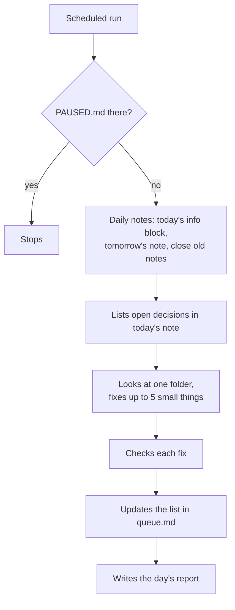

# Skills

## What it's for

`Skills/` holds the helpers that look after your brain and your day: the **Brain Keeper** and the **morning brief**. It can also hold your own notes on how you like other skills to work.

The rules your agent follows here: [skills-CLAUDE.md](../../skills/brain-setup/templates/skills-CLAUDE.md).

## What's inside

```
Skills/
├── brain-keeper/
│   ├── daily.md        what the daily tidy does
│   ├── check-up.md     what the check-up does
│   ├── queue.md        things only you can decide
│   └── reports/        one report per day
└── morning-brief/      only if you wanted a brief
    └── morning-brief.md
```

## Inside, one by one

### `brain-keeper/`: the helper that keeps your brain tidy

**What it's for:** everything the Brain Keeper needs and writes. More below, under "The Brain Keeper".

| File | What it is | Can you change it? |
|---|---|---|
| `daily.md` | The steps of the daily tidy. A scheduled task reads it every day. | Ask your agent to change it |
| `check-up.md` | The steps of the check-up, used when you say "check up my brain" | Ask your agent to change it |
| `queue.md` | The list of things that need you, and small fixes still waiting | Read it anytime. Things you deal with get taken off. |
| `reports/` | One report per day, like `reports/2026-10-21.md`. Kept for 60 days. | Just read them |
| `PAUSED.md` | Only there while the Brain Keeper is paused | Say "resume the brain keeper" |

### `morning-brief/`: your plan for the day

**What it's for:** a short plan each work day. More below, under "The morning brief".

**What goes in:** one file, `morning-brief.md`, with the steps your agent follows. Only made if you wanted a brief in the setup.

**You say:** "morning brief" anytime, or "set up my morning brief" if you didn't have one.

### Folders for other skills

**What it's for:** when you use other skills (for example one that writes posts), their folder here holds your preferences for them.

**What goes in:** `Skills/{skill-name}/` with:

- `notes.md`: how you like that skill to work, in your words, like "Write my posts shorter, no hashtags".
- `references/`: examples and longer material, like three posts you loved.

**Good to know:** a skill that came from someone else is never edited directly. Your `notes.md` changes how it works for you.

## The Brain Keeper

The Brain Keeper looks after your brain in two ways.

### 1. Every day, on its own

It runs at the time set in the setup, on your work days, while the Claude app is open. It never asks you anything. It does this:

1. Checks that today's daily note has a correct info block.
2. Makes tomorrow's daily note, with just the info block.
3. Closes the daily notes from 2, 3 and 4 days ago.
4. Lists your open decisions in today's note.
5. Puts tasks open for more than 30 days on your list.
6. Looks at one folder for problems, then the next folder the next day. The order is: About, Projects, Memory, Relationships, Library, Skills, Daily.
7. Fixes at most 5 small things, checks each fix, and puts the rest on the list.
8. Writes a short report.



**Small things it can fix by itself:** missing info in a note's info block, long dashes, a title that repeats the file name, a name that should be a link, a person with no contact for 12 months moved to `dormant`.

**Things it only tells you about**, and never fixes: broken links, notes nothing links to, files in the wrong folder, two notes for the same thing, pages that disagree with a newer decision, private numbers in an ordinary note (it names the note, never the number).

**It never** deletes (except its own reports after 60 days), moves or renames anything. It never changes a rule file, `goals.md` or `brand.md`. It never reads what `.claudeignore` lists.

If you chose "report only" instead of "small safe fixes", it fixes nothing and puts everything on the list.

### 2. Check-up, when you ask

Say "check up my brain" anytime. Your agent looks at the whole brain, changes nothing yet, and gives you a list grouped like this:

- broken links, notes nothing links to, empty notes, leftover placeholders
- notes in the wrong place, rule files that list things that don't exist
- missing info blocks
- projects with no update for 60 days, goals with no project
- decisions not looked at for 30 days, people with no contact for 12 months
- tasks open for more than 30 days
- the same facts in two notes, two notes for the same person
- pages where old news hides the current truth
- rules that disagree with each other
- passwords or private numbers in ordinary notes
- long dashes and AI-sounding writing

The easy, safe fixes come first. Then you pick: **Fix all safe ones**, **Go one by one**, or **Just the report**. Nothing is deleted or moved without a link check and your yes.

### The list and the reports

- `queue.md` has three parts: **Needs you**, **To fix** and **Next folder**. When something new needs you, today's daily note gets one line pointing to it.
- Each report says what changed, what was fixed, what was put on the list, and any errors.

### Talking to the Brain Keeper

| Say | What happens |
|---|---|
| "check up my brain" | A full check-up now |
| "run the brain keeper" | A daily run now |
| "pause the brain keeper" | It stops until you resume it |
| "resume the brain keeper" | It starts again |
| "what did the brain keeper do" | It explains the latest reports in plain words |

To change what it does, ask in chat, for example "Let the Brain Keeper fix 10 things a day".

## The morning brief

Only if you wanted one in the setup. It comes at your time on your work days, or when you say "morning brief".

Your agent reads your open tasks, yesterday's note, the next step of every active project, and decisions that are open or waiting. If a calendar is connected, it reads today's events too. Then it replies in 6 short lines at most:

- your 3 most important things today, each linked to its note
- what you're waiting on from other people
- one decision to make, if there is one
- today's events, if a calendar is connected

The brief doesn't write any file. If you answer with news, your agent saves it the usual way.

## Rules

- One folder per skill.
- When a skill is added, it gets a line in the table in `Skills/CLAUDE.md`.
- `brain-keeper/daily.md` is read by a scheduled task. Change it only to change what the daily run does. Keep it plain: no links, no boxes.
