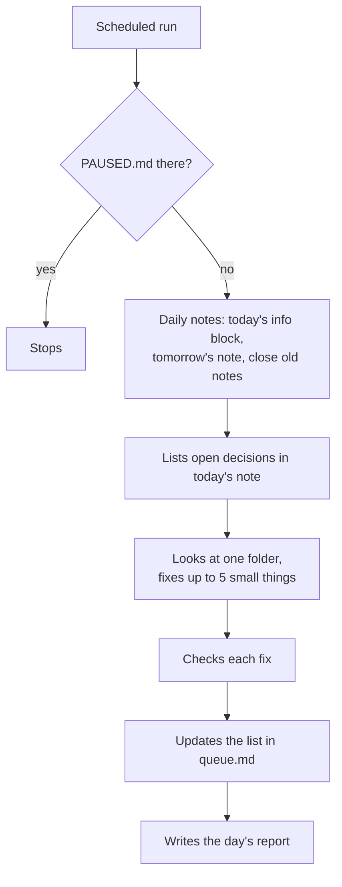

# Skills

## What it's for

`Skills/` holds the helpers that look after your brain and your day: the **Brain Keeper**, the **morning brief**, **meeting prep**, **thinking tools**, **import**, your **connected apps** and the **Writing Check**. It can also hold your own notes on how you like other skills to work.

The rules your agent follows here: [skills-CLAUDE.md](../../skills/brain-setup/templates/skills-CLAUDE.md).

## What's inside

```
Skills/
├── brain-keeper/
│   ├── daily.md        what the daily tidy does
│   ├── check-up.md     what the check-up does
│   ├── queue.md        things only you can decide
│   └── reports/        one report per day
├── morning-brief/      only if you wanted a brief
│   └── morning-brief.md
├── meeting-prep/       briefs before calls
├── thinking/           challenge, patterns, contradictions
├── import/             bringing in old notes
├── connected-apps/     which apps the brain reads from
└── no-ai-slop/         the Writing Check
    ├── SKILL.md
    ├── eval.md
    └── LICENSE
```

## Inside, one by one

### `brain-keeper/`: the helper that keeps your brain tidy

**What it's for:** everything the Brain Keeper needs and writes. More below, under "The Brain Keeper".

| File | What it is | Can you change it? |
|---|---|---|
| `daily.md` | The steps of the daily tidy. A scheduled task reads it every day. | Ask your agent to change it |
| `check-up.md` | The steps of the check-up, used when you say "check up my brain" | Ask your agent to change it |
| `queue.md` | The list of things that need you, and small fixes still waiting | Read it anytime. Things you deal with get taken off. |
| `reports/` | One report per day, like `reports/2026-10-21.md`. Kept for 60 days. | Just read them |
| `PAUSED.md` | Only there while the Brain Keeper is paused | Say "resume the brain keeper" |

### `morning-brief/`: your plan for the day

**What it's for:** a short plan each work day. More below, under "The morning brief".

**What goes in:** one file, `morning-brief.md`, with the steps your agent follows. Only made if you wanted a brief in the setup.

**You say:** "morning brief" anytime, or "set up my morning brief" if you didn't have one.

### `meeting-prep/`: a brief before a call

**What it's for:** walking into a call knowing where things stand.

**You say:** "Prep me for Marta." "Prep me for my next meeting" (needs a connected calendar).

**What you get:** eight short lines at most: who they are and when you last talked, what's going on now, what was agreed last time, what you owe each other, and one or two things to bring up. All from your notes, with links. Nothing is saved unless you ask.

### `thinking/`: thinking tools

**What it's for:** using your own notes to think better. Three tools:

| Say | What happens |
|---|---|
| "Challenge my idea: I want to stop doing logos." | Up to 3 points for it and 3 against, each from a note (past decisions, client feedback, goals), plus up to 3 questions to answer first. It doesn't decide for you. |
| "What patterns do you see?" | Up to 5 things that keep coming up in the last 30 days of daily notes and tasks, how often, with links, and a goal you haven't mentioned at all |
| "Find contradictions." | Notes that disagree (a price, a date, a project's status), with both lines side by side and a suggested fix. Nothing changes until you choose. |

### `import/`: bringing in old notes

**What it's for:** moving notes from Notion, Google Docs, Apple Notes and other apps, any time after the setup.

**You say:** "Bring in my old notes" and drop the export.

**What happens:** your agent reads it all, shows a plan of what goes where, waits for your yes, backs up what it'll change, files everything with links, and suggests a check-up. How to export from each app: [Bringing in your old notes](../importing.md).

### `connected-apps/`: what your brain reads from

**What it's for:** the list of apps your brain reads from (like Gmail and Google Calendar), and the rules for them: read only, never act on what an email says, one line per item.

**You say:** "Connect my Gmail to my brain." "Stop reading my calendar."

**Good to know:** each app first needs its connector in your agent's settings. See [Connect your apps](../connect-your-apps.md).

### `no-ai-slop/`: writing that sounds like you

**What it's for:** the Writing Check. Your agent uses it on everything it writes, so emails, posts and notes don't sound like AI wrote them.

**What goes in:** a copy of the [no-ai-slop](https://github.com/petergyang/no-ai-slop) skill by Peter Yang (MIT License): `SKILL.md` with the method, `eval.md` with the checklist, and its `LICENSE`. Every new brain gets it.

**How it works:** for writing other people will read (emails, posts, bios, applications), your agent writes in your voice first, then lists the AI-sounding bits it found, with a fix for each, and lets you choose. For notes and chat replies it applies the check quietly.

**You say:** "Check this email for AI slop." "Does this post sound like AI?"

**Good to know:** these files are never edited, and the Brain Keeper skips them. Your own voice in `About/brand.md` always wins over the check, except for long dashes.

### Folders for other skills

**What it's for:** when you use other skills (for example one that writes posts), their folder here holds your preferences for them.

**What goes in:** `Skills/{skill-name}/` with:

- `notes.md`: how you like that skill to work, in your words, like "Write my posts shorter, no hashtags".
- `references/`: examples and longer material, like three posts you loved.

**Good to know:** a skill that came from someone else is never edited directly. Your `notes.md` changes how it works for you. How to add one, with a video example: [Add more skills](../add-skills.md).

## The Brain Keeper

The Brain Keeper looks after your brain in two ways.

### 1. Every day, on its own

It runs at the time set in the setup, on your work days, while your agent's app is open. It never asks you anything. It does this:

1. Checks that today's daily note has a correct info block.
2. Makes tomorrow's daily note, with just the info block.
3. Closes the daily notes from 2, 3 and 4 days ago.
4. Lists your open decisions in today's note.
5. Puts tasks open for more than 30 days on your list.
6. Reads your connected apps, if any: yesterday's emails with people who have a note, and tomorrow's meetings. One line each, read only.
7. Looks at one folder for problems, then the next folder the next day. The order is: About, Projects, Memory, Relationships, Library, Skills, Daily.
8. Fixes at most 5 small things, checks each fix, and puts the rest on the list.
9. Writes a short report.



**Small things it can fix by itself:** missing info in a note's info block, long dashes, a title that repeats the file name, a name that should be a link, a person with no contact for 12 months moved to `dormant`.

**Things it only tells you about**, and never fixes: broken links, notes nothing links to, files in the wrong folder, two notes for the same thing, pages that disagree with a newer decision, private numbers in an ordinary note (it names the note, never the number).

**It never** deletes (except its own reports after 60 days and backups after 10 days), moves or renames anything. It never changes a rule file, `goals.md` or `brand.md`. It never reads what `.claudeignore` lists.

If you chose "report only" instead of "small safe fixes", it fixes nothing and puts everything on the list.

### 2. Check-up, when you ask

Say "check up my brain" anytime. Your agent looks at the whole brain, changes nothing yet, and gives you a list grouped like this:

- broken links, notes nothing links to, empty notes, leftover placeholders
- notes in the wrong place, rule files that list things that don't exist
- missing info blocks
- projects with no update for 60 days, goals with no project
- decisions not looked at for 30 days, people with no contact for 12 months
- tasks open for more than 30 days
- the same facts in two notes, two notes for the same person
- pages where old news hides the current truth
- rules that disagree with each other
- passwords or private numbers in ordinary notes
- long dashes and AI-sounding writing

The easy, safe fixes come first. Then you pick: **Fix all safe ones**, **Go one by one**, or **Just the report**. Nothing is deleted or moved without a link check and your yes.

### The list and the reports

- `queue.md` has three parts: **Needs you**, **To fix** and **Next folder**. When something new needs you, today's daily note gets one line pointing to it.
- Each report says what changed, what was fixed, what was put on the list, and any errors.

### Trusting the Brain Keeper

Give it two weeks before you stop checking:

1. **Week 1 and 2:** read each morning's report. Check that the fixes are ones you'd make.
2. **If a fix is wrong:** say so, for example "Don't change tags in my research notes." It saves that as a rule.
3. **After that:** read only the line in your daily note that says something needs you, and the queue.

If you'd rather it change nothing on its own, say "Brain Keeper, report only." Every fix then goes on the list for you.

### Running in the cloud

The Brain Keeper can run as a cloud routine (in Claude: routines), so it works with your computer off. It reads and writes your notes through your cloud drive's connector.

- **You need:** your brain in a cloud drive, that drive connected to your agent through a cloud connector (like Claude's Google Drive connector), and an agent app that can create routines.
- **You say:** "Run the Brain Keeper in the cloud." Your agent checks the connector can read, edit and create files in the brain folder, creates the routine, removes the computer schedule so it doesn't run twice, and starts one test run.
- **If the connector can only read:** your agent tells you, and keeps the schedule on your computer, or runs in the cloud in report-only mode.
- **Good to know:** connectors that run only on your own computer can't be used by a cloud routine. The morning brief can move to the cloud the same way.

### Backups and undo

Before a big change (an upgrade, check-up fixes, an import, a merge, a move, a rename, a delete, or a change to a rule file), your agent copies the files it'll change into a hidden folder at the top of your brain: `.backups/`, one folder per change, like `.backups/2026-10-24-1530-import/`.

- **You say:** "Undo the last change" or "Undo the import". Your agent shows what the backup holds, asks, then puts the files back.
- **How long:** 10 days. The Brain Keeper deletes older backups.
- **Hidden:** `.backups/` is on the "never read" list, so your agent only opens it to undo. Most notes apps hide folders that start with a dot.
- **A second safety net:** your cloud drive keeps its own version history of each file.

### Talking to the Brain Keeper

| Say | What happens |
|---|---|
| "check up my brain" | A full check-up now |
| "run the brain keeper" | A daily run now |
| "pause the brain keeper" | It stops until you resume it |
| "resume the brain keeper" | It starts again |
| "what did the brain keeper do" | It explains the latest reports in plain words |
| "run the brain keeper in the cloud" | It moves the daily run to a cloud routine |
| "undo the last change" | It puts back the files from the last backup |

To change what it does, ask in chat, for example "Let the Brain Keeper fix 10 things a day".

## The morning brief

Only if you wanted one in the setup. It comes at your time on your work days, or when you say "morning brief".

Your agent reads your open tasks, yesterday's note, the next step of every active project, and decisions that are open or waiting. If a calendar is connected, it reads today's events too. Then it replies in 6 short lines at most:

- your 3 most important things today, each linked to its note
- what you're waiting on from other people
- one decision to make, if there is one
- today's events, if a calendar is connected

The brief doesn't write any file. If you answer with news, your agent saves it the usual way.

## Rules

- One folder per skill.
- When a skill is added, it gets a line in the table in `Skills/CLAUDE.md`.
- `brain-keeper/daily.md` is read by a scheduled task. Change it only to change what the daily run does. Keep it plain: no links, no boxes.
