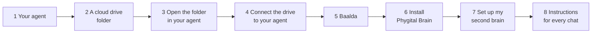

# Getting started

About 20 minutes the first time: 10 to get the apps ready, 10 for the setup forms.



## What you need

- **An AI agent that can work in a folder on your computer:** read, edit and create files there. We recommend the Claude desktop app with a paid plan. The setup was built and tested there, and it's the only one that shows the setup as form windows. Claude Code, Codex, Hermes Agent, OpenClaw and other agents work too: see [Other agents](other-agents.md).
- **A cloud drive** that keeps a copy of the folder on your computer and that your agent can connect to, so you can reach the brain from your phone. For example Google Drive, Nextcloud, Dropbox or OneDrive.
- **A computer** (Mac or Windows), with a little free space. A brain is small: plain text files, plus any pictures you add.

You don't need to know any code.

The cloud drive and Baalda are part of the setup. The cloud drive matters most: it's how you use your brain from your phone. If you don't want one of them, say so and the setup goes on without it.

Your agent reads your notes, and your drive stores them. It's worth a look at your AI's privacy settings: see [What you share with your AI](../SECURITY.md#what-you-share-with-your-ai).

The steps below use **Claude and Google Drive** as the example, because that's the pair we tested most. With other apps the steps are the same idea; the menus have other names.

## 1. Your agent

With Claude:

1. Download the Claude desktop app from claude.ai/download.
2. Sign in and pick a paid plan.

**Why a desktop app:** the setup reads and writes files in a folder and sets up scheduled tasks. A chat-only app in a browser can't do that.

## 2. A cloud drive folder

Your brain lives in a cloud drive, so it's backed up and you can reach it from anywhere.

**Pick a drive your agent can connect to.** Your agent needs to read, edit and create files in it, both on your computer and from its phone or web app. Check your agent's list of connectors or integrations before you choose.

| Drive | On your computer | Connecting your agent |
|---|---|---|
| Google Drive | Google Drive for desktop | Claude has a built-in Google Drive connector |
| Nextcloud | The Nextcloud desktop app | Usually through an MCP server (a small add-on that lets an agent use another app) |
| Dropbox, OneDrive and others | Their desktop apps | Check whether your agent has a connector or MCP server for it |

With Google Drive:

1. Install **Google Drive for desktop** and sign in.
2. Open your Google Drive folder on your computer and make a new folder for your brain, for example `My Brain`.
3. Make sure that folder is kept **on your computer**, not only in the cloud. In Google Drive's settings, either choose to mirror your files, or right-click the `My Brain` folder and make it available offline.

> [!WARNING]
> **Why step 3 matters:** if the files only live in the cloud, your agent may not be able to open them quickly, or at all, while you're offline. Most drives have this setting. Look for "mirror", "available offline" or "always keep on this device".

**Why the folder goes in the drive first:** then you never have to move it later. Moving a brain after it's built can break things.

**Folder name tips:** short and simple. Letters, numbers, spaces and hyphens are fine.

## 3. Open the folder in your agent

In the Claude app, start a new task and choose the `My Brain` folder. Your agent can now read and write in it.

**Check it worked:** ask "What folder are you in?" Your agent should name `My Brain`.

You'll pick this same folder every time you want to work with your brain.

## 4. Connect the drive to your agent

In Claude's settings, under connectors, connect **Google Drive**. With another drive, add its connector or MCP server.

**Why:** then you can reach your brain from your agent's website and phone app too, away from your computer. See [Your brain on your phone](phone.md).

The cloud part is done.

## 5. Baalda

Download [Baalda](https://github.com/naveedharri/baalda) and open the same `My Brain` folder. This is where you read and browse your notes: click a `[[link]]` to jump to that note.

You don't have to use Baalda to use your brain. Your agent does the writing, and Baalda is for looking around on your computer. You don't need it on your phone.

## 6. Install Phygital Brain

In Claude Code:

```
/plugin marketplace add Phygital-Brain/phygital-brain
/plugin install phygital-brain@phygital-brain
```

In the Claude desktop app, add `Phygital-Brain/phygital-brain` as a plugin from GitHub in the plugin settings.

With another agent, there's nothing to install: see [Other agents](other-agents.md).

**Check it worked:** in a chat, ask "Do you have the Phygital Brain setup?" Your agent should say yes.

## 7. Build your brain

In a chat on your `My Brain` folder, say:

> Set up my second brain.

Then this happens:

1. **Checks.** Your agent checks that your folder is in a cloud drive, that the drive is connected, and that you have Baalda. If something is missing, it helps you, or goes on without it if you say so.
2. **Language.** Your agent asks which language your brain should speak. Everything after this is in that language.
3. **Form 1: About you.** Your name, what you do, your strengths, how you like to work, and more.
4. **Form 2: Your work.** It starts with 3 questions your agent writes for your own kind of work. Then your customers or interests, your goal, your projects and what's worrying you.
5. **Form 3: Your days and people.** Work days, morning brief time, the people who matter, your social media, your tools.
6. **Form 4: Files.** Drop your CV, a bio, a price list or old notes. Or skip it.
7. **Build.** Your agent makes the folders, the rule files, your first notes and the Brain Keeper. This takes a few minutes. You don't need to do anything.
8. **Finish.** One short message: what was built, how to open it, how to use it every day and on your phone, and a short text for your settings (see "Instructions for every chat" below).

**Tips for the forms:**

- Mostly clicks. Short answers are fine.
- Every choice has an "Other" box to write your own answer.
- You can skip any question. You can add things later by telling your agent.
- Press Continue and the next form opens. The last one says "Build my brain".
- If your app can't show form windows, your agent asks the same questions in chat instead.

## 8. Instructions for every chat

Your brain's rules work inside your brain folder. To make your agent talk the same way in **every** chat, paste a short text into its settings:

- **Claude:** Settings, the personal instructions box. On the desktop app you can also save instructions on this computer.
- **Other agents:** their custom instructions.

At the end of the setup, your agent writes this text for you from your answers. It looks like this:

```
Use simple, plain words and no jargon. Keep replies short, no walls of text. Use short lists and examples. Work step by step and check each step before moving on. Do only what I asked.
```

Keep it short, and don't put private details in it. Your brain's rules still win inside your brain folder.

## Your first chat

Open a new chat on your brain folder and try these four. They test that your agent can find and use what the setup built.

| Say | A good answer |
|---|---|
| "Who am I?" | Your name, what you do and how you like to work, from `About/me.md` |
| "What am I working on?" | Your projects from the setup, with their next steps |
| "Add a task: call the printer on Thursday." | It adds the task and tells you where |
| "Write a short bio for my website." | It sounds like you, and uses facts from your About pages |

If an answer is vague or wrong, tell your agent what's missing: "I also make book covers." It saves the fact in the right page.

**Day-one checklist:**

- [ ] The seven folders exist: `About`, `Daily`, `Projects`, `Relationships`, `Memory`, `Library`, `Skills`
- [ ] `CLAUDE.md` is at the top of the folder
- [ ] `About/me.md` has your real details, not blanks
- [ ] Today's daily note exists in `Daily/`
- [ ] The Brain Keeper is scheduled (ask: "When does the Brain Keeper run?")
- [ ] Your agent answered "Who am I?" correctly

## On your phone

Once the brain is in a cloud drive and the drive is connected to your agent, you can ask your brain things from your agent's phone app, and with Claude you can send tasks to your computer with Dispatch. Everything is in [Your brain on your phone](phone.md).

## Your first week

- **Start small.** A brain with a few real notes beats one full of old imports. Bring in only the old notes you used in the last six months: see [Bringing in your old notes](importing.md).
- **Talk to it every day,** even small things: "Had a call with Marta", "Sent the invoice". The more it knows, the more it helps.
- **Drop things in:** an email you got, a brief, a photo of notes. Ask "Where should this go?"
- **Correct it** when it gets something wrong: "Don't do that, do this." It saves your correction as a rule.
- **Look in Baalda** once or twice, to see how your notes link up.
- **Tell it to save what matters:** "Save this as a decision", "Remember this about Marta". It saves a lot on its own, but a decision or a lesson you name is never missed.
- **Read the Brain Keeper's reports** for the first two weeks, in `Skills/brain-keeper/reports/`. Once its fixes look right, read only the line in your daily note when something needs you.

## Keeping it up to date

When there's a new version of Phygital Brain:

1. Update the plugin. In Claude Code: `/plugin marketplace update phygital-brain`. With another agent, download the new version of the repository.
2. In a chat on your brain folder, say **"Upgrade my second brain."**

Your agent shows what's new, asks first, and keeps your notes and your own rules as they are.

To change your setup answers later, say **"Update my answers."** The forms open again, and your About pages are refreshed.

## If something goes wrong

| What you see | What to do |
|---|---|
| The form window doesn't open | Nothing. Your agent asks the same questions in chat. |
| "I can't write to this folder" | Pick the `My Brain` folder again when you start the task, and check that your drive's app is running. |
| A link looks broken right after a sync | Wait a few minutes. The note is usually still on its way from your drive. Your agent never "fixes" it with a blank note. |
| Two copies of a note, one ending in `(1)` or "conflicted copy" | Your drive made a copy because the note changed in two places at once. Ask your agent: "Merge these two notes." |
| The Brain Keeper didn't run | Scheduled tasks only run while your agent's app is open and your computer is awake. Say "run the brain keeper" to run it now. |
| No morning brief | Same as above. Or say "morning brief" anytime. |
| Your agent forgot something | Check it's working in your `My Brain` folder. It only knows your brain there. |

## Questions

See the [FAQ](faq.md).

## Leaving

Your brain is plain text files in your own cloud drive. If you ever stop using Phygital Brain, the notes stay yours, and any notes app that reads Markdown can open them.
