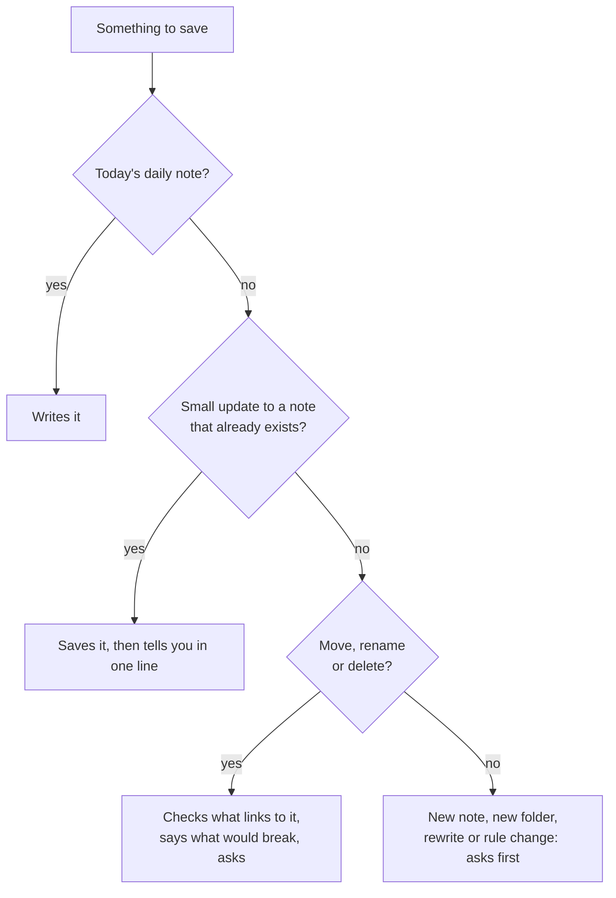

# How it works

## The big idea

Your brain is a folder of notes. Some of those notes are **rules**: files called `CLAUDE.md` that tell your agent where everything goes and how to work with you. Every time you open a chat on your brain folder, your agent reads those rules. So it doesn't start from zero each time. It already knows you, your projects and your people.

You talk. Your agent writes, files and links. You read it all in Baalda whenever you like.

## The folders

Each folder has its own page, with what's inside, how to use it, examples and rules. Start at [The folders in your brain](folders/README.md).

| Folder | What lives there |
|---|---|
| `About/` | The core facts: you, your goals, your business, customers, voice, tools |
| `Daily/` | One note per day, and `tasks.md` for open tasks |
| `Projects/` | One folder per project, with a `README.md` as its front page |
| `Relationships/` | One note per person or company, in subfolders by type |
| `Memory/` | Decisions with the why, research, money (private), applications, the archive |
| `Library/` | Reusable things: prompts, templates, frameworks |
| `Skills/` | The Brain Keeper and the morning brief |

Each folder has a `CLAUDE.md` with its rules: what goes where, and how each note starts. The root `CLAUDE.md` holds the main rules, including your own. See [Main rules](folders/main-rules.md).

## What happens when you open a chat

1. Your agent quietly reads the newest daily note, `About/me.md` and your open tasks.
2. It answers you the way you chose in the setup, in your language.
3. It never says "loading" or lists what it read.

## What happens when you tell it something

Say "I had a call with Marta, we moved the cover deadline to the 15th." Your agent:

1. **Finds the home** for each piece using the rules: the date goes to the project, the call goes to today's daily note, and Marta's last contact gets updated.
2. **Checks what's already there,** so it updates the right note and never makes a second note for the same person.
3. **Saves or asks** (see the table below).
4. **Links things** with `[[double brackets]]`, so the project, the person and the day point to each other.
5. **Logs one short line** in today's daily note.
6. **Tells you in one line** what it saved and where.

## When it saves and when it asks



| Kind of change | What your agent does |
|---|---|
| A line in today's daily note | Writes it |
| A small update to a note that already exists (a date, a fact, a status) | Saves it, then tells you in one line |
| A new note or a new folder | Asks first |
| Rewriting or reorganising a note | Asks first |
| Moving, renaming or deleting anything | Checks what links to it, tells you what would break, then asks |
| Changing a rule file | Asks first. The one exception is saving your correction as a new rule. |

## How notes are built

**Info block.** Every note starts with a few lines between `---` marks:

```
---
type: project
status: active
tags: [project, children-books]
---
```

They help your agent sort and find notes. These words stay in English in every language, so the rules keep working.

**Links.** `[[Marta]]` is a link to Marta's note. Your agent puts links inside sentences, not in lists at the end.

**Truth at the top.** Pages about you and your people keep the current facts at the top, and a dated history below, newest first. When something changes, the top is rewritten and one line is added below. So the top is always right, and nothing is lost.

**One idea per note.** Each note makes sense on its own, like a building block, and links to the others.

## The four forms

1. **About you:** name and what you do, strengths, values and work you say no to, how you take things in, when you focus, how your agent should talk to you, city, a link.
2. **Your work:** three questions written for your own job, then customers (or the areas that matter, if you don't sell), what slows you down, your goal, current projects and what's worrying you.
3. **Your days and people:** work days, morning brief time, key people, who you work with, social media, where you talk to people, where your notes live, your writing voice.
4. **Files:** CV, bio, price list, portfolio, old notes, and anything else.

Every choice has an "Other" box. You can skip anything. Where the form window can't open, your agent asks the same questions in chat.

Your answers decide what gets built. People who don't sell anything get no business pages and no client folder. People who don't want a morning brief don't get one.

## Every day

Open a chat on your brain folder and talk normally:

- "I had a call with Marta, we agreed on the cover by Friday."
- "New project: a children's book about the sea."
- "Write a reply to this email."
- "What's on my plate this week?"
- "Why did I decide to raise my prices?"

## On your phone

Ask your brain things from the Claude phone app, with Google Drive connected, and send tasks to your computer with Dispatch. See [Your brain on your phone](phone.md).

## Keeping it healthy

- **Brain Keeper, every day:** runs by itself at your time. It makes tomorrow's daily note, closes old ones, lists open decisions, fixes up to 5 small things and writes a report. Things only you can decide go on a list in `Skills/brain-keeper/queue.md`, and a line in your daily note points to it.
- **Check-up:** the Brain Keeper's other mode. Say "check up my brain" anytime for a full list of problems and suggested fixes. Nothing changes until you say yes.
- **Morning brief:** if you chose one, it comes at your time on work days: your 3 most important things, what you're waiting on, and one decision to make. Say "morning brief" anytime.

More in [Skills](folders/skills.md).

## Your own rules

When you correct your agent ("don't use bullet points", "always ask before emailing clients"), it adds your words as a new rule at the bottom of the main rule file, under your name. It doesn't ask. Upgrades never change your rules.

You can also add a rule on purpose: "Add a rule: never book calls on Fridays."

## Changing things

| You want to... | Say |
|---|---|
| Redo the setup questions | "Update my answers." |
| Change how your agent talks | "From now on, give me longer answers." |
| Add a folder for something new | "I want a place for my students." Your agent suggests where and asks first. |
| Change when the Brain Keeper runs | "Run the Brain Keeper at 7 instead." |
| Stop the Brain Keeper for a while | "Pause the brain keeper." |
| Add or change the morning brief | "Set up my morning brief." |
| Move to a newer version | "Upgrade my second brain." |

## Language

Your brain speaks the language you chose. Notes, messages and the forms are in that language. Folder names, file names, links to files and the info block words stay in English, so the rules keep working the same everywhere. More in [Languages](../languages/README.md).

## Privacy

- `.claudeignore` lists what your agent never reads unless you ask for that exact file: password and key files, and `Memory/finances/`. You can add your own private folders.
- Private details (tax IDs, bank details, card numbers, full legal name, date of birth) live only in the one note that needs them, and are never repeated in replies.
- Passwords, keys and tokens never go in a note. Use a password manager.
- Your notes live in your own Google Drive. Your agent reads them when you open a chat on the folder.

## What your agent never does

- Deletes, moves or renames without asking.
- Makes a blank note to "fix" a broken link.
- Makes files at the very top of your brain.
- Copies private details into other notes.
- Promises a client a price before it understands the job.
- Does extra things you didn't ask for. It suggests them and waits.
