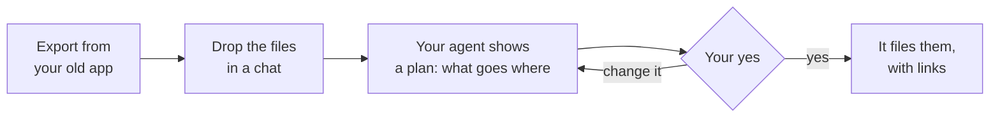

# Bringing in your old notes

You can bring notes from other apps into your brain, at the setup (form 4) or any time later. Your agent reads them, files each piece in the right folder, and asks before it makes each new note.

## Before you start

- **Start small.** Bring what you used in the last six months, and leave the rest. Old notes you never open make the brain harder to search.
- **You don't need to clean anything first.** Your agent sorts and tidies as it files.
- **Keep the originals** in the old app until you've checked the result.
- **Leave out private things** you don't want your AI to read, like passwords or health records.

## How to export from common apps

These are the usual menus. They can change, so check the app's help pages if you don't see them.

| App | How to export | What to drop in |
|---|---|---|
| Notion | Settings, then Export content, then choose Markdown | The unzipped folder. Databases come out as tables, and some embeds break. |
| Google Docs | File, then Download, then Markdown (or plain text) | The downloaded files, one per document |
| Apple Notes | Copy and paste the notes into a chat, or export them as PDF | The text, or the PDFs |
| Evernote | Export notes as ENEX or HTML | The exported files |
| OneNote | Copy section by section, or use a converter to Markdown | The text, or the converted files |
| Obsidian or another Markdown app | They're already Markdown | The folder of notes |
| Word documents | Save as plain text, or drop the `.docx` in as it is | The files |

## Then, in a chat on your brain

Say:

> Here are my old notes from Notion. Bring them in.

Your agent:

1. Reads everything you dropped in.
2. Shows you a plan: which notes become projects, people, decisions, research or library items, and which it would leave out.
3. Waits for your yes, or your changes to the plan.
4. Files each piece, links people and projects, and checks it never makes a second note for someone who already has one.
5. Logs one line in today's daily note.

For a big export, ask it to go in parts: "Start with my client notes."

## After importing

- Say **"check up my brain"**. The check-up finds duplicates, missing info and notes that nothing links to.
- Look through the new notes in Baalda.
- When you're happy, you can stop using the old app.
