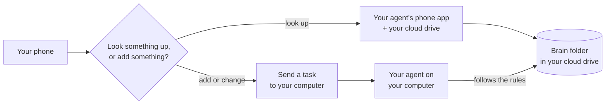

# Your brain on your phone

Your brain lives in a cloud drive, so you can reach it from your phone. That's where a second brain helps most: on the bus, before a meeting, right after a call.

There are two ways, and they do different things:

| Way | What it's good for | Your computer |
|---|---|---|
| **1. Ask:** your agent's phone app, with your cloud drive connected | Finding and reading what's in your brain | Can be off |
| **2. Do:** sending a task to your agent on your computer (in Claude, this is Dispatch) | Adding things, filing, updating notes, the Brain Keeper | Must be on, with your agent's app open |

You can use both: **Ask** to look things up, **Do** to add things.

No computer at all? See [Phone only](phone-only.md): your agent builds the brain straight into your Google Drive from your phone.

The examples below use **Claude** and **Google Drive**, the pair we tested most. Other agents and drives work the same way if your agent's phone app can connect to your drive (through a connector or an MCP server, a small add-on that lets an agent use another app).

## Before you start

You need:

- Your brain folder **inside a cloud drive** ([Getting started](getting-started.md), step 2).
- **The drive connected to your agent** ([Getting started](getting-started.md), step 4).
- Your **agent's phone app**, signed in to the same account. For Claude, that's the Claude app from the App Store or Google Play.

Read [What you share with your AI](../SECURITY.md#what-you-share-with-your-ai) first. On your phone, the same rules apply.

## 1. Ask: look things up

Open your agent's phone app and start a chat. Make sure your drive is turned on for that chat. In the Claude app, it's in the chat's tools or connectors menu.

Then ask about your brain. Say which folder, so it looks in the right place:

- "In my My Brain folder on Google Drive, what's the next step on the picture book?"
- "In my brain, what did Marta and I agree last week?"
- "In my brain, what are my open tasks?"
- "Read my About/me.md and remind me how I price a cover."
- "Find the note about the print shops in my brain."

**Good to know:**

- This way is best for **reading**. Some connectors can also edit or create files, but a phone chat doesn't load the brain's rules by itself, so it may file things in the wrong place. To add or change things, use **Do** below.
- If an answer feels off, say: "First read CLAUDE.md in my brain folder."
- Your computer can be off. Your agent reads straight from the drive.

## 2. Do: send a task to your computer

Some agents let you send a task from your phone to the agent's app on your computer. Your computer does the work in your brain folder, with all the rules, then tells you on your phone when it's done. In Claude this is **Dispatch**.

**Set it up once (Claude):**

1. On your computer, open the Claude desktop app and find **Dispatch**.
2. Pair your phone by scanning the QR code with the Claude phone app.
3. Make sure your brain folder is one of the folders Claude can use.

Dispatch is new, and which plans have it can change. If you don't see it, check Claude's help pages. Other agents may have their own way to do this, or none yet.

**Then, from your phone, say things like:**

- "In my brain: I had a call with Marta, we moved the cover deadline to the 15th."
- "In my brain: new task, call the printer on Thursday."
- "In my brain: save this as a lead. A bakery in Lisbon wants a logo, found me on Instagram."
- "In my brain: give me my morning brief."
- "In my brain: run the brain keeper."

**Good to know:**

- Your computer must be **awake**, with your **agent's app open**. If it's asleep, the task waits or fails.
- Start each task with "In my brain:" so it works in the right folder.
- Your agent still asks before it makes a new note, moves or deletes anything. You answer on your phone.

## Quick capture when you can't use either

No signal, or the computer is off? Write it down anywhere (your phone's notes app, a voice memo), then later, at your computer, paste it in: "Here's what happened today, file it."

## Reading your notes without asking

- **Your drive's phone app** (Google Drive, Nextcloud, Dropbox...): open your brain folder and tap a note. Notes are plain text files, so they open as text. Links won't be clickable.
- **Phygital Memory:** you don't need it on your phone. It's for browsing on your computer.

## Safety on your phone

- Lock your phone with a code or your face. Anyone holding your unlocked phone can ask your brain anything.
- Your `Memory/finances/` folder is still off limits unless you ask for an exact file.
- If you lose your phone, sign out of your agent and your drive from another device.

## If something goes wrong

| What you see | What to do |
|---|---|
| "I can't find that" in the phone app | Say the folder name: "In my My Brain folder on Google Drive...". Check your drive is turned on for the chat. |
| The phone app gives a vague answer | Say: "First read CLAUDE.md and About/me.md in my brain folder." |
| A task sent to your computer never finishes | Wake your computer and open your agent's app. |
| A note you added on the phone isn't in the brain | Send a task to your computer for adding things. The phone app is best for reading. |
| A note shows up twice, one ending in `(1)` or "conflicted copy" | It was changed in two places at once. At your computer, say "Merge these two notes." |
