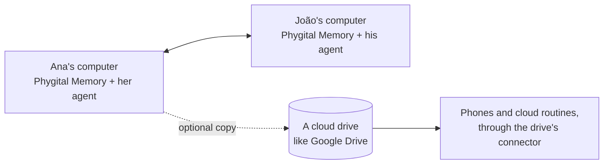

# Phygital Memory

[Phygital Memory](https://github.com/Phygital-Brain/Phygital-Memory) is the notes app for your brain. It's free and open source, for Mac, Windows and Linux. Your agent does the writing; Phygital Memory is where you read, browse and share what it wrote.

## What you get

- **Your notes as linked pages.** Click a `[[link]]` to jump to that note: from a project to the client to the day you talked. Pictures linked in a note show inside it.
- **Search in milliseconds**, across the whole brain, with [Phygital Engram](search-with-phygital-engram.md) built in.
- **Version history** for every note, and a trash that keeps things for 7 days.
- **Encrypted, if you want.** Lock the brain with a password. Without it, or its recovery key, the files can't be read.
- **Your agent at a door you control.** Each AI app gets its own key, starts read only, and sees only the memories you pick. Every change it makes can be undone.

The notes stay plain Markdown files. Stop using the app and they're still yours, readable by anything.

## Open your brain in it

1. Download it from the [Phygital Memory releases](https://github.com/Phygital-Brain/Phygital-Memory/releases/latest).
2. Click the memory name at the top of the sidebar, then **Add memory › From this computer**, and choose your `My Brain` folder.

New to both? Phygital Memory can also build a brain for you: press **New memory**, and it makes the folders, rules and first notes, then leaves one task for your agent to finish the rest.

## Share with a team

Phygital Brain starts as one person's brain. A team can share one through Phygital Memory, straight from computer to computer, with no account and no cloud of ours.

### Where the files live

- **Each person's computer.** Everyone has a full copy of the brain. Each person's agent works in that copy, like a one-person brain.
- **Kept in step by Phygital Memory.** Changes go straight between computers, through Syncthing. Both computers must be online with the app open at the same time; changes wait until they are.
- **A cloud drive too, if you want.** The same brain can also live in a cloud drive, like Google Drive. That's what lets agents reach it from a phone, and lets a cloud routine run the Brain Keeper with every computer off.

> [!WARNING]
> Two sync services on the same folder can step on each other: when both copy the same change, you may get duplicate notes ending in `(1)` or "conflicted copy". Pick one as the main one for edits (Phygital Memory, for a team), and test the second one with a few notes before the whole team uses it.

### Set it up

1. **One person builds the brain** with the normal setup, as the owner, and opens it in Phygital Memory.
2. **Share it** from Phygital Memory: the whole brain, one folder or one file, with **Can edit** or **Can view**.
3. **Each teammate** installs Phygital Memory and accepts the share. The brain appears on their computer.
4. **Tell your agent:** "Set up my team." It adds a Team section to the main rules, with each person's name, role, their own daily notes folder and what they can change, and a note for each person in `Relationships/Team/`.
5. **Each teammate** opens a chat on the shared folder in their own agent. The first time, their agent asks who it's working with.
6. **Optional:** add the cloud drive copy and its connector, for phones and cloud routines. See [Connect your apps](connect-your-apps.md).

### How the brain works for a team

| Part | For a team |
|---|---|
| About, Projects, Relationships, Memory, Library | Shared. One place for each fact. |
| Daily notes | One folder per person, like `Daily/joao/`, so logs don't mix |
| Decisions | Each decision note names who decided |
| Rule files and About pages | Only the owner changes them, or someone the owner names |
| The Brain Keeper | One run for the whole brain. Let only one person's agent (or one cloud routine) run it, so it doesn't run twice. |
| Your own rules | Saved in the Team section for everyone, or under the person's name for just them |

### Permissions

Who gets which folders, and whether they can change them, is set when you share in Phygital Memory (**Can edit** or **Can view**), not in the brain's rules. The rules tell each agent what to ask the owner about first, but they can't stop a person from opening a file they have.

`.claudeignore` still keeps folders like `Memory/finances/` closed to every agent, unless someone asks for an exact file.

### Getting a team to use it

- Use it alone for two or three weeks first, so the folders and rules fit how you work.
- Add the most curious teammate next. They'll find what's unclear and help explain it to the others.
- Add the rest one at a time, when they ask how you found something so fast.

### Limits

- It works best for small teams. Large teams with many people writing at once haven't been tested.
- There are no per-section permissions inside a note: a person sees a whole note or none of it.
- Each teammate needs their own AI agent and Phygital Memory on their computer.
- Shared changes move only while both computers are on with the app open.
