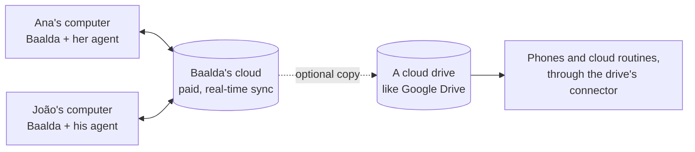

# Teams

Phygital Brain starts as one person's brain. A team can share one, with [Baalda](https://github.com/naveedharri/baalda) keeping everyone's copy in sync.

## Where the files live

- **Baalda's cloud (paid).** For a team, the brain lives in Baalda's managed cloud. It syncs every person's copy in real time, so an edit on one computer shows up on the others in seconds. Check Baalda's site for its current plans and prices.
- **Each person's computer.** Baalda keeps a copy of the folder on every computer. Each person's agent works in that local copy, like a one-person brain.
- **A cloud drive too, if you want.** The same brain can also live in a cloud drive, like Google Drive. That's what lets agents reach it from a phone, and lets a cloud routine run the Brain Keeper with every computer off.

> [!WARNING]
> Two sync services on the same folder can step on each other: when both copy the same change, you may get duplicate notes ending in `(1)` or "conflicted copy". Pick one service as the main one for edits (Baalda, for a team), and test the second one with a few notes before the whole team uses it.

## Set it up

1. **One person builds the brain** with the normal setup, as the owner.
2. **Move it into Baalda's cloud.** Follow Baalda's own steps for sharing a folder with a team.
3. **Invite the team** in Baalda. Each person opens the shared folder on their computer.
4. **Tell your agent:** "Set up my team." It adds a Team section to the main rules, with each person's name, role, their own daily notes folder and what they can change, and a note for each person in `Relationships/Team/`.
5. **Each teammate** opens a chat on the shared folder in their own agent. The first time, their agent asks who it's working with.
6. **Optional:** add the cloud drive copy and its connector, for phones and cloud routines. See [Connect your apps](connect-your-apps.md).

## How the brain works for a team

| Part | For a team |
|---|---|
| About, Projects, Relationships, Memory, Library | Shared. One place for each fact. |
| Daily notes | One folder per person, like `Daily/joao/`, so logs don't mix |
| Decisions | Each decision note names who decided |
| Rule files and About pages | Only the owner changes them, or someone the owner names |
| The Brain Keeper | One run for the whole brain. Let only one person's agent (or one cloud routine) run it, so it doesn't run twice. |
| Your own rules | Saved in the Team section for everyone, or under the person's name for just them |

## Permissions

Who can see and change which folders is set in Baalda, not in the brain's rules. The rules tell each agent what to ask the owner about first, but they can't stop a person from opening a file. Check Baalda's docs for what its permissions cover.

`.claudeignore` still keeps folders like `Memory/finances/` closed to every agent, unless someone asks for an exact file.

## Getting a team to use it

- Use it alone for two or three weeks first, so the folders and rules fit how you work.
- Add the most curious teammate next. They'll find what's unclear and help explain it to the others.
- Add the rest one at a time, when they ask how you found something so fast.

## Limits

- It works best for small teams. Large teams with many people writing at once haven't been tested.
- There are no per-section permissions inside a note: a person sees a whole note or none of it.
- Each teammate needs their own AI agent and their own Baalda account.
