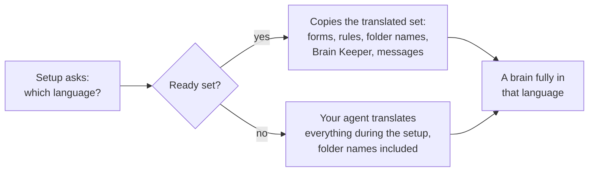

# Languages

Phygital Brain is written in English and ready in 20 more languages: Chinese (Simplified), Chinese (Traditional), Hindi, Spanish, Arabic, French, Bengali, Portuguese (Brazil), Portuguese (Portugal), Russian, Urdu, Indonesian, German, Japanese, Vietnamese, Turkish, Korean, Italian, Polish and Dutch.

## How a brain gets its language

A ready language is translated **once**, here in the repository. The setup copies it into the brain, and from then on the brain's own files are in that language: its rules, its folder and note names, the Brain Keeper's steps, the headings it writes and the phrases you say to it. Your agent never looks up a translation while it works.

Any other language is translated by your agent during the setup, with the same rules ([translating.md](../skills/brain-setup/translating.md)): the forms, the rules, the folder and note names and the Brain Keeper. It doesn't ask anything about the translation. The result works the same as a ready language, but nobody has checked it yet. To make a checked set to share, use the `add-language` skill below.

What stays English in every language: the file names `CLAUDE.md`, `README.md` and `.claudeignore`, the hidden `.backups/` folder, `Skills/no-ai-slop/`, and the info block words at the top of each note (`status: active`). Those work like switches, so every agent and the Brain Keeper read them the same way.

At the end of the main rules, every brain that isn't in English has a short **Folder map**: each English folder name next to the brain's name. Only upgrades and Phygital Brain's own skills use it, to know that `Sobre/` is what the templates call `About/`.

## What's in this folder

| File | What |
|---|---|
| `en.json` | The English source: folder and note names, feature names, setup messages, every form text |
| `{code}.json` | The same keys, translated, for one language |
| `{code}/templates/`, `{code}/keeper/` | The setup's and the Brain Keeper's templates, translated, with paths left in English |
| `{code}/GLOSSARY.md` | The words chosen for that language, and why |
| `TRANSLATING.md` | The rules for translators and reviewers |

`scripts/i18n.py build` turns each language into the set the setup copies, in `skills/brain-setup/i18n/{code}/`, and swaps every English path for the language's names so they match in every file. `scripts/i18n.py check` checks nothing is missing or broken.

## Add your language

Open a chat on a copy of this repository and say:

> Translate Phygital Brain into my language.

The `add-language` skill:

1. Asks three things: formal or informal "you", the 7 main folder names, and the names for the Brain Keeper and the morning brief.
2. Translates everything: the forms, the messages, the rule files and the Brain Keeper.
3. Builds and checks it.
4. Reads it again as a native speaker would, and translates parts back into English to catch changes in meaning.
5. Shows you how to use it right away, and how to share it with everyone in a pull request.

To do it by hand, follow [TRANSLATING.md](TRANSLATING.md).

## Switch a brain's language

Say **"Switch my brain to Spanish"** (or any ready language). Your agent shows the list of folders and notes it'll rename, backs up everything first, renames, swaps the rule files and keeps every rule and note you wrote. Notes you wrote stay in the language you wrote them in. "Undo the last change" takes it back within 10 days.

## Status of each language

| Status | Meaning |
|---|---|
| `source` | English, the original |
| `translated` | Translated, not reviewed yet |
| `reviewed-by-ai` | A second, separate AI reviewed it as a native speaker would |
| `reviewed` | A native speaker read it and approved it |
